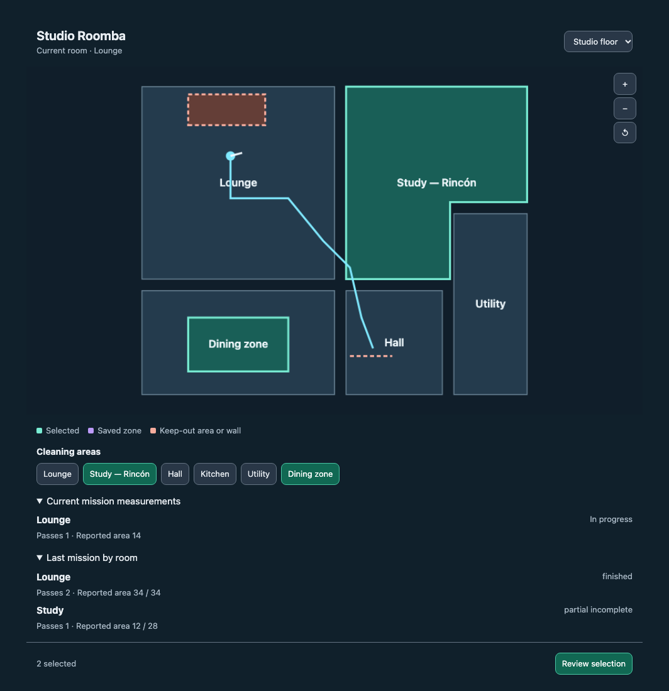
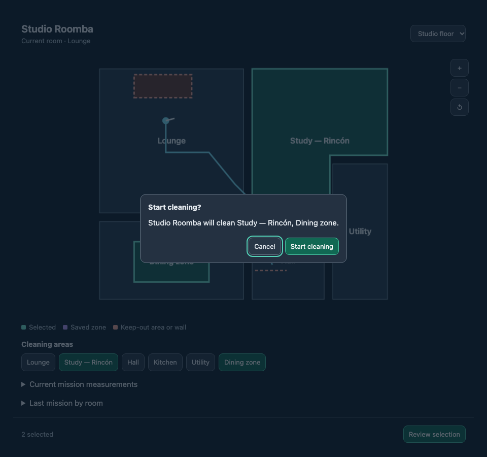

# Roomba Home for Home Assistant


Control modern Roomba robots managed by the **Roomba Home** app. Follow
cleaning missions, pick rooms or saved zones from an interactive floor plan,
and use robot and dock readings in Home Assistant automations. The integration
uses Roomba's own cloud services for device data and control.

## Features

- **Robot and dock controls.** Start, pause, resume, cancel, or return to the
  dock. Select vacuuming, mopping, simultaneous cleaning, or sequential
  vacuuming and mopping where available. Supported models expose suction,
  mop wetness, SmartScrub, passes, carpet boost, and manual dock actions.
- **Room and zone cleaning.** Select regions and review the robot and
  destinations before sending a command. The map supports zoom and shows
  keep-out areas, virtual walls, and the observed route. The integration
  also exposes actions for selecting regions, estimating planned duration,
  and vacuuming a verified point within a room.
- **Mission progress and history.** See the reported phase, mode, surface,
  elapsed time, connectivity timestamp, and recent position. The last
  mission includes outcomes, area values, and pass counts per reported room.
  Fresh timeline replies add the current stage and in-progress room readings.
- **Schedules and maintenance.** Manage weekly schedules, inspect consumables,
  and automate robot and dock problem alerts and mission-finished events.
- **Multiple robots.** Choose the robots to manage in a single account.
  Preferences and entity IDs survive deselection and re-enabling.

Capabilities vary by model and firmware. The validation matrix documents what
has been exercised on the Roomba Max 700 Combo (X185240). [Capability matrix](docs/capabilities.md) ·
[Physical validation](docs/validation.md)

## Floor plan dashboard





Screenshots use a synthetic floor plan and mission.

1. Enable **Show saved floor plans and live room updates** in the integration
   options. This also creates the native floor plan image and live room sensors.
2. Add `/roomba_home/roomba-home-map-card.js?v=0.12.1` as a **JavaScript module**
   in **Settings → Dashboards → Resources**. Enable Advanced Mode in your user
   profile if Resources is hidden. [Home Assistant resource setup](https://contributors.home-assistant.io/frontend/custom-ui/resources/)
3. Add a manual card with your robot's vacuum entity.

```yaml
type: custom:roomba-home-map-card
entity: vacuum.example
```

The card uses the robot's saved next-cleaning preferences. Live markers expire
at Roomba's deadline. Reported room areas retain provider units until verified.
A reliable mission percentage and countdown still require provider evidence.
[Map and mission details](docs/usage.md#interactive-floor-plan) ·
[Telemetry reference](docs/telemetry.md)

## Installation

Install the integration as a custom component, restart Home Assistant, and add
**Roomba Home** from **Settings → Devices & services → Add integration**. Use
the account linked to the Roomba Home app. [Installation guide](docs/installation.md)

## Documentation and development

- [Usage, entities, and actions](docs/usage.md)
- [Roomba API reference](docs/api.md)
- [Development and testing](docs/development.md)
- [Specification catalog](specs/CATALOG.md)
- [Release notes](CHANGELOG.md)
- [Privacy and captures](SECURITY.md)

The project follows the architecture of [My Verisure](https://github.com/efraespada/my_verisure)
and the SDD structure from [vypdev/copilot](https://github.com/vypdev/copilot).
Automated tests use synthetic devices and maps. The full adapter suite runs
with Home Assistant's test harness.
