# Roomba Home for Home Assistant


Control modern Roomba robots managed by the **Roomba Home** app. Follow
cleaning missions, pick rooms or saved zones from an interactive floor plan,
and use robot and dock readings in Home Assistant automations. The integration
uses Roomba's own cloud services for device data and control.

## Quick start

The verified model is **Roomba Max 700 Combo (X185240)**, linked to a Roomba Home
account. The household checks verified three robots and their docks, the
first-clean checklist, and the archived dock timeline in 0.71.0.
[Capability matrix](docs/capabilities.md) · [Physical validation](docs/validation.md)

1. In **HACS → Custom repositories**, add `efraespada/ha-roomba-home` as an
   **Integration** and download the latest release. The installation guide
   also covers installing without HACS. [Installation and troubleshooting](docs/installation.md)
2. Restart Home Assistant. Open **Settings → Devices & services → Add
   integration** and select **Roomba Home**.
3. Enter the account credentials you use in Roomba Home and a two-letter
   country code, such as `ES`. Select the robots you want to manage.
4. Open a robot's device page to find its vacuum, next-cleaning controls,
   sensors, and linked dock. Enable maps in the integration options if you
   want the interactive dashboard.

Keep a backup of the component folder before upgrading. The integration keeps
the existing config entry and entity IDs across upgrades. [Installation and troubleshooting](docs/installation.md)

## Features

- **Robot and dock controls.** Start, pause, resume, cancel, or return to the
  dock. Returning from active cleaning pauses the Max 700 Combo first.
  Select vacuuming, mopping, simultaneous cleaning, or sequential
  vacuuming and mopping where available. Supported models expose suction,
  mop wetness, SmartScrub, passes, carpet boost, and manual dock actions.
  Skip the current destination when Roomba reports a supported mission.
  Adjust the robot's **Voice volume** and **Child and pet lock** from its
  device page. On the linked dock, configure mop wash temperature, wash
  frequency, automatic solution dispensing, drying duration, and when the
  dock empties the robot's bin. Choose after each routine, every 25 or
  50 m², or set a custom area threshold.
  [Robot settings](docs/usage.md#robot-settings) · [Dock settings](docs/usage.md#dock-settings)
- **Robot help.** Review the Max 700 Combo first-clean checklist and open
  Roomba's owner’s manual and setup guides from the card. Look up error,
  charging, and start-refusal codes and see linked articles for recognized
  current problems. [Robot help and automation example](docs/usage.md#robot-help)
- **Room and zone cleaning.** Select regions and review the robot and
  destinations before sending a command. **Clean everywhere** starts a new
  run across the robot's reachable area after confirmation. Zoom in to see
  keep-out areas, no-mop areas, virtual walls, detected carpet, dock locations,
  and the observed route. Supported maps also have a rotatable 3D view.
  The integration exposes actions for selecting regions, estimating planned duration,
  and vacuuming a verified point within a room. Supported robots can vacuum
  and then mop a selected destination in the same mission.
- **Saved floors.** Start a mapping-only run and see when it is active or
  paused. Review and remove a saved floor from the card. [Mapping and floor removal](docs/usage.md#map-a-floor)
- **Mission progress and history.** See the reported phase, mode, cleaned area,
  elapsed time, connectivity timestamp, and recent position. The last
  mission includes outcomes, area values, and pass counts for reported
  rooms and zones.
  Fresh timeline replies add the current stage, its reported start time,
  in-progress measurements, and the selected destinations with their
  requested preferences and observed outcomes. See each destination's
  accumulated cleaning time across passes and pauses. Saved zones show
  the number of passes confirmed by completion events.
  The live route distinguishes travel, vacuuming, and mopping, including
  simultaneous vacuuming and mopping. The latest reported route activity
  is available as a Home Assistant sensor. A continuous Roomba subscription
  updates the map marker between state polls. The marker follows consecutive
  reported positions through turns and can recover earlier route segments
  when a viewer joins midway through a mission. **On mapped carpet** appears
  when the latest position falls inside a carpet on the active floor.
  For robots with several saved maps, **Follow active floor** switches to
  the floor Roomba identifies for the current mission.
  **Estimated coverage** shades where Roomba reports vacuuming and mopping,
  with separate filters for both activities.
  **Temporary obstacles** marks detections reported during the current run.
  Browse recorded cleaning reports with the mission's own coverage, route,
  timeline, and 3D floor plan. Hide travel, cleaning paths, or coverage
  independently and see zones and restrictions saved in the archived map.
  The timeline includes the end of the run and reported fault codes.
  Directed reports include the requested order and preferences, plus the
  reported outcome and recorded cleaning time for each destination.
  [Cleaning history](docs/usage.md#cleaning-history)
- **Room cleaning scores.** View Roomba's reported score, mission timestamps,
  and suggested settings for each matched room on the active floor.
  [Room cleaning scores](docs/usage.md#room-cleaning-scores)
- **Routines and schedules.** List, create, edit, duplicate, and remove supported
  cleaning routines from the floor plan. Set the order and cleaning profile
  for each room, zone, or supported furniture target. Choose a routine's
  icon and color when creating or editing it. Let Roomba choose the
  order for rooms and saved zones and see its saved duration estimate when
  available. Apply Light, Normal, or Deep to a single
  destination or the entire selection on the supported Max 700 Combo.
  Apply Roomba's **Smart recommendations** to each eligible room, or apply
  them across an ordered draft. Inspect and reuse individual variants of
  Roomba's remembered settings for each area. Preview the duration before
  saving. Edit supported routines created in Roomba Home. Load recent and
  suggested routines and run a reviewed draft. Use **Manage schedules** on the floor
  card to manage weekly and one-time cleanings, including the order, mode,
  and settings for each room or saved zone. Review map dependencies before
  editing destinations.
  [Saved routine actions](docs/usage.md#saved-cleaning-routines) · [Cleaning schedules](docs/usage.md#cleaning-schedules)
- **Maintenance and alerts.** Open **Maintenance** to see consumables, part
  references, and links to iRobot's shop or care guides. Reset supported
  counters after servicing a part, and automate robot and dock problem alerts
  and mission-finished events. [Maintenance and parts](docs/usage.md#maintenance-and-replacement-parts)
- **Robot settings.** Rename the robot and choose from its installed voices.
  The robot's device information includes the serial number reported by Roomba.
  List and install downloadable voices, adjust voice volume and the child
  and pet lock, or reboot a connected robot from its device page.
  Read the installed firmware, last update, and Roomba's update status.
  [Robot setting actions](docs/usage.md#robot-settings) · [Software status](docs/usage.md#robot-software-status)
- **Multiple robots.** Choose the robots to manage in a single account.
  Preferences and entity IDs survive deselection and re-enabling.

Capabilities and entity availability depend on the robot and dock. **Connected**
and the connectivity timestamp reflect the values reported by Roomba. The
optional **Last cloud read** sensor records when Home Assistant read the account.
[Telemetry reference](docs/telemetry.md)

## Dock settings

Open the robot's linked dock in Home Assistant to set its automatic
emptying frequency. Use **Auto-empty area** when you want a custom
threshold. [Dock settings and automation example](docs/usage.md#dock-settings)

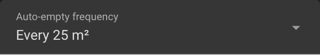

## Robot help

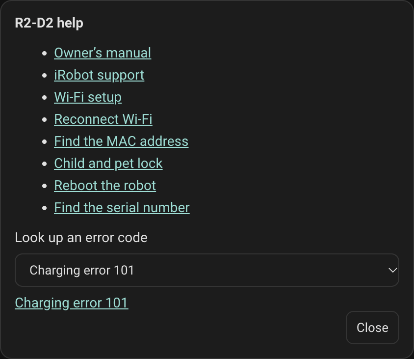

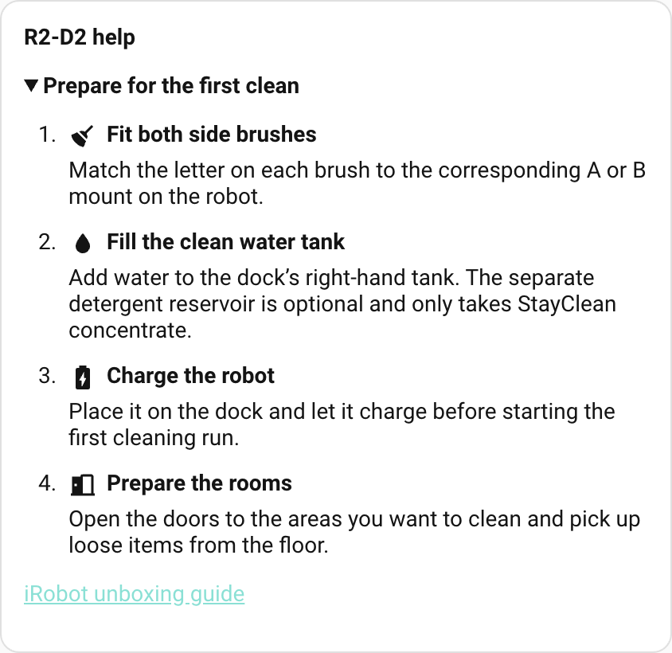

## Floor plan dashboard


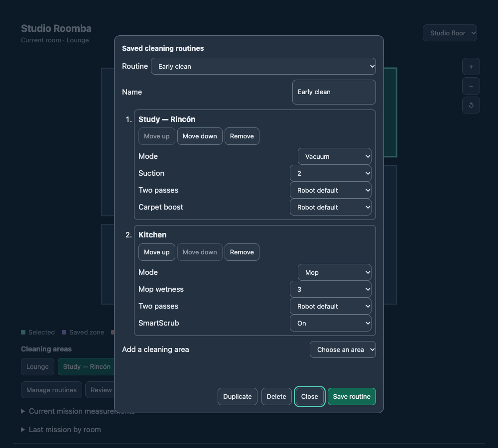

Screenshots use a synthetic floor plan and mission.

1. Enable **Show saved floor plans and live room updates** in the integration
   options. This also creates the native floor plan image and live room sensors.
2. Add `/roomba_home/roomba-home-map-card.js?v=0.71.2` as a **JavaScript module**
   in **Settings → Dashboards → Resources**. Set `v` to your installed version
   whenever you upgrade so the browser loads the updated card. Enable Advanced
   Mode in your user profile if Resources is hidden. [Home Assistant resource setup](https://contributors.home-assistant.io/frontend/custom-ui/resources/)
3. Add a manual card with your robot's vacuum entity.

```yaml
type: custom:roomba-home-map-card
entity: vacuum.example_robot
```

On upgrade, update the existing module URL to the version shown above and
reload the dashboard. Use one card per robot.

- **Review selection** shows the robot and destinations before cleaning with
  the next-cleaning preferences saved in Home Assistant.
- **Clean a point** marks a spot inside a room in the overhead or 3D view.
  Choose a supported cleaning mode and review the mode, room, and marked point
  before starting. You can also enter the position with the keyboard.
  During a run, the card marks the point and mode reported by Roomba.
  [Point cleaning](docs/usage.md#clean-a-map-point)
- **3D view** shows reported walls and optional furniture on an angled floor
  plan. Drag to pan, pinch to zoom on touch screens, and rotate the camera with
  **⟳**. Use **Show furniture** to toggle the furniture layer. Room and zone
  selection works in both views. The editor temporarily uses the overhead
  view when you place or change an object.
- **Floor settings** renames the selected floor or rotates it in 90° steps.
  Choose **Rotate floor** and **Rotate right 90°**, then review and save the
  preview. The saved orientation also applies to the Home Assistant floor image.
- **Map backups** stores a local copy of the current floor for that Roomba.
  Browse saved revisions offline, pin important versions, export a backup,
  or enable automatic snapshots before map edits and removal. Review and
  restore the recorded name, orientation, and cleaning zones on the current
  floor. Recover room names and types for rooms with matching boundaries.
  Recover keep-out and no-mop zones, virtual walls, and furniture
  placements from a backup. Recover missing furniture and zone destinations
  in compatible routines or schedules, including their cleaning order and
  per-area settings.
  [Map backups](docs/usage.md#local-map-backups)
- **Edit rooms** divides a room, merges two adjacent rooms, and edits room
  names and types on a supported Max 700 floor plan. Choose **Divide a
  room**, select the room, then use **Place divider on map** to pick two
  points. To undo the split, choose **Merge rooms** and select both adjacent
  rooms on the map or in the lists. Review the highlighted rooms before
  saving.
- **Edit cleaning zones** creates, renames, moves, resizes, or removes a
  rectangle on a supported floor plan. Choose two opposite corners on the map
  or enter their coordinates. On supported Max 700 maps, the saved rectangle
  becomes selectable once Roomba confirms the active map revision.
  [Saved-zone editor validation](docs/validation.md#immediate-saved-zone-selection-in-0250)
- **Edit restrictions** creates, moves, resizes, or removes keep-out zones,
  no-mop zones, and virtual walls. Choose **No-mop zone** and draw a
  rectangle to protect a rug. For a barrier across a doorway, choose
  **Virtual wall → Place wall on map**, pick its two endpoints, then review
  and save. You can also enter the coordinates with the keyboard.
  [Restriction editor](docs/usage.md#edit-map-restrictions)
- **Show furniture** displays saved and detected objects. In **Edit
  furniture**, choose **Chair**, place its center, enter its width and
  depth, and check the rotation preview before saving.
- **Customize cleaning** opens a one-off draft from **Review selection**.
  Set each area's mode and preferences, check the order, then confirm the
  start. **Save as routine** carries the same draft to the routine editor.
  [One-off cleaning](docs/usage.md#customize-a-one-off-cleaning)
- **Manage routines** opens the saved routines list. Select areas on the map
  before opening it to prefill a new routine. Add furniture, rooms, or zones,
  set their individual cleaning preferences, and arrange them in order.
  Choose **Run saved routine** to review and start a supported routine.
  Choose **Use in schedule** to copy an ordered room or saved-zone
  selection into a new schedule. [Schedules](docs/usage.md#cleaning-schedules)
- **Review map dependencies** shows known saved routines and schedules for
  the selected areas. It flags entries with unresolved destinations.
- **Last mission by area** shows reported outcomes, area values, and pass
  counts for rooms, zones, and furniture. **Current mission measurements**
  appears when Roomba supplies a fresh timeline report.
  [Physical run and installed card validation](docs/validation.md#ordered-furniture-completion-and-area-results-in-0230)
- **Planned order** shows how many destinations Roomba has finished and
  which destination it is approaching or cleaning during a directed run.
  It displays each destination's requested settings and reported pass count
  when Roomba supplies them. An unordered run shows **Selected destinations**.
  The card and **Estimated cleaning time remaining** sensor show an
  approximation when Roomba provides a matching estimate for each remaining
  destination. The card refreshes the countdown between robot updates.
  [Live progress and automation example](docs/usage.md#telemetry-progress-and-problems)
- **Skip current area** asks for confirmation while Roomba reports the
  current destination. The mission history shows the skipped area.
  [Skip control and automation example](docs/usage.md#skip-the-current-destination)

Overall live coverage percentage still requires provider verification.
[Map and mission details](docs/usage.md#interactive-floor-plan) ·
[Map editor SDD](specs/009-map-zone-editor.md)

After dividing a room, either result is available to select from the active
map. A merge removes the second room from the card as soon as the merged map
is active. [Room edit validation](docs/validation.md#installed-room-editor-validation-in-0220)

To vacuum and then mop a particular destination, select **Vacuum then mop**
for that area in a routine. The map card tracks the active destination, and
mission history reports the completed cleaning modes.
[Directed sequence validation](docs/validation.md#directed-vacuum-then-mop)

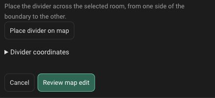

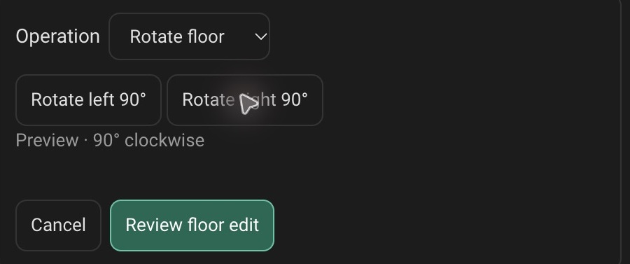

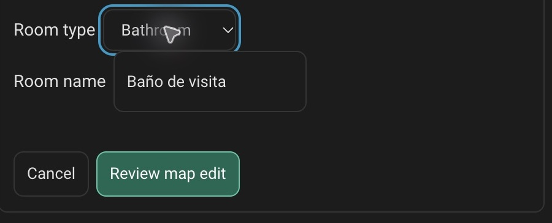

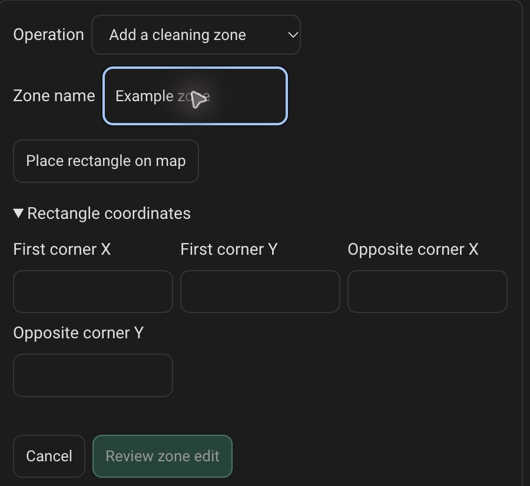

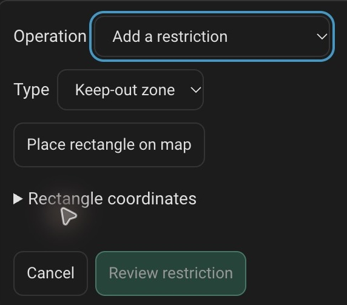

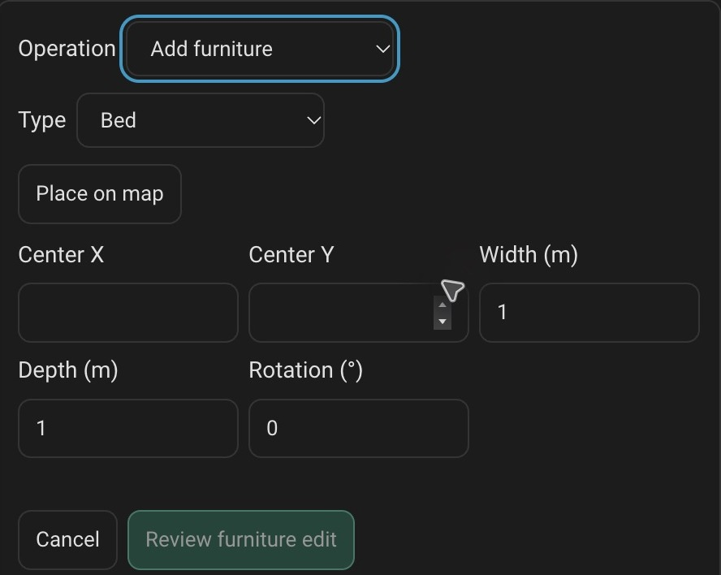

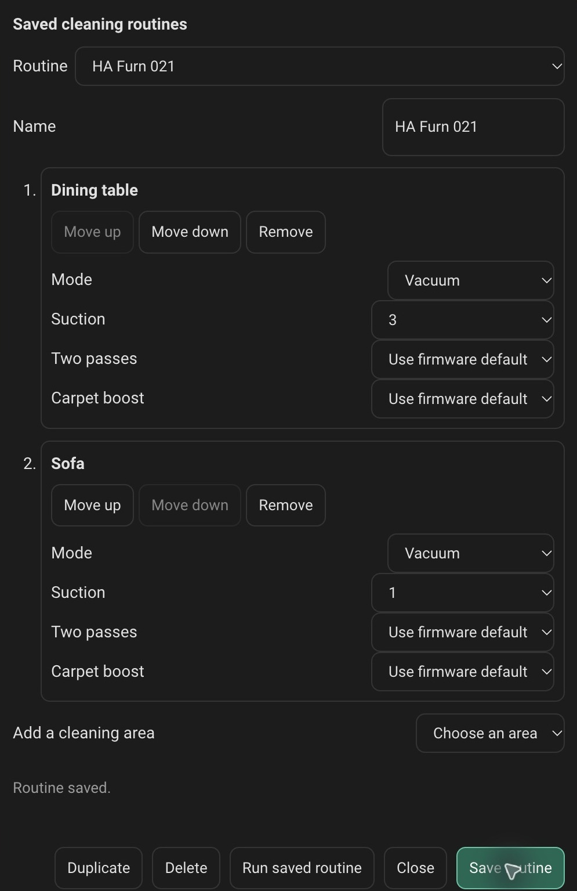

## Copyable examples

Replace the example entity IDs with the ones shown on your devices. Use
**Developer tools → Actions** to try a single action. Put the same actions in
a script or automation to reuse them.

### Mop with a saved wetness setting

Add this sequence to a Home Assistant script. Start on an idle robot. A start
request on a paused robot resumes its existing mission.

```yaml
sequence:
  - action: select.select_option
    target:
      entity_id: select.example_robot_next_cleaning_mode
    data:
      option: mop
  - action: number.set_value
    target:
      entity_id: number.example_robot_next_wetness_level
    data:
      value: 2
  - action: vacuum.start
    target:
      entity_id: vacuum.example_robot
```

The mode options are `vacuum`, `mop`, `vacuum_mop`, and `vacuum_then_mop`
where supported. [Cleaning modes and preferences](docs/usage.md#choose-a-cleaning-mode-and-preferences)

### Vacuum one room and mop another

Run `roomba_home.list_cleaning_regions` for the vacuum and copy IDs from its
response. Select rooms or saved zones on the same active map in the order you
want to clean them.

```yaml
action: roomba_home.clean_regions
target:
  entity_id: vacuum.example_robot
data:
  regions:
    - id: example_map:rid:entryway
      mode: vacuum
      suction_level: 2
    - id: example_map:rid:kitchen
      mode: mop
      wetness_level: 2
```

You can also assign vacuum regions to Home Assistant areas and use
`vacuum.clean_area`. [Region and dock actions](docs/usage.md#rooms-zones-and-dock)

### Mop around a point

Copy the room ID from `roomba_home.list_cleaning_regions`. Coordinates are
fractions of that room's bounding rectangle. Use the map card to pick and
review the point visually.

```yaml
action: roomba_home.clean_point
target:
  entity_id: vacuum.example_robot
data:
  region_id: example_map:rid:kitchen
  x: 0.4
  y: 0.55
  mode: mop
```

### Run a saved routine

Choose **Manage routines** to save the ordered destinations and their profiles.
Use **Appearance** to pick a color and enter an emoji for the saved routine.
Open an area's remembered settings, then choose **Remembered by Roomba** under
**Cleaning preset** to copy the compatible settings into the draft.
To choose a specific variant, open **Roomba's remembered settings** and
select **Use these settings** next to it.
Use **List cleaning routines** to find the assigned routine ID.

```yaml
action: roomba_home.run_cleaning_routine
target:
  entity_id: vacuum.example_robot
data:
  routine_id: "0123456789abcdef0123456789abcdef"
```

[Routine actions and examples](docs/usage.md#saved-cleaning-routines)

### Create a weekly schedule in the disabled state

```yaml
action: roomba_home.create_cleaning_schedule
target:
  entity_id: vacuum.example_robot
data:
  name: Weekday kitchen
  weekdays: [1, 3, 5]
  time: "08:30"
  regions:
    - id: example_map:rid:kitchen
      mode: vacuum_then_mop
```

Review the returned schedule ID and weekday/time before using
`roomba_home.set_cleaning_schedule_enabled`. The action uses ISO weekdays,
where Monday is `1`. [Schedules and saved routine examples](docs/usage.md#cleaning-schedules)

### Notify Home Assistant when a mission finishes

```yaml
alias: Roomba mission finished
triggers:
  - trigger: state
    entity_id: event.example_robot_mission_finished
conditions:
  - condition: template
    value_template: >-
      {{ trigger.from_state is not none and trigger.to_state is not none and
         trigger.from_state.state != trigger.to_state.state and
         trigger.to_state.attributes.get('event_type') == 'mission_finished' }}
actions:
  - action: persistent_notification.create
    data:
      title: Roomba mission finished
      message: >-
        Result: {{ trigger.to_state.attributes.get('outcome') or 'Unknown' }}
mode: queued
```

This event follows Roomba's mission history. It can arrive after the robot has
docked. [Robot and dock problems](docs/telemetry.md#problems-and-events) ·
[Mission finished event](docs/telemetry.md#mission-finished-event)

## Documentation and development

- [Usage, entities, and actions](docs/usage.md)
- [Roomba API reference](docs/api.md)
- [Development and testing](docs/development.md)
- [Specification catalog](specs/CATALOG.md)
- [Roadmap](docs/roadmap.md)
- [Release notes](CHANGELOG.md)
- [Privacy and captures](SECURITY.md)

The project follows the architecture of [My Verisure](https://github.com/efraespada/my_verisure)
and the SDD structure from [vypdev/copilot](https://github.com/vypdev/copilot).
Automated tests use synthetic devices and maps. The full adapter suite runs
with Home Assistant's test harness.
