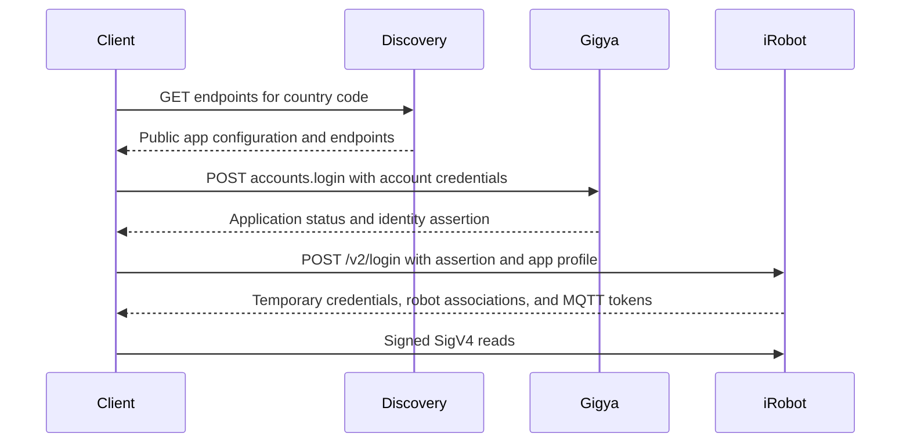

# Observed Roomba Home API

Observation date: 2026-11-23. Android App `com.irobot.home.prime`, version 3.4.1. That
document describes traffic and evidence of this version, but not a public API guaranteed by
iRobot. The client and account values are obtained as they run, with examples omitting their
value.

## Authentication

The client discovers the deployment, authenticates with Gigya, exchanges its
assertion for an iRobot session, and makes signed reads and MQTT connections.

1. `GET https://disc-prod.iot.irobotapi.com/v1/discover/endpoints?country_code=ES`
   returns `deployments`, `current_deployment`, and `gigya`.
2. Discovery supplies the Gigya domain and public application key.
   `POST /accounts.login` sends form fields `apiKey`, `loginID`, `password`,
   `targetEnv=mobile`, `sessionExpiration=-2`, and `format=json`. Successful
   sign-in requires the integer `errorCode` to be zero.
3. `POST {httpBase}/v2/login` exchanges `gigya.uid`, `gigya.signature`, and
   `gigya.timestamp`. The request includes `app_id`, `app_info`,
   `authorizer_params`, and `multiple_authorizer_token_support`. `app_id`
   controls the MQTT client identity. A test changing only
   `app_info.device_id` still collided; a distinct stable
   `ANDROID-PRIME-{uuid}` identifier resolved the collision.
   `AppProfile.native()` generates a profile without application secrets.
4. The session returns expiring AWS `credentials`, `robots`, and
   `connection_tokens`. Some robot fields contain passwords and are excluded
   from public diagnostics.
5. Requests to `httpBaseAuth` use AWS SigV4 with service `execute-api` and the
   discovered region. `botocore` signs the exact JSON bytes sent.

The client replaces its session five minutes before expiry by repeating native
sign-in. Renewal with a persistent Gigya token still needs validation. Commands
are sent once. A 403 can be a normal API error. A 429 returns a retry delay
between 1 and 900 seconds.

A later test passed discovery and Gigya authentication and received HTTP 403
during the exchange at `POST /v2/login`. The client preserves it as an API
error and configuration reports a connection failure.
[Exchange evidence](evidence/2026-11-23-temporary-zone-history.json)

## Verified HTTP reads

They are all `GET` signed. The parameters reproduce only when they have been observed and
their private values stay out of the repository

| Route | Parameters observed | Purpose |
| --- | --- | --- |
| `/v1/user/associations/robots` | `include_passwords` | Associated inventory |
| `/v1/user/households` | — | Households |
| `/v1/households/{id}/settings` | — | Home adjustments |
| `/v1/households/{id}/settings/schedule` | — | Household schedules |
| `/v1/user/favorites` | `app_edition` | Favorites |
| `/v1/user/timeline` | `include_robots`, `details_type_filter`, `limit`, `show_all`, `app_version` | Activity |
| `/v1/p2maps` | `robotId`, `visible` | Robot maps |
| `/v1/p2maps/{id}` | — | Map metadata |
| `/v1/p2maps/livemap` | `robotId`, `rawOnly` | Start of the live map, observed in an app |
| `/v1/p2maps/clean-score` | `p2map_id` | Cleaning result |
| `/v1/p2maps/{id}/routines` | `limit` | Routines |
| `/v1/{id}/missionhistory` | `app_id`, `maxAge`, `filterType`, `supportedDoneCodes` | History |
| `/v1/robots/{id}/parts` | — | Consumables |

The public parts catalog is
`GET https://content-prod.iot.irobotapi.com/v2/es-es/ES/X185240/parts`.
It maps part codes to names and indicates whether each counter is enabled.
A separate signed read provides the robot's usage percentage `counter`,
unit `count_type`, and quantities `count_used` and `count_remaining`.
Negative `minutes_remaining` is treated as unavailable.

The estimates action sends signed `POST /v1/time-estimates` with the robot's
`robot_id`, the current `smart_map_id`, and empty `region_id` and `zone_id`.
The `v1` response has `region` entries giving seconds per mode, suction,
SmartScrub, and two-pass combination. This endpoint uses mode 32 for vacuum
and mop. The action projects compatible combinations for the requested
rooms and performs a read-only calculation.

Of 148 observed live map announcements, 145 also included
`livemap_url_raw`. The SDK declares `pos_update` and `map_update`.
Both message types were observed during two missions. The position matched
saved room geometry. [iRobot maps](https://homesupport.irobot.com/s/article/20500)

[Estimates and live map evidence](evidence/2026-11-23-cleaning-estimates.json) ·
[Position evidence](evidence/2026-11-24-live-progress.json)

## MQTT of modern models

The app sets up `wss://{mqttAts}/mqtt` at the port 443 with these header:

| Header | `connection_tokens` |
| --- | --- |
| `x-irobot-auth` | `iot_token` |
| `x-amz-customauthorizer-name` | `iot_authorizer_name` |
| `x-amz-customauthorizer-signature` | `iot_signature` |

Each token provides its `client_id` and his list `devices`. The evidence was given by two groups of his association. The prefixes are solved by the `svcDeplId` of each robot and should not be assumed to belong as currently deployed. Subscriptions are sent in lots of up to eight, as per [AWS IoT's share](https://docs.aws.amazon.com/general/latest/gr/iot-core.html).

Reading: To be published at `{iotTopics}/things/{robot_id}/shadow/name/{shadow}/get` and
listen to his sufixes `/accepted` and `/rejected`. A `get` demand status stored in the
cloud: **doesn't itself prove that the robot's connected or recent data**. The state of
connectivity is consulted separately.

| Shadow | Data observed | Retirement of initial evidence |
| --- | --- | --- |
| `ro-currentstate` | Batteries, mission and base | 3 accepted |
| `rw-settings` | Vacuuming, moisture and washing. | 3 accepted |
| `ro-services` | Optional functions | 3 accepted |
| `rw-software` | Version and update | 3 accepted |
| `ro-configinfo` | Hardware and private fields | 3 accepted |
| `ro-stats` | Accountants and errors | 3 accepted |
| `rw-schedule` | Programming | 3 accepted |
| `rw-constatus` | `connected` and `connectedv2` | 3 accepted |
| `ro-sensor` | Not available in these models | 3 Rejected 404 |

The SDK plays `connectedv2=0` as disconnected and `connectedv2=1` as connected. The integration prioritizes these values and uses `connected` as backrest when the code cannot be interpreted. The three robots have been caught and reported `connected=true` and `connectedv2=1`. [Standard evidence](evidence/2026-11-23-dock-diagnostics.json)

The prefix `rw-` does not allow them to write these data. The reader MqttShadowReader only
publishes reading applications `get` with `retain=False`. The name-less classic state does
not contain all information about modern models.

The integration consults status and connection with fast cadency. Adjustments, software and statistics have a range of five minutes. The responses MQTT accepted before the deadline are applied by robot. The status and base error code was contrasted with models from the official SDK. The [inventory](telemetry.md) document fields, units and problem events.

## Verified commands

It's published with QoS 1 and `retain=False` in `{irbtTopics}/things/{robot_id}/cmd` solving
the robot prefix. The body includes `command`, `time` in seconds and `initiator=rmtApp`. In
0.1.0 and 0.2.0, `start` adds `params.operatingMode=2`, vacuuming. The branch 0.3.0
serializes a tipized profile validated by capabilities. The dedicated missions add the map,
version and regions verified at today's reading.

| Order | Reported actual cycle result |
| --- | --- |
| `start` | `run / clean` Mode 2 and 5,5 s |
| `pause` | `stop / clean` after 210 Test s |
| `stop` | `stop / none`, mission cancelled |
| `dock` | `hmUsrDock / dock` and after `charge / none` |

The cycle ended at the dock with no misstatement. The normalised sequence is at [public evidence without identities](evidence/2026-11-23-control.json). The start and final status were also contrasted with an emulator's app.

`MqttCommandSender` returns a transport receipt that `physical_result` It's `unconfirmed`: A PUBACK does not show performance. Coordinator HA adds status check. Canceling and returning to the dock are separate operations. The initial cycle did not validate a sum, fringes and zones or all the contexts of each order. Consultation [the command SDD](../specs/004-command-validation.md).

### Extension of 0.3.0

| Mode | Support bit oMode | Value operatingMode | Evidence |
| --- | ---: | ---: | --- |
| Vacuum | 2 | 2 | PDK and previous physical cycles |
| Mop | 4 | 4 | PDK, production and posterior sustained run |
| Simultaneous | 32 | 6 | SDK and run held in mode 6 |
| Sequential | 512 | 512 | SDK and advertised capacity; outstanding physical phases |

The mask 550 Announces the four modes and cannot be sent 32 to apply simultaneously. Mission
parameters: `suctionLevel`, `padWetness.padPlate`, `swScrub` how 0/1, `twoPass` and
`carpetBoost` as booleans. No parameters are included vacuuming to mop and mopping to
vacuum.

The polls confirmed pause, cancellation and base without error in terms 4 and 6. In the mode 4 been observed padWash and 150 seconds and after more than a minute in run. At 6 the global power has passed from 3 a 1 after applying 1.moisture and booster did not necessarily coincide with the request. The precedence of global, mission and room preferences remains to be verified. The [Retiring evidence](evidence/2026-11-23-cleaning-modes.json) retains these boundaries.

Other mopping requested moisture 1 and SmartScrub Retirement. The robot reported moisture 2 and `swScrub=1` in `rw-settings` while cleaning and back to the dock. To restore values, the Test client published `state.desired` in `rw-settings/update` following the SDK and checked `state.reported` for both fields. The moisture that was applied during the mission remains to be determined. From 0.6.0 The integration allows you to write a single field verified in that Shadow and expects `state.reported` reflect the value. If the result remains uncertain, it returns a confirmation error and recovers its reported value in following readings. [mopping](evidence/2026-11-23-mop-preferences.json)

The preset power uses `rw-settings.state.reported.suctionLevel`. To update it, 0.8.0 published only the whole key `suctionLevel` in `state.desired` of the topic `rw-settings/update`. The range comes from `cap.suctionLvl` and the operation requires an announced mode that aspires. The integration confirms the value with an independent reading of that same robot. [Test of default](evidence/2026-11-23-default-suction.json)

In 0.9.0 Boolean are confirmed by the same mechanism `twoPass` and `carpetBoost`. The capacity of the modality and information field enables each monitoring. The whole `autoevacFreq` represents an area in m² of 10 a 1000 When the robot uses a surface modality. Control requires `cap.autoevac=2` an empty base and a current value of that modality. The frequency code 0, 1, 2 and 4 preserve their meanings by mission or return to the dock and they are never interpreted as m². [Evidence of the three persistent adjustments](evidence/2026-11-23-persistent-cleaning-options.json)

`resume` was checked after pausing a mission per room, returning run with earlier mode. Read
`/v1/p2maps` with `robotId` and `visible=true` returned an active map with seven inputs to
`rooms_metadata`: 6 Rid rooms and an tid ephemeral region. A directed order uses `p2map_id`,
`user_p2mapv_id` and `regions` with `region_id` and `type` Reg for rooms or zid to areas.
The Java enum of rooms is serialised as rid. The room test was charged with the broker and
followed at the dock.

The SSK supports a third region `tid` for an area of the order. The same identifier unites `regions[].region_id` with `id_multipolys[].id`. For a simple polygon, `poly` contains the coordinate ring on native axes. A robot X185240 initiated vacuuming and his record confirmed the region, polygon or map version requested. The course ended with error 48 and zero surface. It takes a mission to clear up the region and have an opportunity for temporary zone. [Evidence of temporary zone](evidence/2026-11-23-temporary-zone-history.json)

The app's favorites contain `regions[].params` and `ordered=1`. Integration can reproduce
these adjustments by region, restricted to tipada options. Regional mode tested 32 and the
robot reported simultaneous mode 6. The Mode 512 complete mission start into mode 2 and the
test was cancelled before monitoring mopping. Sends directed with 512 global did not start a
mission.

The basic core commands contrasted with the SDK are `evac`, `washPad`, `dryPad`,
`stopPadDry` and `fluidRefill`(g) specific capabilities and statements of the dock That's
after dispatch. A later change of the component is checked. `find` uses that same envelope
and we register sending because sound lacks confirmation by state

`GET /v1/{id}/missionhistory` using its own profile and parameters `maxAge=10`, `filterType=omit_quickly_canceled_not_scheduled` and `supportedDoneCodes=dndEnd,returnHomeEnd`. They are designed to start, end and duration with area or result as well. The 6 observed records have been shown `runM`, `pauseM`, `chrgM`, `chrgs`, `evacs` and `dockedAtStart`. The breakdown `oModeStats` contains `nMin` and `sqft` by modality, observed for `vac` and `vacmop`. The duration and surface by mode are read directly, with total using the mission fields. The projection omits complete commands, mission identity and trajectories. Of `cmd` get the destination and, if all regional types are known their quantity. In addition to regular cadency, the robot's track record is checked at an end of a mission and once again if its result has not been published. `timeline.finEvents[]` may include `type=error`, `ts` and `error.value`. The integration takes code from the last valid final event. On a mission that ended with `done=stuck` and value 48 was preserved in that field even though the robot once again reported an error 0 as they get attached. [Evidence of historic diagnosis](evidence/2026-11-23-schedule-dispatch.json)

The following are currently available: Roomba Home have been consulted by `GET
/v1/user/households` and `GET /v1/households/{id}/settings/schedule`. The first document
identifies robots associated with the home. The second contains `household_schedules[]` with
`schedules[].options` every robot. It is distinguished `enabled` from an absent value. The
weekly start uses ISO days from 1 a 7, hour and minute. The projection omits names, schedule
IDs and their complete orders. The account reported five cloud schedules disabled while the
Shadow of each robot had zero local programs.

`PUT /v1/households/{id}/settings/schedule/{household_schedule_id}` supports the body `schedules: [{schedule_id, options}]`. The client select a group with only one weekly schedule and an order `start` for robot, changes only `options.start` and clear the list. The confirmation compares days, time and activation with command. The same path allows to change only the activation. The `POST` and `DELETE` retirement with time frames. Integration uses `POST .../settings/schedule` with `schedules: [{options}]` and `DELETE .../settings/schedule/{household_schedule_id}`. The high man keeps an order `start` with `ordered=1`, the current map and profiles by region. At times the simultaneous mode uses `32`. The sequential uses `512` and `routine_modified=true` at regional parameters. A activated schedule began vacuuming and telemetry reported `cleanMissionStatus.initiator=cloud`. [Controlled high and withdrawal](evidence/2026-11-23-schedule-crud.json) [Schedule editing](evidence/2026-11-23-schedule-writes.json) · [Fire and physical result](evidence/2026-11-23-schedule-dispatch.json)

`rw-settings.timezone` provides the robot's time zone. The SDK reads it from the matching Shadow and all three captured readings contain valid IANA zones. The next weekly start is computed with that area and published as a date at UTC. Value is unknown if an active schedule lacks, recurrence remains undecided or the first hour as a matter of fact. [Notes from iRobot about time zone synchronization in the Max series 700](https://homesupport.irobot.com/articles/en_GB/Knowledge/70550)

## Spot cleaning and map coordinates

The SDK declares two orders. `point_clean` gets an active map `p2map_id` his version `user_p2mapv_id` and a point at `geom.center`. Capacity `cap.dSpot` difference the tiptooling of a variant that supports hot water. `spot` That's a different code. The manufacturer document the punctual cleanup using Max's button 700. [Max controls 700](https://homesupport.irobot.com/articles/en_US/Knowledge/70501)

The consultation with signature `GET /v1/p2maps/{id}/versions/{version}/geojson` and `response_type=binary` returns a compressed tar file with gzip. The client requests `application/gzip,application/json`. Valids the map and version with fields `id` and `version` their metadata and crosses the `id` room geometry with inventory associated to the robot. Stretch the perimeter and exclusions `policyZones` of a kind `KeepOutZone`. The robot initiated a vacuuming and published `run/clean` Mode 2. The track record confirmed `point_clean` with the exact map, version and point. The geometry remains in private capture. [Evidence of clearance by point](evidence/2026-11-23-point-clean.json)

Home Assistant defines `vacuum.clean_spot` at the current robot's place. Action `roomba_home.clean_point` turns room fractions into a native point and sends `point_clean` with vacuuming. A new remote-source mission allows information to be reported **Submitted**. The track record confirms the exact order when a supplier publishes his or her registration. [Home Assistant](https://www.home-assistant.io/integrations/vacuum/#list-of-actions)

The SDK's mission bridge also recognizes `spot`. A publication with a model vacuuming and without coordinates obtained an accused MQTT. The robot remained loaded. Positioning tests have been completed at the dock before we can publish `spot` with the robot at rest above ground. The physical test documented by iRobot That's still the robot button. [Max controls 700](https://homesupport.irobot.com/articles/en_US/Knowledge/70501)

The app announces a live map with the signed
`GET /v1/p2maps/livemap?robotId={robot_id}&rawOnly=true`. A successful
response contains `mqtt_topic`. The integration checks it against
`{irbtTopics}/things/{robot_id}/livemap/update` from the robot's discovered
deployment. The initial 28-second idle test accepted the subscription and
received no map or position updates.
[Initial live map evidence](evidence/2026-11-23-spot-and-live-map.json)

Two active vacuum missions yielded position batches. In a
`pos_update.cur_path` array, the first integer is the index of the first
position, followed by groups of `x`, `y`, orientation in radians, and a
numeric operating-modes field. The final integer matches the envelope
`timestamp` in Unix seconds. The envelope's `update_expire_ts` controls
freshness. The positions align with the room polygons of the active saved
map. `map_update.livemap_url_raw` points to a zlib-compressed object. Its
uncompressed format still needs verification.

The active timeline uses `mission/timeline/request` with integer
`timelineRequestId` and replies on `mission/timeline/report`. Start and
relocation events were confirmed for the current mission. The reader matches
the reply nonce and `nMssn` and discards retained or malformed replies. It
projects a recognized stage and in-progress room readings from `event` and
final room results from `finEvents`.
Historical `timeline.finEvents` room records contain `p2mapId`, `p2mapvId`,
`rid`, `area`, `totalArea`, `passCount`, and `status` where reported. The
integration exposes the raw area values until a provider unit is confirmed.
Live coverage and remaining time need further evidence.
[Map and timeline evidence](evidence/2026-11-24-live-progress.json)

## Primary sources

The concrete authentication and Shadow names come from capture of the app as well with its native SDK. The repository does not have an APK and its code broken down. For transport rules have been consulted [AWS SigV4 firm](https://docs.aws.amazon.com/IAM/latest/UserGuide/reference_sigv-create-signed-request.html), [custom authentication of AWS IoT](https://docs.aws.amazon.com/iot/latest/developerguide/custom-auth.html) and [Device Shadow's themes](https://docs.aws.amazon.com/iot/latest/developerguide/device-shadow-mqtt.html).
