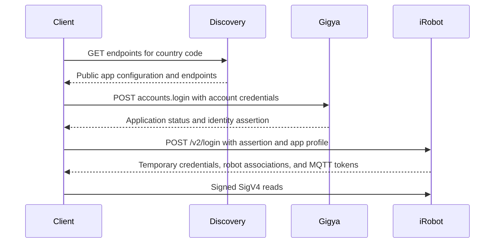

# Observed Roomba Home API

Observation date: 2026-11-23. Android App `com.irobot.home.prime`, version 3.4.1. That
document describes traffic and evidence of this version, but not a public API guaranteed by
iRobot. The client and account values are obtained as they run, with examples omitting their
value.

## Authentication



The client discovers the deployment, authenticates with Gigya, exchanges its
assertion for an iRobot session, and makes signed reads and MQTT connections.

1. `GET https://disc-prod.iot.irobotapi.com/v1/discover/endpoints?country_code=ES`
   returns `deployments`, `current_deployment`, and `gigya`.
2. Discovery supplies the Gigya domain and public application key.
   `POST /accounts.login` sends form fields `apiKey`, `loginID`, `password`,
   `targetEnv=mobile`, `sessionExpiration=-2`, and `format=json`. Successful
   sign-in requires the integer `errorCode` to be zero.
3. `POST {httpBase}/v2/login` exchanges `gigya.uid`, `gigya.signature`, and
   `gigya.timestamp`. The request includes `app_id`, `app_info`,
   `authorizer_params`, and `multiple_authorizer_token_support`. `app_id`
   controls the MQTT client identity. A test changing only
   `app_info.device_id` still collided; a distinct stable
   `ANDROID-PRIME-{uuid}` identifier resolved the collision.
   `AppProfile.native()` generates a profile without application secrets.
4. The session returns expiring AWS `credentials`, `robots`, and
   `connection_tokens`. Some robot fields contain passwords and are excluded
   from public diagnostics.
5. Requests to `httpBaseAuth` use AWS SigV4 with service `execute-api` and the
   discovered region. `botocore` signs the exact JSON bytes sent.

The client replaces its session five minutes before expiry by repeating native
sign-in. Renewal with a persistent Gigya token still needs validation. Commands
are sent once. A 403 can be a normal API error. A 429 returns a retry delay
between 1 and 900 seconds.

A later test passed discovery and Gigya authentication and received HTTP 403
during the exchange at `POST /v2/login`. The client preserves it as an API
error and configuration reports a connection failure.
[Exchange evidence](evidence/2026-11-23-temporary-zone-history.json)

## Verified HTTP reads

They are all `GET` signed. The parameters reproduce only when they have been observed and
their private values stay out of the repository

| Route | Parameters observed | Purpose |
| --- | --- | --- |
| `/v1/user/associations/robots` | `include_passwords` | Associated inventory |
| `/v1/user/households` | — | Households |
| `/v1/households/{id}/settings` | — | Home adjustments |
| `/v1/households/{id}/settings/schedule` | — | Household schedules |
| `/v1/user/favorites` | `app_edition` | Favorites |
| `/v1/user/timeline` | `include_robots`, `details_type_filter`, `limit`, `show_all`, `app_version` | Activity |
| `/v1/p2maps` | `robotId`, `visible` | Robot maps |
| `/v1/p2maps/{id}` | — | Map metadata |
| `/v1/p2maps/livemap` | `robotId`, `rawOnly` | Start of the live map, observed in an app |
| `/v1/p2maps/clean-score` | `p2map_id` | Room cleaning scores and suggested settings |
| `/v1/p2maps/{id}/routines` | `limit` | Routines |
| `/v1/{id}/missionhistory` | `app_id`, `maxAge`, `filterType`, `supportedDoneCodes` | History |
| `/v1/robots/{id}/parts` | — | Consumables |

The public parts catalog is `GET /v2/{locale}/{market}/{sku}/parts` on
`content-prod.iot.irobotapi.com`. The integration selects the account's
country and the Home Assistant language. The catalog maps part codes to
names, counter availability, replacement SKUs, and optional URLs.
A separate signed read provides the robot's usage percentage `counter`,
unit `count_type`, and quantities `count_used` and `count_remaining`.
Negative `minutes_remaining` is treated as unavailable.

The dashboard's `roomba_home/maintenance` WebSocket command takes the
vacuum `entity_id` and requires entity read permission. It returns
`robot`, `counters_available`, and a bounded `parts` list. Each row
includes a part code, a normalized part name, dock association, and
available counter values and type. Catalog references use the optional
`part_sku`, `replacement_url`, and `maintenance_guide_url` fields. Validate
the HTTPS catalog route for the configured market and matching SKU before
publishing a replacement link. For Spain, iRobot's store resolves a short
product URL built from that SKU. Other directory links retain the catalog
locale and omit marketing parameters. Care guides use verified iRobot hosts
and paths. Catalog references can remain available while signed counters
are unavailable. The command reads the coordinator snapshot.

The Android SDK resets a single maintenance counter with a signed
`POST /v1/robots/{id}/parts` and `{"parts":[{"part_id":"72","counter":0}]}`.
The response contains the associated `robot_id` and reset rows in `parts`.
The integration checks the requested part and the cloud response before
reading the same counter again. Only a matching acknowledgement and a
fresh zero usage value confirm the action. The POST is sent once. The dust
bag counter (`147`) is disabled in the catalog.

The estimates action sends signed `POST /v1/time-estimates` with the robot's
`robot_id`, the current `smart_map_id`, and empty `region_id` and `zone_id`.
The `v1` response has `region` entries giving seconds per mode, suction,
SmartScrub, and two-pass combination. This endpoint uses mode 32 for vacuum
and mop. The action projects compatible combinations for the requested
rooms and performs a read-only calculation.

`roomba_home.estimate_cleaning_routine` applies this table to an ordered
draft. Match each room by identity and active floor revision. Match its
mode and the table's suction, SmartScrub, and pass dimensions against the
draft preferences and last reported robot defaults. If a required setting
is unavailable, use its matching rows only when all yield the same time.
Wetness and carpet boost are outside the reported table dimensions.

The optional `floor` review includes `map_id`, `version`, and an optional
`inventory_id`. Confirm the active revision again after the estimate read.
Return `duration_seconds` for a complete draft, `partial_duration_seconds`
for the available subtotal of an incomplete draft, and one result per
requested area in the original order. A missing row yields a null duration.
Conflicting compatible durations also set `ambiguous: true` for that area.
The observed floor had room estimates and omitted its furniture.
[Draft estimate evidence](validation.md#routine-draft-estimates)

Of 148 observed live map announcements, 145 also included
`livemap_url_raw`. The SDK declares `pos_update` and `map_update`.
Both message types were observed during two missions. The position matched
saved room geometry. [iRobot maps](https://homesupport.irobot.com/s/article/20500)

[Estimates and live map evidence](evidence/2026-11-23-cleaning-estimates.json) ·
[Position evidence](evidence/2026-11-24-live-progress.json)

### Continuous position delivery

An opt-in live map uses a separately authenticated, read-only MQTT
subscription to the robot's announced `livemap/update` topic. The
existing state and timeline polling continues on the main client. The
stream never publishes robot commands. A watch is bound to the robot's
current mission and one verified map revision.

Position messages carry an index, timestamp, expiry, heading, and activity
values. The transport and mission projection allow up to five seconds of
provider clock skew. The authenticated `roomba_home/live_positions` WebSocket
subscription sends changed route samples and the latest position for a
selected entity and map revision. A reset clears the previous mission's
route. The existing floor plan snapshot provides a fallback.
The card follows consecutive intermediate samples for provider intervals
up to six seconds when all indexes are present and the path length is
plausible. A new sample arriving during the animation starts at the
displayed position and finishes any remaining observed legs. Marker
animation lasts at most 1.8 seconds per update and follows the browser's
reduced-motion preference.
[Physical stream evidence](validation.md#continuous-position-and-cleaning-coverage)

### Local map backup commands

The card uses authenticated Home Assistant WebSocket commands scoped to the
selected vacuum entity. `roomba_home/map_backups` lists saved metadata and
retention settings. `roomba_home/read_map_backup` accepts `backup_id` with
optional `download`. A preview returns floor geometry and the verified
metadata. An export returns `format_version: 1`, the floor metadata, the
base64-encoded native gzip archive, and `programs` when captured. Both use
local storage and the entity's read permission.

`roomba_home/capture_map_backup` requires the current `map_id`, `version`,
`inventory_id`, and `settings_id`. It reads the associated inventory again,
checks all four values, and verifies the exact archive. The content ID
combines the archive digest with canonical floor metadata and optional
program destinations. A repeated capture reuses the saved ID and timestamp.
`roomba_home/configure_map_backups`
sets `retention` and `automatic`. `roomba_home/modify_map_backup` takes a
`backup_id` and `pin`, `unpin`, or `delete` operation. These commands require
control permission for the selected robot.

Home Assistant writes private, atomic storage and checks the saved result
before confirming a capture. The stored data contains the native binary
archive, selected floor metadata, and editable selections of programs that
target a recorded native cleaning zone or supported furniture object. Account sessions and signed download
URLs stay outside that storage. [Backup validation](validation.md#local-map-backups)

`roomba_home/restore_map_backup_settings` accepts `backup_id` and the active
`map_id`, `version`, `inventory_id`, and `settings_id`. It verifies a backup
for the same floor and returns the changed `name` and `orientation` with
their `from` and `to` values. With `confirmed: true`, it checks the active
floor again after any automatic backup and sends the recorded values in a
single `POST /v1/p2maps/{id}/settings`. A signed inventory read confirms the
new settings and the same active geometry revision and destination inventory.
This command requires control permission for both review and confirmation.
[Restoration validation](validation.md#restoring-backed-up-floor-settings)

`roomba_home/restore_map_backup_room_details` accepts the same backup and
active floor review fields. It returns a `rooms` list with the previous and
proposed `name` and `room_type`, an `id`, and a `status` for each affected
room. A room with `status: ready` has a matching identifier and footprint
and a `review_id`. Confirm with `confirmed: true`, `room_id`, and that
`review_id`. Home Assistant rechecks the floor after any automatic backup,
sends one `set_room_metadata` request, and verifies the room and unchanged
geometry. Missing rooms, changed boundaries, and unsupported saved details
are reported during review. [Room recovery validation](validation.md#recovering-room-names-and-types)

`roomba_home/restore_map_backup_zones` accepts the same backup and active
floor review fields. It checks the saved boundary against the active
coordinate frame and validates archived zone outlines against the current
rooms, keep-out areas, and virtual walls. The preview returns `changes`,
known `dependencies`, any `unchecked` program types, and a `review_id`.
Send the returned `review_id` with `confirmed: true`. Home Assistant checks
the review and current revision again, then sends one `set_permanent_area`
request with the changed and missing backed-up zones in `area_points`.
Roomba can publish a new revision with the same zone identifiers and saved
outlines. The confirmation verifies the returned geometry and active
revision. The restore uses the existing backup retention and permission
policies. [Zone recovery validation](validation.md#recovering-cleaning-zones)

`roomba_home/restore_map_backup_restrictions` accepts the same backup and
active floor review fields. It returns a `changes` list with each restored
restriction's `id`, `kind`, and whether it is `missing`, plus a `review_id`.
Confirmation requires `confirmed: true` and the matching `review_id`.
Home Assistant verifies that both policy layers can round-trip, that the
floor boundary matches, and that the restored shapes still overlap a
visible room. A different restriction type using a saved identifier stops
the write. A single `set_virtual_wall` request reapplies the saved shapes
and retains newer entries by identifier. The returned archive and active
revision confirm the complete policy layer.
[Restriction recovery validation](validation.md#recovering-map-restrictions)

`roomba_home/restore_map_backup_furniture` accepts the same backup and
active floor review fields. The preview returns `changes` with the saved
object `id`, `kind`, display `name`, `source`, and whether it is `missing`.
It also returns `dependencies` with linked saved routines and their
`objects`, any `unchecked` program sources, and a `review_id`. Confirm with
`confirmed: true` and that `review_id`. The review covers the active
revision and object placements. The provider's upload timestamp is generated
when saving. Recovery requires a matching floor boundary, a round-trippable
catalog in both versions, and compatible IDs. One `adjust_furniture` request
keeps later objects and verifies the full layer's IDs, types, sources,
angles, and native outlines in the new active revision. Roomba can recalculate
derived cleaning areas around the restored objects.
[Furniture recovery validation](validation.md#recovering-furniture-placements)

`roomba_home/restore_map_backup_programs` accepts the same backup and active
floor review fields and requires control permission. Preview returns
`programs` with a `status` for each saved program and the `unchecked` source
types from capture. An eligible program has `status: ready`, `destinations`
with their saved order and preferences, and an individual `review_id`.
Confirm with `confirmed: true`, `kind`, `program_id`, and that `review_id`.
The active and saved zone outlines or furniture placements must match. The program must still exist,
with the same settings and relative order for its surviving destinations.
Revalidate the map and freshly read the program before sending a single
selection update to Roomba. The program keeps its current name and, for
schedules, its timing and enabled state. A confirmed write returns
`applied: true`. [Recovery validation](validation.md#recovering-program-destinations)

### Active floor with several saved maps

When there is more than one saved map, the correlated mission timeline can
supply an exact `cmd.p2map_id` and `cmd.user_p2mapv_id` from a start or point
command. A command without a declared floor can be resolved from a
relocalization event with matching `p2mapId` and `confp2mapId` and a valid
`confp2mapvId`. The robot's localization revision is internal. Its floor
identifier establishes which current saved revision to bind to this mission.
Conflicting floor evidence or a change to the bound saved revision clears
the live overlay.

The floor plan WebSocket read accepts a selected `map_id` and a separate
`known_map_id` to identify geometry already cached by the viewer. Without a
selected floor it follows the active one after confirmation and otherwise
keeps an available cached floor. Position, current room, coverage, obstacles,
and current activity appear on the verified floor.
[Mission replay](validation.md#multiple-saved-floors)

### Mode-specific live coverage

The live map positions and raw route snapshots provide coordinates and
operating modes. The integration accumulates a footprint at each verified
cleaning position and joins consecutive positions that report the same
cleaning mode. Effective radii of 9 cm for vacuuming, 11 cm for mopping,
and 10 cm for the combined mode were fitted to the Max 700 Combo's
archived coverage polygons. Travel and unrecognized modes do not
contribute coverage.

The optional `coverage` object contains `cell_size` in metres and a list of
`rows`. A row contains its grid index and a list of
`[first_column, end_column_exclusive, activity_mask]` runs.
Mask 1 means vacuuming, 2 means mopping, and 3 means both. Each live
subscription event carries complete replacements for the changed rows.
A reset clears the previous mission. Floor plan snapshots contain the
available rows for that floor revision.

The grid remains an estimate derived from the motion reports. The mission
archive exposes Roomba's own coverage polygons.
[Coverage reconstruction and replay](validation.md#live-coverage-reconstruction)

### Temporary obstacles

The raw live object repeats obstacle detections in top-level field 15.
Fields 5 and 6 of each record carry little-endian float coordinates in
the raw route frame. The coordinator projects them onto the current floor
revision using direct position anchors from the same mission. If the
snapshot revises parts of the trail, a group of at least five agreeing
recent anchors can still place the obstacles.

The floor plan snapshot and live subscription expose the projected
`obstacles` as a list of `[x, y]` coordinates in metres. A live event
replaces the list when it changes and sends an empty list when it clears.
The layer has a 60-second freshness limit. It clears on mission and
floor changes. Obstacle metadata and classifications remain unverified.
[Physical comparison](validation.md#live-temporary-obstacles)

### Mapping runs and floor removal

The Max 700 Combo supports a mapping-only `train` command in the native
command envelope. It reports `cleanMissionStatus.cycle: train` with phase
`run` during exploration and `stop` when paused. The integration confirms a
start only when a remote app-initiated mapping cycle is running. The pause,
resume, stop, and dock commands retain their native envelopes. Start
requires advertised persistent-map support and a docked robot with no
active mission. The integration checks for a newly published floor after
the cycle ends.

Roomba can return a visible, active floor with its archive revision before
it returns `rooms_metadata`. The integration keeps that floor and all
other associated floors. A compatible archive supplies room geometry and
destinations while Roomba's separate room inventory is absent. The first
name accepts up to 20 characters, matching the app's mapping wizard. The
standard rename dialog uses a 16-character limit.

The Android SDK removes a floor with signed `POST /v1/p2maps/{id}/settings`
and `trigger_fast_updates=true`. The request body sets `visible` to `false`.
The endpoint can return a successful response with no JSON. The card sends
the reviewed map, revision, region inventory, and settings identifiers only
after the operator confirms removal. Home Assistant checks those identifiers
against the latest associated list, sends one write, and verifies that the
floor no longer appears in that list. Linked routines and schedules are
managed separately by Roomba.

### Robot software status

The Android SDK reads `rw-software.lastSwUpdate` as an offset-bearing
timestamp. The integration converts it to UTC and retains the original
installed version from `rw-software.softwareVer`. The dock's installed
version comes from `ro-currentstate.dock.fwVer`.

The app checks `GET https://content-prod.iot.irobotapi.com/v2/firmware`
with model `sku`, `softwareVer`, and `dockFwVer` when available. This request
is public. The associated account, device identifiers, firmware packages,
and download URLs are excluded from the returned Home Assistant data. An
empty `firmware` list matched the app's up-to-date state on the Max 700
Combo. Other catalog versions are listed as candidates. iRobot can stage
their delivery by device. A failed or malformed response leaves the status
unavailable. [Software rollout](https://homesupport.irobot.com/articles/en_US/Knowledge/550)

### Archived cleaning reports

The signed mission history resource returns cleaning records and their
original `p2maps` references. Each reference has a `p2map_id` and `p2mapv_id`.
The card lists `start`, `spot`, and `point_clean` records associated with
the selected robot. It uses the app's ten-day query and keeps summaries
for records without map references. Each report is represented by an
opaque selection key scoped to the robot.

Selecting a report resolves the key against the current signed mission
list and fetches its referenced archive through
`GET /v1/p2maps/{map}/versions/{version}/geojson?response_type=binary`.
The response archive must identify the same map and revision. Its
`trajectories` layer contains indexed line segments and `coverage` contains
polygons. Both carry `operatingModes`, including observed travel, vacuum,
mop, and combinations. The report can also contain rooms, furniture,
carpet, an ad hoc zone, a dock, and obstacle points. The optional map
layers `saved_zones`, `keep_out`, `no_mop`, and `virtual_walls` carry the
geometry from that same archived revision. Trajectory segments keep
their own boundaries even when their indexes are consecutive.

Home Assistant's authenticated `roomba_home/mission_history` request
accepts `entity_id`. Supplying a report's `report_id` and optional numeric
`map_index` requests its detail and selected archive. The response contains
typed drawing layers and the final timeline's event types, timestamps, and
reported durations. An unavailable archive leaves the recorded numerical
results accessible. Account credentials, raw IDs, commands, and URLs stay
out of the dashboard response. Access requires permission to read the
vacuum entity and the integration's map option. [ClearView map history](https://homesupport.irobot.com/articles/en_US/Knowledge/20500)

For a directed start, `plan` preserves the validated destination sequence,
whether Roomba committed to that order, explicit regional preferences, and
the final per-destination outcomes. A destination with no matched final
event has status `unreported`. The report's overall outcome is independent
of the destination outcomes. A room or temporary target can report the
robot's internal revision on the same floor during that mission.

Names come from the selected signed mission archive. If it is readable and
missing a destination's name, one optional read of the original requested
revision on that floor can recover the name. The optional revision never
changes the geometry drawn for the report. Both the plan and metrics remain
readable when the archive is missing. The response omits native area and
map identifiers.

### Floor plan display layers

The Max 700 persistent map archive includes optional layers alongside room
polygons and furniture. The authenticated floor plan response provides usable
layers from the associated revision in `geometry.presentation`.

| Manifest type | GeoJSON data | Dashboard use |
| --- | --- | --- |
| `floorPlan` | `MultiLineString` classified as `exterior`, `interior`, or `door` | Walls for the 3D view. Door segments stay open. |
| `floorTypes` | `Polygon` or `MultiPolygon` classified as `carpet` | Detected carpet overlay |
| `dockPoses` | `Point` with an orientation property | Dock marker at the reported coordinates |

The browser projects these planar coordinates. Wall and furniture heights
are fixed display estimates. Camera changes are local to the card and issue
no map edits. [ClearView LiDAR map guide](https://homesupport.irobot.com/s/article/20500)

## MQTT of modern models

The app sets up `wss://{mqttAts}/mqtt` at the port 443 with these header:

| Header | `connection_tokens` |
| --- | --- |
| `x-irobot-auth` | `iot_token` |
| `x-amz-customauthorizer-name` | `iot_authorizer_name` |
| `x-amz-customauthorizer-signature` | `iot_signature` |

Each token provides its `client_id` and his list `devices`. The evidence was given by two groups of his association. The prefixes are solved by the `svcDeplId` of each robot and should not be assumed to belong as currently deployed. Subscriptions are sent in lots of up to eight, as per [AWS IoT's share](https://docs.aws.amazon.com/general/latest/gr/iot-core.html).

Reading: To be published at `{iotTopics}/things/{robot_id}/shadow/name/{shadow}/get` and
listen to his sufixes `/accepted` and `/rejected`. A `get` demand status stored in the
cloud: **doesn't itself prove that the robot's connected or recent data**. The state of
connectivity is consulted separately.

| Shadow | Data observed | Retirement of initial evidence |
| --- | --- | --- |
| `ro-currentstate` | Batteries, mission and base | 3 accepted |
| `rw-settings` | Vacuuming, moisture and washing. | 3 accepted |
| `ro-services` | Optional functions | 3 accepted |
| `rw-software` | Version and update | 3 accepted |
| `ro-configinfo` | Hardware and private fields | 3 accepted |
| `ro-stats` | Accountants and errors | 3 accepted |
| `rw-schedule` | Programming | 3 accepted |
| `rw-constatus` | `connected` and `connectedv2` | 3 accepted |
| `ro-sensor` | Not available in these models | 3 Rejected 404 |

The SDK plays `connectedv2=0` as disconnected and `connectedv2=1` as connected. The integration prioritizes these values and uses `connected` as backrest when the code cannot be interpreted. The three robots have been caught and reported `connected=true` and `connectedv2=1`. [Standard evidence](evidence/2026-11-23-dock-diagnostics.json)

The prefix `rw-` does not allow them to write these data. The reader MqttShadowReader only
publishes reading applications `get` with `retain=False`. The name-less classic state does
not contain all information about modern models.

The integration consults status and connection with fast cadency. Adjustments, software and statistics have a range of five minutes. The responses MQTT accepted before the deadline are applied by robot. The status and base error code was contrasted with models from the official SDK. The [inventory](telemetry.md) document fields, units and problem events.

## Verified commands

It's published with QoS 1 and `retain=False` in `{irbtTopics}/things/{robot_id}/cmd` solving
the robot prefix. The body includes `command`, `time` in seconds and `initiator=rmtApp`. In
0.1.0 and 0.2.0, `start` adds `params.operatingMode=2`, vacuuming. The branch 0.3.0
serializes a tipized profile validated by capabilities. The dedicated missions add the map,
version and regions verified at today's reading.

| Order | Reported actual cycle result |
| --- | --- |
| `start` | `run / clean` Mode 2 and 5,5 s |
| `pause` | `stop / clean` after 210 Test s |
| `stop` | `stop / none`, mission cancelled |
| `dock` | `hmUsrDock / dock` and after `charge / none` |

The cycle ended at the dock with no misstatement. The normalised sequence is at [public evidence without identities](evidence/2026-11-23-control.json). The start and final status were also contrasted with an emulator's app.

`MqttCommandSender` returns a transport receipt with
`physical_result=unconfirmed`. The Home Assistant coordinator checks the
reported state. On the Max 700 Combo, a return from active cleaning sends
`pause` and waits for the same mission to pause before publishing `dock`.
It confirms arrival at `charge / none`. Each command is published once.
[Command SDD](../specs/004-command-validation.md)

### Extension of 0.3.0

| Mode | Support bit oMode | Value operatingMode | Evidence |
| --- | ---: | ---: | --- |
| Vacuum | 2 | 2 | PDK and previous physical cycles |
| Mop | 4 | 4 | PDK, production and posterior sustained run |
| Simultaneous | 32 | 6 | SDK and run held in mode 6 |
| Sequential | 512 | 512 | Vacuum and mop observed under one mission identity, including a directed command from the Android app |

The mask 550 Announces the four modes and cannot be sent 32 to apply simultaneously. Mission
parameters: `suctionLevel`, `padWetness.padPlate`, `swScrub` how 0/1, `twoPass` and
`carpetBoost` as booleans. No parameters are included vacuuming to mop and mopping to
vacuum.

The polls confirmed pause, cancellation and base without error in terms 4 and 6. In the mode 4 been observed padWash and 150 seconds and after more than a minute in run. At 6 the global power has passed from 3 a 1 after applying 1.moisture and booster did not necessarily coincide with the request. The precedence of global, mission and room preferences remains to be verified. The [Retiring evidence](evidence/2026-11-23-cleaning-modes.json) retains these boundaries.

Other mopping requested moisture 1 and SmartScrub Retirement. The robot reported moisture 2 and `swScrub=1` in `rw-settings` while cleaning and back to the dock. To restore values, the Test client published `state.desired` in `rw-settings/update` following the SDK and checked `state.reported` for both fields. The moisture that was applied during the mission remains to be determined. From 0.6.0 The integration allows you to write a single field verified in that Shadow and expects `state.reported` reflect the value. If the result remains uncertain, it returns a confirmation error and recovers its reported value in following readings. [mopping](evidence/2026-11-23-mop-preferences.json)

The preset power uses `rw-settings.state.reported.suctionLevel`. To update it, 0.8.0 published only the whole key `suctionLevel` in `state.desired` of the topic `rw-settings/update`. The range comes from `cap.suctionLvl` and the operation requires an announced mode that aspires. The integration confirms the value with an independent reading of that same robot. [Test of default](evidence/2026-11-23-default-suction.json)

### Robot serial number

The signed `GET /v1/robots?robot_id=…` request reads the asset linked to
the selected robot. The client accepts `SerialNumber` when the response
`RobotID` matches the requested association. Home Assistant stores this
serial as device registry metadata. Diagnostics retain aggregate counts.

The account coordinator refreshes serial numbers on setup and daily.
A failed refresh preserves existing registry information and retries
with backoff. The selected robots keep their stable registry identities.
[Android and signed API validation](validation.md#robot-serial-number) ·
[Home Assistant device registry](https://contributors.home-assistant.io/core/integrations/device-registry/)

### Robot name and voice language

The Max 700 reports its current name at `rw-settings.state.reported.name`.
The settings writer publishes just `state.desired.name` and waits for the
reported name to match. The app limits the name field to 63 characters.
The reported value takes precedence over a cached name in the account.

The active language is `langs2.sLang`. Installed options combine
`langs2.dLangs.langs` and `langs2.uLangs.langs` from the same settings
shadow. Write only `state.desired.langs2.sLang` and use the exact provider
code. The coordinator rereads the inventory before publishing. The
Home Assistant selector uses lowercase keys and maps them back to that
provider code. Language package downloads are a separate operation.
[Robot identity evidence](evidence/2026-11-25-robot-identity.json)

The app reads downloadable languages from the public
`GET /v2/app/langpacks/{sku}` route on `content-prod.iot.irobotapi.com`.
The client sends no account or robot identifiers. It validates
`languagePackItems`, matches each row's `sku` case-insensitively, and
projects valid tags from `languages`. The action removes codes already
reported as installed.

### Voice pack installation

The Max 700 voice installer resolves a lowercase locale against that
same model catalog. It writes one `rw-software` update with
`state.desired.deploymentId` and `state.reported.deploymentMpkg`.
Roomba Home uses `LANG` followed by a UTC timestamp in
`yyMMddHHmmss` format. The metapackage must be the catalog-provided
`picea_lang_pack` archive for the requested locale.

The robot must be connected, docked, and idle, with a reported language
slot and no deployment pending. Read the reported deployment identifier
and state together with the installed inventory. The observed states
were downloading (3), installing (4), and idle after installation (0).
A matching identifier, idle state, and newly reported locale establish
installation. The action also confirms the selected voice. A correlated
firmware error is reported with its code. The request is sent once and
confirmation is bounded to ten minutes.
[Voice installation evidence](evidence/2026-11-25-voice-installation.json)

### Robot reboot

The direct integration test sent the standard command-channel envelope
with `command: reset`, a timestamp, and `initiator: rmtApp`. The sender
publishes once. Confirmation requires `rw-constatus` to report a loss and
return of connectivity, in that order, within 180 seconds. A broker
acknowledgement or an unknown connection state alone is insufficient.
[Reboot and voice catalog evidence](evidence/2026-11-25-reboot-and-voice-catalog.json)

### Voice volume and child and pet lock

The Max 700 reports an integer at `state.reported.audio.volume` and a boolean
at `state.reported.childLock`. The app's SDK declares both keys as read/write
fields. Each update publishes one setting to `rw-settings/update` using the
associated robot's authenticated MQTT connection.

```json
{"state":{"desired":{"audio":{"volume":76}}}}
```

```json
{"state":{"desired":{"childLock":true}}}
```

The integration confirms the matching value in a later shadow read. A lost
acknowledgement triggers readback without another publish.
[Configuration controls validation](validation.md#robot-configuration-controls)

### Max 700 automatic mop wash settings

Independent `rw-settings.state.reported` reads identified the values below
while exercising the Android dock settings on a docked Max 700 Combo.

| Field | App choices and corresponding values |
| --- | --- |
| `pwHeat` | Room temperature `0`, hot `1`, very hot `2` |
| `pwReturn` | Standard `100`, medium `101`, high `102` |
| `detergent` | Off `0`, automatic dispensing `1` |
| `padDryDur` | `3`, `4`, or `5` hours |

The frequency selector changes `pwReturn` and preserves `pwAreaInterval` and
`pwTimeInterval`. Starting with 0.29.0 the integration writes one verified key
to `rw-settings/update` under `state.desired`, then reads `state.reported`
to confirm it. A recognized wash dock gates temperature, frequency, and
detergent. A recognized drying dock gates duration. Unknown values remain
visible in raw telemetry without creating a writable control.
[Anonymized dock settings trial](evidence/2026-11-25-dock-preferences.json)

In 0.9.0 Boolean are confirmed by the same mechanism `twoPass` and `carpetBoost`. The capacity of the modality and information field enables each monitoring. The whole `autoevacFreq` represents an area in m² of 10 a 1000 When the robot uses a surface modality. Control requires `cap.autoevac=2` an empty base and a current value of that modality. The frequency code 0, 1, 2 and 4 preserve their meanings by mission or return to the dock and they are never interpreted as m². [Evidence of the three persistent adjustments](evidence/2026-11-23-persistent-cleaning-options.json)

`resume` was checked after pausing a mission per room, returning run with earlier mode. Read
`/v1/p2maps` with `robotId` and `visible=true` returned an active map with seven inputs to
`rooms_metadata`: 6 Rid rooms and an tid ephemeral region. A directed order uses `p2map_id`,
`user_p2mapv_id` and `regions` with `region_id` and `type` Reg for rooms or zid to areas.
The Java enum of rooms is serialised as rid. The room test was charged with the broker and
followed at the dock.

The SSK supports a third region `tid` for an area of the order. The same identifier unites `regions[].region_id` with `id_multipolys[].id`. For a simple polygon, `poly` contains the coordinate ring on native axes. A robot X185240 initiated vacuuming and his record confirmed the region, polygon or map version requested. The course ended with error 48 and zero surface. It takes a mission to clear up the region and have an opportunity for temporary zone. [Evidence of temporary zone](evidence/2026-11-23-temporary-zone-history.json)

The app's favorites contain `regions[].params` and `ordered=1`. Home Assistant
preserves the order and each destination's typed cleaning profile. The robot
reported simultaneous mode 6 for a regional mode request of 32.

### Directed vacuum then mop

Directed trials with only a command-level mode 512 did not start. The official
Android app's immediate furniture command put `operatingMode: 512` inside
the destination's `params`. The destination was a `tid` linked to the saved
furniture by `id_multipolys[].metadata.furniture_id`. Other observed regional
fields were `suctionLevel: 2`, `padWetness: {padPlate: 2}`, `swScrub: 0`,
and `twoPass: false`. The immediate command omitted command-level `params`
and regional `routine_modified`. Saved routines retain their existing
regional encoding.

The integration sends the sequence with the corresponding destination when
starting directed cleaning. For a single shared next-cleaning profile, each
selected destination receives that profile. A fresh remote mission entering
an expected cleaning mode confirms the start. Its clean mission status
reports physical operating modes 2 and 4 as the sequence progresses, and
mission history provides the final outcome and measurements for each mode.
Point cleaning keeps its separate temporary-geometry command.
[Physical validation](validation.md#directed-vacuum-then-mop)

The dock commands in the native SDK are `evac`, `washPad`, `dryPad`,
`stopPadDry`, and `fluidRefill`. The integration checks the advertised
capability and confirms the corresponding reported component transition
after sending the command. The Max 700 Combo accepts a manual wash while
the dryer reports `702`. Starting a wash changes `pwState` to `602` and
interrupts drying. `find` uses the same command envelope and receives an
acknowledgement. The robot publishes no state change for the sound.

`GET /v1/{id}/missionhistory` using its own profile and parameters `maxAge=10`, `filterType=omit_quickly_canceled_not_scheduled` and `supportedDoneCodes=dndEnd,returnHomeEnd`. They are designed to start, end and duration with area or result as well. The 6 observed records have been shown `runM`, `pauseM`, `chrgM`, `chrgs`, `evacs` and `dockedAtStart`. The breakdown `oModeStats` contains `nMin` and `sqft` by modality, observed for `vac` and `vacmop`. The duration and surface by mode are read directly, with total using the mission fields. The projection omits complete commands, mission identity and trajectories. Of `cmd` get the destination and, if all regional types are known their quantity. In addition to regular cadency, the robot's track record is checked at an end of a mission and once again if its result has not been published. `timeline.finEvents[]` may include `type=error`, `ts` and `error.value`. The integration takes code from the last valid final event. On a mission that ended with `done=stuck` and value 48 was preserved in that field even though the robot once again reported an error 0 as they get attached. [Evidence of historic diagnosis](evidence/2026-11-23-schedule-dispatch.json)

### Cloud schedule frequency and ownership

`GET /v1/user/households` associates robots with their households. The signed
`GET /v1/households/{id}/settings/schedule` returns
`household_schedules[].schedules[].options` for each robot. Weekly and
one-time entries use `frequency: WEEKLY` and `frequency: ONCE`.
Both store `start: {day, hour, min}`. The Android app published one ISO
weekday for a one-time schedule, and set the group's `options.robot_id`.
Its nested start command omitted the redundant robot ID. An explicit
different robot ID in the command invalidates the entry's scope.
[One-time schedule evidence](evidence/2026-11-25-once-schedule.json)

`POST .../settings/schedule` sends `schedules: [{options}]` with an
initially disabled entry. A start command retains the current map
revision, `ordered: 1`, and each area's profile. Regional simultaneous
cleaning uses mode 32. Sequential cleaning uses mode 512 and the routine
modified flag. Updates use `PUT .../settings/schedule/{household_schedule_id}`
and `schedules: [{schedule_id, options}]`. Updates require a single editable
start belonging to the selected robot. Timing or name edits preserve the
native command. A settings edit validates the current floor revision and
serializes the reviewed rooms or zones, listed order, and concrete per-area
settings. Settings and name edits preserve the existing start and frequency
when the request omits `time`. The enabled flag has a separate action. A
fresh read confirms the requested start, name, enabled state, and command.
Deletion uses one `DELETE` on the same group path with a fresh read to
confirm removal. [Schedule editor validation](validation.md#schedule-editor-and-per-area-settings)

`region_settings` is projected only for observed, reproducible commands.
Supported forms include the ordered regional command with the modified
marker and an ordered one-time native `rmtApp` command with an empty global
parameter object and a timestamp. The latter can store inactive mop
preferences on vacuum regions. The editor retains these draft values for
use if the user changes the mode. A replacement uses the canonical ordered
form and serializes the active settings for the selected mode. Timing,
activation, and removal remain available for other editable single-start
entries. [One-time schedule evidence](evidence/2026-11-25-once-schedule.json)

`rw-settings.timezone` gives the robot's IANA time zone. Weekly
starts recur on their ISO weekdays. For one-time entries, the next-start
sensor uses the weekday and provider creation time to anchor a single
occurrence. It omits a prediction if an enabled schedule has an
unconfirmed occurrence or the earliest local time is ambiguous.
[Max 700 software notes](https://homesupport.irobot.com/articles/en_GB/Knowledge/70550)

### Room cleaning score reads

A signed `GET /v1/p2maps/clean-score?p2map_id={map_id}` returns
`clean_scores[]` and `clean_score_ranges`. A score record supplies
`p2map_id`, `active_p2mapv_id`, `mission_last_processed`, and `regions[]`.
A room reading can contain a numeric `clean_score`,
`high_traffic_enum`, `updated_ts` in Unix seconds, and
`smart_clean_prefs`. Its last cleaned and unfinished mission references
use `startTime` in Unix seconds.

The integration queries an associated floor with map access enabled. It
requires an exact match for the current map revision and joins region
IDs to the room inventory. The action and card share one typed
projection. Zero stays a valid raw score. The reported ranges are
displayed in provider order. The projection removes internal score
and mission IDs, keeps the available timestamps, and validates suggested
preferences with the region profile decoder. A stale or absent score
result leaves the room list empty. [Validation](validation.md#room-cleaning-scores)

## Mission results for zones and furniture

The mission timeline uses `type=zone` and `zone.zid` for a cleaned zone.
Each event contains `p2mapId` and `p2mapvId` and can report `status`,
`area`, `totalArea`, and `passCount`. The integration retains Roomba's
native measurements and the newest observation per destination on that
map revision.

A finished mission's `cmd.regions` identifies saved zones (`zid`) and
temporary targets (`tid`). When the command also links a temporary target
to a furniture object through `id_multipolys[].metadata.furniture_id`, the
integration presents the result as furniture. Both finished history and
matched live timeline reports contained the mission's command. Zone events
in a physical run carried the same map ID and a different revision from
`cmd.user_p2mapv_id`. For a destination found in the same mission command
on the same map, the integration uses the command's user revision to look
up its furniture. The older archive can still identify the furniture after
Roomba publishes a new active revision. Live reports without command
context can recognize a saved zone whose identifier matches the exact
active map revision. Unresolved results keep their measurements.
[Ordered completion evidence](evidence/2026-11-25-ordered-furniture-completion.json)

## Skip the current destination

`cap.mc` advertises support for mid-mission skipping. Codes 1, 2, and 3
represent directed missions, directed and whole-floor missions, and the
current area, respectively. The basic command sends `command: "skip"`
with the timestamp and remote application initiator. A new skipped event
in the same mission timeline confirms that Roomba skipped the intended
destination.

The active event can be a room or zone. A travel event can name a room or
zone with `dest`, map and revision identifiers, and `rid` or `zid`.
Correlate a temporary area to furniture using the original mission command.
Finished area status 3 or 7 supplies confirmation. Status 8 describes an
area the robot plans to revisit.
[Physical validation](validation.md#skip-the-current-destination)

## Room division and merge

On a Max 700, the official Roomba Home Android app sent both writes to
`POST https://auth2.prod.iot.irobotapi.com/v1/p2maps/{map_id}/versions`.
Each JSON body contained `edit_cmd` with a `command` and `params`, and
`response_type` set to `binary`.

| Operation | `edit_cmd.command` | `edit_cmd.params` |
| --- | --- | --- |
| Divide a room | `split_room` | `room_id` and flattened `split_points` as `[x1, y1, x2, y2]` in native map coordinates |
| Combine two rooms | `arrange_room` | `room_ids` containing the two selected room IDs |

The official app sent two interior points for the divider. The edit service
extended the divider to the room boundaries. In the archive's `rooms`
layer, `properties.adjacentRoomIDs` describes neighboring rooms and
`properties.visibility.type` identifies visible rooms.

Both responses were HTTP 200 with `application/gzip`. The map archive
reader decoded `rooms`, `borders`, and `metadata` from each response. A
separate `GET /v1/p2maps/{map_id}` confirmed the active revision and
returned the associated `rooms_metadata` inventory. The room selected
from the split archive could start cleaning while that inventory and the
estimate response still listed only the original room. Saving and exiting the
editor and renaming the new room left the inventory at one room. The second
ID first appeared in both metadata endpoints during the directed mission,
under the same revision. A repeat trial used a second division to produce a
fresh ID. A mission cleaning an already listed room left the inventory
unchanged. A mission specifically targeting the fresh ID made it visible
in both responses within six seconds of the start action on the same
revision. The app's HTTP calls in that interval included time estimates
and telemetry. The provider's internal publication logic remains unknown.

The inventory can retain the removed ID after a merge. A repeat division in
Home Assistant reused that ID, already listed before the split. The
integration uses the visible rooms and names from the associated active
`picea` archive. The
card's cleaning confirmation compares the map revision and a fingerprint of
the available destination IDs, kinds, and labels. Room edit drafts use the
map revision and revalidate visible rooms and adjacency at save time.
Raw inventory changes still refresh the geometry snapshot and invalidate
drafts in the other map editors.
[Android validation](validation.md#official-app-room-division-and-merge)
[Installed editor recheck](validation.md#installed-room-boundary-recheck)

### Room naming

The Android app used the same map-version route to save room names and
types. It sent `set_room_metadata` with `room_id` and
`room_metadata: {"name": "Example room", "type": "other"}` for a custom
label. A preset in the Spanish app sent `"name": "Baño"` with
`"type": "bathroom"`. The app's custom field allows up to 31 characters.

The returned room feature contains its name and a `type.value` field. The
integration checks the requested name and type, room identities, geometry,
and the active revision. The card uses the revision's room label while the
associated inventory catches up.

All eight room types offered by the card passed the Max 700 read-back
check. Roomba accepted `diningRoom` and `livingRoom` as type values.
In a separate write, `dining_room` returned a room classified as
`livingRoom`.

Map edits can also return a JSON acknowledgement with `p2mapv_id` and the
associated `p2map_metadata.p2map_id`. The integration waits for that revision
in the signed active map list and reads its archive on the standard
geometry route. Acknowledgement, the active revision, and verified archive
content are checked before the edit is reported as successful.
[Revision acknowledgement validation](validation.md#recovering-room-names-and-types)

### Floor name and orientation

The Android app saves a floor name or orientation using
`POST /v1/p2maps/{map_id}/settings?trigger_fast_updates=true`. Renaming
sends `{"name": "Example floor"}`, and rotating sends a single
`user_orientation_rad` value. The app's rename dialog allows up to 16
characters after the floor has a name. One press of **Rotate** changed the angle by about
`-π/2` radians relative to the previous orientation.

Both operations return the map's settings and associated region metadata.
The rotation and subsequent restoration left the active version and region
inventory unchanged. The original floor name and absolute angle were
restored and confirmed through the map list and archive.

Home Assistant tracks these settings separately from the map version and
region inventory. The card updates its display when Roomba changes the
settings without creating a new map version. It projects polygons, the
live position and heading, and the trajectory through the saved angle.
Clicks and rectangle endpoints are converted back to the original map
coordinates before editing areas.

## Cleaning-zone edits

The Android app used the same v1 map-version route to create, move, resize,
rename, and delete a saved cleaning zone. For creation and updates,
`edit_cmd.command` was `set_permanent_area`. Its
`edit_cmd.params.area_points` contained one entry
`[zone_id, name, [x1, y1, x2, y2, x3, y3, x4, y4]]` in native map
coordinates. The app retained the same zone ID for its updates. The Android
SDK allocates new IDs from 100 through 139 using the first available ID
in the active zone layer.

Deletion used `del_permanent_area` with `params.area_ids` containing the
zone ID. All four saves returned HTTP 200 with a gzip map archive. The
zone appeared or disappeared in `cleanZones` as expected, and the
associated map inventory continued to report zero cleaning zones. Home
Assistant checks that the selected outline and map revision changed as
requested and that the rooms, outer border, restrictions, and other zone
outlines stayed the same.
[Android cleaning-zone validation](validation.md#official-app-cleaning-zone-lifecycle)

A saved routine on the official app could preselect a matching outline
before the associated inventory listed the zone. The launched vacuum command
used the saved ID as a `zid` with regional parameters and the current map
revision. An independent read during the run then found the zone in the
associated inventory. After deletion, that inventory retained the ID even
though the active archive no longer contained the zone.

For native saved zone IDs 100 through 139, the integration uses the
associated, active `picea` archive to reconcile availability. A named
rectangle can be selected as a `zid` before the inventory lists it. A
native-range ID without an active outline is omitted. Legacy inventory
entries outside that range keep their existing behavior. A routine review
uses the selectable destinations and their labels to detect changes.
[Directed zone trial](validation.md#directed-vacuum-then-mop)

## Restriction edits

The Roomba Home Android app uses the v1 map-version route with the command
`set_virtual_wall` and `response_type: "binary"`. Its
`edit_cmd.params.virwall` starts with the number of entries and includes
the complete replacement restriction layer. Each rectangular entry is
`[id, kind, x1, y1, x2, y2, x3, y3, x4, y4]` in native map coordinates.
Kind `1` represents a keep-out polygon. Kind `6` represents a no-mop
polygon. Send `[0]` when removing the final entry.

Both types are stored as closed polygons in `policyZones` with
`properties.type` set to `KeepOutZone` or `NoMopZone`. Moving or
resizing a shape keeps its ID. Roomba can round the vertices in the
returned archive. The integration accepts the same outline within
0.0001 native map units and verifies other parsed map geometry, the active
revision, the restriction IDs, and their types.

Roomba represents a linear virtual wall as a `KeepOutZone` line. A signed
Max 700 trial verified kind `2` with native vertices `[A, A, B, B]`, where
`A` and `B` are the two coordinate pairs. The provider retains the first
and last vertices as endpoints. The `roomba_home/edit_restrictions`
WebSocket accepts `kind: "wall"` on creation. Its `bounds` array is the
ordered `[x1, y1, x2, y2]` of the new endpoints for either creation or
update. The segment must have distinct endpoints and pass inside a visible
room. Move and delete operations address the existing `zone_id`, and a
move retains the same type and ID. Each write preserves the other policy
shapes. A policy layer with an unknown shape or additional properties is
read-only because a replacement write could discard information.
[Restriction validation](validation.md#restriction-editor-validation-in-0190)
[Virtual wall validation](validation.md#editing-virtual-walls)

### Furniture edits

Roomba Home uses `adjust_furniture` on the same v1 map-version route with
`response_type: "binary"`. The Android requests contained
`edit_cmd.params.timestamp` in Unix seconds, `furniture_list`, and
`package: [1, 1]`. Each furniture row contained an ID, a numeric
type, a user-modified flag, and four ordered native coordinate pairs. The
first edge encodes orientation. The captured living chair used type
`1528` and kept its ID through changes to position, size, and orientation.
Removal included the remaining entries and a row with ID `"0"` and the
removed item's type and outline.

The request replaces the furniture layer. A direct write containing one
item returned a map with just that item. The Android app included every
retained item and submitted the user-modified flag as `1` for all of them.
The response reclassified the previously detected furniture as user
furniture. Sending the original full list with flag `0` restored all
detected elements and their original properties. A complete-list create,
update, and removal with the detected elements' flags left at `0` preserved
their full properties at each step. The archive's `furniture`
layer exposes each polygon with `type`, `source`, `orientation`, and
`cleaningArea`. A derived cleaning outline can change after editing.

The Home Assistant card sends the selected object and placement intent.
The integration reloads the active revision, builds the entire
replacement, and checks the returned object identifier, type, source,
rotation, and corners. Untouched objects must retain their original
IDs, types, sources, orientations, and outlines. The provider can round the
reported orientation independently of the vertices. The read-back accepts
differences up to 0.02 degrees and 0.0001 native units at the corners.
Roomba can recalculate their derived cleaning outlines when nearby furniture changes. A map
containing an unrecognized object type disables writes.

[Furniture edit evidence](evidence/2026-11-25-map-furniture.json)

### Furniture targets in routines

The Android app saved a routine with two furniture objects through
`POST /v1/user/favorites`. The command contained `ordered: 1`,
`initiator: "rmtApp"`, a Unix-second `time`, and the active map and
revision. Each target used `regions[].type: "tid"` with its own
`params`. The same temporary region ID identified a row in
`id_multipolys`, and that row's `metadata.furniture_id` gave the
stable furniture identifier. The two lists were in matching order.

For the captured sofa and table, each `poly` contained four native
coordinates without the closing duplicate. The polygon's center matched
the furniture footprint and its sides were extended by 0.4 metres on
each edge. The integration regenerates the outline from the active map
before saving or running a routine. Mixed routines preserve the requested
order and attach each profile to its matching destination. A direct API trial
created and reordered a routine containing a room and two furniture
destinations with distinct suction settings. Roomba confirmed the saved
order and settings and the temporary record was removed.
[Furniture routine evidence](evidence/2026-11-25-map-furniture.json)

## Spot cleaning and map coordinates

An observed `point_clean` command contains `p2map_id`, `user_p2mapv_id`,
`geom.center`, and `params.operatingMode`. The robot must advertise digital
spot cleaning via `cap.dSpot` and the requested mode via `cap.oMode`.
The official app sends only the chosen mode in `params`. The available
codes are 2 for vacuum, 4 for mop, 6 for simultaneous vacuum and mop, and
512 for vacuum then mop. Omitting the mode from the Home Assistant action
selects vacuuming. Sequential point runs may report their current phase's
mode while the timeline retains the requested sequence.

Signed `GET /v1/p2maps/{id}/versions/{version}/geojson` with
`response_type=binary` returns a gzip-compressed tar archive. The client
checks the metadata IDs and resolves room fractions against the associated
room geometry. Room and floor boundaries, keep-out zones, and virtual walls
are checked before dispatch. Wet modes also check the no-mop geometry.

A fresh remote mission in the requested mode is evidence of submission.
Roomba's recorded timeline or mission history can establish the exact
point command. When the current authenticated timeline includes a
`point_clean` command for the displayed revision, the floor-plan response
includes `active_point` with its center, mode, and expiry time.
[Vacuum point evidence](evidence/2026-11-23-point-clean.json)

The floor plan reports `can_clean_point` and the available `point_modes`
to users with entity control permission when the robot advertises digital
spot support. The card
passes `review` with `map_id`, `version`, and `inventory_id` to `clean_point`.
The integration resolves the submitted room against that map revision and
inventory before refreshing geometry for validation. Automations can omit
`review` to resolve their room fractions against the current map.

The SDK's mission bridge also recognizes `spot`. A publication with a model vacuuming and without coordinates obtained an accused MQTT. The robot remained loaded. Positioning tests have been completed at the dock before we can publish `spot` with the robot at rest above ground. The physical test documented by iRobot That's still the robot button. [Max controls 700](https://homesupport.irobot.com/articles/en_US/Knowledge/70501)

The app announces a live map with the signed
`GET /v1/p2maps/livemap?robotId={robot_id}&rawOnly=true`. A successful
response contains `mqtt_topic`. The integration checks it against
`{irbtTopics}/things/{robot_id}/livemap/update` from the robot's discovered
deployment. The initial 28-second idle test accepted the subscription and
received no map or position updates.
[Initial live map evidence](evidence/2026-11-23-spot-and-live-map.json)

Two active vacuum missions yielded position batches. In a
`pos_update.cur_path` array, the first integer is the index of the first
position, followed by groups of `x`, `y`, orientation in radians, and a
numeric operating-modes field. The final integer matches the envelope
`timestamp` in Unix seconds. The envelope's `update_expire_ts` controls
freshness. The positions align with the room polygons of the active saved
map. The Max 700 Combo published the following values in localized
cleaning trials. Home Assistant derives the route color and last live
activity sensor from these position values. Unrecognized values use the
generic route color and leave the sensor state unknown.

| Position operating modes | Route activity |
|---|---|
| `0` | Traveling |
| `5` | Vacuuming |
| `4` | Mopping |
| `6` | Vacuuming and mopping |

[Active route evidence](evidence/2026-11-25-wet-route-activity.json)

`map_update.livemap_url_raw` points to a presigned S3 object compressed
with zlib. The envelope and the signature date share a timestamp. The
integration accepts fresh references from the robot's confirmed live-map
topic. The observed path uses the provider's `pmaptransferbucket`,
`p2maps/v007`, an object scope, the current robot identifier, and
`rawmap`. The download preserves the signed query, rejects redirects,
and uses only its binary Accept header. Signed references and raw blobs
are held in memory for the read.

The object contains a one-based position list in nested field 6, with the
point count in field 1 and repeated samples in field 2. Sample fields 1,
2, and 3 are the operating-modes integer and little-endian float x and y,
using the Protocol Buffers wire encoding.
Roomba can append records beyond the declared count during a mission.
The decoder uses only the declared prefix. It bounds decompression and
retains up to 2,048 visible samples. The
origin is aligned using at least four overlapping direct samples spanning
at least 0.5 m. Mode values must match. Every anchor must agree with a
common translation within 3 cm. The integration then fills missing earlier
indices for that mission and map revision before the final matching
anchor. Direct positions retain priority and drive position expiry.
[Late-join evidence](evidence/2026-11-25-live-route-backfill.json) · [Protocol Buffers encoding](https://protobuf.dev/programming-guides/encoding/)

The active timeline uses `mission/timeline/request` with integer
`timelineRequestId` and replies on `mission/timeline/report`. Start and
relocation events were confirmed for the current mission. The reader matches
the reply nonce and `nMssn` and discards retained or malformed replies. It
projects a recognized stage and in-progress room readings from `event` and
final room results from `finEvents`. The timestamp in the current event's
`ts` becomes `stage_started_at` on the live timeline sensor when it falls
between the verified mission start and observation time.
Historical `timeline.finEvents` room records contain `p2mapId`, `p2mapvId`,
`rid`, `area`, `totalArea`, `passCount`, and `status` where reported. The
integration exposes the raw area values until a provider unit is confirmed.
The native point-cleaning view showed elapsed time. Live coverage, global
percentage, and a remaining-time reading need further provider evidence.
[Map and timeline evidence](evidence/2026-11-24-live-progress.json)

### Live mission destinations

The matched timeline's `cmd` can contain a directed `start` command with
`p2map_id`, `user_p2mapv_id`, and a list of `regions`. A region can
identify a room, saved zone, temporary zone, or a furniture target linked
through `id_multipolys`. The `params.operatingMode` value describes the
requested mode for a region. A single destination or integer `ordered=1`
establishes a visit order. Results combine a recognized current
room, zone, or travel event with final `finEvents` outcomes. Status `0`
counts as finished. A destination being revisited stays in progress
until the latest pass finishes. Names are resolved from the associated
revision and the public plan omits provider identifiers.

`requested_settings` contains recognized `suction_level`, `wetness_level`,
`two_pass`, `smart_scrub`, and `carpet_boost` values from the matched
command. A regional value takes precedence over a shared value. A null
parameter group contributes no preferences. Omitted preferences remain
omitted in the public plan. `reported_pass_count` preserves a current or
finished `passCount` event, including zero.

A physical room-only vacuuming run reported `cleanMissionStatus.sqft`
increasing from 0 to 21 during cleaning. Replays of the two-furniture
timeline advanced from one confirmed destination to two. The observed
area fields measure reported surface and destination outcomes. Global
coverage still requires corroborating evidence.
[Live mission destination evidence](evidence/2026-11-25-live-itinerary.json)

### Estimated time remaining

The integration matches the active command's room profiles to the signed
`/v1/time-estimates` duration matrix. It uses the robot's reported defaults
for omitted settings and checks that the command's user map revision is
still current. Room events from the matched mission may use the robot's
internal revision. They can identify a declared target on the same map.

The reading sums the durations of pending rooms and subtracts the reported
time already spent in the active room. The estimate is hidden during stages
with unverified timing and when a destination lacks a duration. The
provider's timeline supplied stage times and area outcomes in the observed
mission. The Android client also resolved its countdown locally.
[Physical timing and replay evidence](validation.md#estimated-time-during-a-directed-mission)

## Saved cleaning routines

The native favorites collection uses `GET` and `POST /v1/user/favorites`.
Change and remove operations use `PUT` and `DELETE /v1/user/favorites/{id}`.
All four operations use `app_edition=1` in the query string. Without the query,
the tested update and remove paths returned HTTP 404. Roomba assigns the
saved `favorite_id` at creation.

The observed routine has a `commanddefs` array containing a direct `start`
command with an associated `robot_id`. Mapped regions refer to the current
`p2map_id` and `user_p2mapv_id` and retain their ordering and individual
parameters. A rename preserves unmodified provider fields. Replacing regions
invalidates the former time estimates. A full collection read confirms changes.
[Saved routines SDD](../specs/010-saved-cleaning-routines.md)

Native formats include an ordered `start` with `select_all: false` and a
Normal or Replay tag, plus timestamped commands from `initiator: rmtApp`.
Roomba sends the concrete settings in each region. A verified timed variant
also supplies common settings, uses regional overrides, and omits the
`ordered` flag to let the robot choose the order. Another timed ordered
variant includes the saved floor ID with no explicit revision. It may
include `swScrub: 0` in vacuum-only regions. Home Assistant verifies the
selected destinations against the current floor revision before dispatch.
The Android sequential mode uses 512 and can include the boolean
`routine_modified` marker.

A name-only update preserves the native command and estimate, including
any Replay provenance. A settings replacement stores the selected areas,
order, and concrete preferences. For rooms and saved zones, `ordered: false`
uses a timed command without the `ordered` field. Furniture destinations
use the explicit order required by their observed protocol.
[Multi-area favorite validation](validation.md#native-multi-area-favorites)

### Remembered area cleaning preferences

The signed `GET /v1/p2maps` response includes
`rooms_metadata[].room_metadata.operating_mode_defaults`, keyed by numeric
mode strings, and `last_operating_mode`. The Max 700 Combo supplied entries
under 2 for vacuuming, 4 for mopping, and both 6 and 32 for combined cleaning.

The `roomba_home/floor_plan` WebSocket response projects `remembered_cleaning`
alongside geometry. It associates recognized preferences with a room or saved
zone only after its identifier and kind match the active signed map archive.
It can refresh these preferences independently when the card already has the
geometry. The response retains each recognized variant's mode code, validated
settings, supported preset label, and update timestamp when one is supplied.
Retired room identifiers and temporary targets with no verified persistent
destination stay out of the projection.

For each compatible cleaning mode, the card can reuse the variant with the
exact reported last mode code, the sole known variant, or the uniquely most
recent dated variant. If multiple compatible variants remain ambiguous,
the card shows them for inspection and leaves that mode's preset unavailable.
Applying a preset copies settings into a draft. Saving the draft uses the
existing routine or schedule action.
[Remembered settings validation](validation.md#remembered-area-cleaning-preferences)

### Saved routine estimates and cleaning defaults

One `time_estimates` entry with `unit: minute` supplies the optional saved
duration. The action returns the provider's precision and normalizes the
known `GOOD_CONFIDENCE`, `PARTIAL_CONFIDENCE`, and `POOR_CONFIDENCE` values
to `good`, `partial`, and `poor`. The card displays the rounded-up minutes.
The estimate describes the saved configuration at the time Roomba generated
it. [Native routine comparison](validation.md#native-single-area-routines)

The floor plan snapshot has `cleaning.default_mode` from the selected robot's
next-cleaning profile and `cleaning.presets` keyed by mode and preset name.
The provisioned model and reported `digiCap.cleaningProfiles` code must match
the verified support. Each preset supplies typed region fields accepted by
the existing routine actions. It retains the area's effective mode and
uses null for settings left to firmware. The server checks the live map
and the resulting profiles when saving. [Preset validation](validation.md#fixed-routine-presets)

### Smart routine recommendations

The signed floor score response includes per-room `smart_clean_prefs`
for the reported active revision. The integration projects those fields
onto supported cleaning modes and validates the levels and switches
against the robot's advertised capabilities. The score WebSocket command
and `roomba_home.get_map_cleaning_scores` can include `smart_presets`,
keyed by the room's segment ID and then by the selected mode.

The draft editor fetches recommendations when the viewer chooses the
preset. It applies the returned settings to eligible rooms in place
while retaining each area's mode and order. It discards a response if
the reviewed floor or draft changes during the read. Saving uses the
existing ordered routine write with concrete settings.
[Physical validation](validation.md#smart-routine-recommendations)

### Recent and suggested floor routines

Roomba Home reads `GET /v1/p2maps/{map_id}/routines?limit=5`. Each observed
entry has one `commanddefs` item. Its `params.routine_type` identifies
`REPLAY`, `CLEAN_ALL`, or `SPOT_CLEAN`. A replay includes the previous
command's `user_p2mapv_id` and a `last_run` timestamp in seconds. The
projection exposes a reviewed current revision, recognized settings, and
the optional seconds estimate. It omits the opaque `replay_of` reference.

A replay draft resolves its destination IDs on the current floor. It
preserves explicit order and merges its command and per-area preferences.
For a temporary furniture destination, the native link must match a
current furniture ID and the expanded outline within 1 mm. Unsupported
records remain visible with unavailable draft settings. The clean-all
suggestion loads current rooms in the editor. The spot suggestion opens
the existing point picker on supported models.

`roomba_home.run_cleaning_draft` accepts an ordered area list and an exact
floor review. It resolves areas using the active archive and sends the
usual reviewed cleaning command. The provider favorite inventory is
independent of this start.
[Quick routine validation](validation.md#recent-and-suggested-routines)

`roomba_home.clean_everywhere` uses the native untargeted `start` command
with the current next-cleaning profile. It sends no map identifier,
revision, or destination list. The service requires `confirmed: true` and
reads the robot's state before sending. A paused, active, or unavailable
robot cannot start a new mission through this action. The floor-plan
WebSocket supplies `can_clean_everywhere` for the card affordance.
[Scope validation](validation.md#whole-area-and-directed-cleaning-scope)

## Primary sources

The concrete authentication and Shadow names come from capture of the app as well with its native SDK. The repository does not have an APK and its code broken down. For transport rules have been consulted [AWS SigV4 firm](https://docs.aws.amazon.com/IAM/latest/UserGuide/reference_sigv-create-signed-request.html), [custom authentication of AWS IoT](https://docs.aws.amazon.com/iot/latest/developerguide/custom-auth.html) and [Device Shadow's themes](https://docs.aws.amazon.com/iot/latest/developerguide/device-shadow-mqtt.html).
