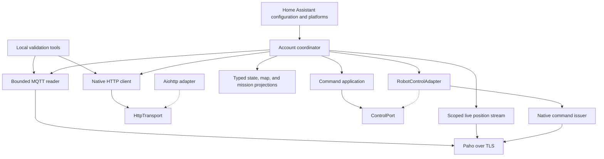
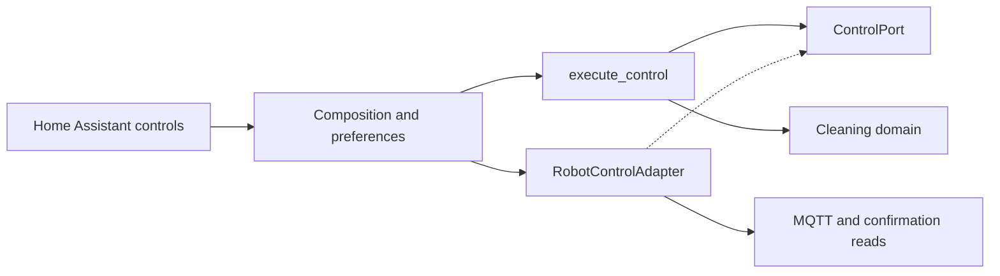

# Architecture and decisions

The integration follows My Verisure's organization of account
configuration and per-device monitoring. Roomba-specific protocol
adapters implement regional discovery, authentication, and signed cloud
requests. Home Assistant owns configuration entries, registries, and user
interfaces.

The protocol and domain modules in `core/` have no Home Assistant or CLI
dependencies. The integration and developer tools supply the transports
and lifecycle decisions at their respective entry points.

| Component | Responsibility |
| --- | --- |
| `core/models.py` | Private session values, native app profile, and destination validation |
| `core/client.py` | Discovery, single-flight authentication, signing, and typed HTTP operations |
| `core/transport.py` | HTTP timeouts, response limits, TLS transport, and redirect policy |
| `core/mqtt.py` | Scoped named shadows and bounded live position and timeline observations |
| `core/mqtt_live.py` and `live_stream.py` | Separately authenticated position subscriptions and watch lifecycle |
| `core/commands.py` | Serialize and issue a supported native command |
| `core/cleaning.py` and `core/cleaning_protocol.py` | Semantic profiles, capabilities, and translation to native settings |
| `core/application.py` | Control preconditions, dispatch, and confirmation through a port |
| `core/preferences.py` | Per-robot cleaning preference persistence contract |
| `core/state.py` and `core/telemetry.py` | Activity, availability, typed readings, and unknown state |
| `coordinator.py` | Account composition, polling, state projection, operation scope, and cleanup |
| Home Assistant platforms and WebSocket APIs | Entities, interactive cards, validation, and permissions |
| `tools/` | Explicit local validation and reduced reports |
| `specs/` | Capability contracts, acceptance scenarios, and traceability |

## Polling and confirmation

The coordinator schedules one account poll every 60 seconds at rest or
every 15 seconds during activity. It reads optional device information
on separate cadences and preserves eligible partial results. A
disconnected robot, missing data, and a verified zero remain distinct.
Paho runs outside the Home Assistant event loop. The coordinator
serializes operations sharing a broker client identity and waits for
owned work to close when an entry unloads.

The MQTT transport acknowledges a publication separately from the robot's
physical result. The command application reads again every five seconds
within the initial confirmation window. Start, pause, and stop use 40
seconds. Dock arrival uses 120 seconds. A same-mission return with
confirmed progress can continue under the regular poll. Provider
backoff applies to scheduled reads and confirmation reads. Commands
with an unconfirmed outcome are not automatically republished.

The live map uses mission timelines from authorized active polls. A
separate authenticated subscription can also deliver positions between
polls. Each live map measurement requires a matching robot, mission,
and map scope. The coordinator expires stale data and retains proven room time
across a pause, a re-entry, or a completed trip to charge. The exposed
estimate requires Roomba's duration and a supported active stage.
[MQTT state](../specs/002-mqtt-state.md) ·
[Command validation](../specs/004-command-validation.md) ·
[Current mission and maps](../specs/008-mission-detail-and-map-card.md)

## Identity and ownership

The config flow hashes the provider account ID for a stable entry
identity. Each selected robot keeps its registry identity across
reloading and reauthentication. Docks are associated child devices
when supported. Credentials and the app profile belong to the private
config entry. Diagnostics disclose model, counts, and problem
classifications without private account or map data.
[Integration lifecycle](../specs/003-home-assistant.md) ·
[Security](../SECURITY.md)

## Cleaning profiles and device capabilities

Cleaning profiles are semantic values. The serializer sends only
settings applicable to the selected mode. Changing a saved preference
does not start a mission. Resuming a paused mission preserves its
running profile.

`DeviceCapabilities` combines typed cleaning, docking, and map support.
`DockSnapshot` combines capabilities and current state before a
maintenance command. Home Assistant identifies a recognized dock through
its robot association and keeps that child device stable. Its entities use
the same robot coordinator and retain their registry identities.
[Cleaning profiles](../specs/006-cleaning-profiles.md) ·
[Device capabilities](../specs/007-device-capabilities.md)

## Maps and directed cleaning

`maps.py` validates associated active maps and their regions. The adapter
rereads the map before an area command to validate the revision and
destinations. A failed read preserves the known region associations and
marks the data unavailable. A successful read replaces the previous
inventory, including an empty result.

Directed cleaning places each profile beside its destination in the
serialized command. The command application observes a new remote
mission to confirm submission of a vacuum-then-mop sequence. The mission
history supplies its physical phases and final outcome. Live and finished
zone and furniture names use the command's associated map revision and
share the archive cache. [Cleaning profile SDD](../specs/006-cleaning-profiles.md) ·
[Map and mission SDD](../specs/008-mission-detail-and-map-card.md)

The timeline adapter projects destination identities and skip events into
the command use case. Home Assistant hashes the reviewed mission and
destination for its card and validates that review before issuing a new
read. The use case compares the freshly reported destination and confirms
the request only when a matching new skip event appears. The same robot
operation lock covers preparation, dispatch, and confirmation.
[Skip command validation](../specs/004-command-validation.md)
