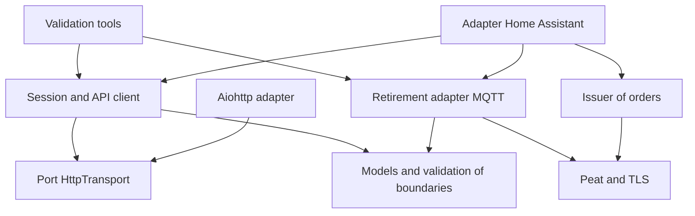
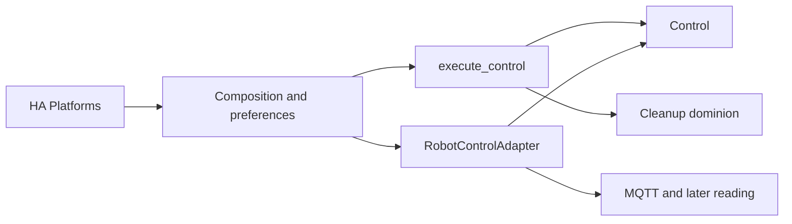

# Architecture and decisions

The structure refers to the model of My Verisure: API isolated from framework, account
configuration and several devices as separate evidence for product expectations. Your
authentication protocol isn't re-used.

textual equivalent: tools make up HTTP and MQTT customers. HTTP depends on an injected port
and aiohttp implements it. Both customers use private models. The adapter Home Assistant
consumes these customers and doesn't change their contracts.

| Component | Current liability |
| --- | --- |
| `core/models.py` | Session, implementation profile and destination validation |
| `core/client.py` | Access, exclusion from concurrent renovations and HTTP signature |
| `core/transport.py` | HTTP TLS, response limits and time |
| `core/mqtt.py` | WebSocket connection, tokens and shadows scattering |
| `core/commands.py` | Fitted vocabulary and unique sending with receipt of the broker |
| `core/cleaning.py` | Unchanging modalities, capabilities and preferences without infrastructure |
| `core/cleaning_protocol.py` | Translation of support bits and native parameters |
| `core/application.py` | Preconditions, resumption and confirmation through Control Port |
| `core/preferences.py` | Stylish persistency contract with no HA dependencies |
| `core/state.py` | Pure activity projection, connectivity and unknown values |
| `coordinator.py` | HA composition, consultation and exclusion of the port's control |
| `config_flow.py` and platforms | Account, selection and status |
| `tools/` | Private inputs and standardized reports |
| `specs/` | Contracts, risks and testing with each capacity |

The core doesn't matter Home Assistant. The adaptors MQTT are blockers and the co-ordinator
runs them in an executor, serializing consultations or orders so as to avoid opening
customers with it client_id At once. Each operation closes its connection. When canceling,
its closed closure is expected and the thread isn't abandoned.

The regular consultation is every 60 second. Each robot processes his or her serial orders.
During a confirmation call, another robot can run an order and simultaneous checks share the
reading of his current account. The transition will be checked every five seconds with a
period of 40 seconds or 120 To come back. A failed reading cuts the confirmation and
preserves unconfirmed result. The recovery period after a reading failure or an 429 applies
to both the scheduled consultation and status refresher applying for order. The endpoint's
limit of maps is shared between his scheduled consultation and directed cleanliness. The
complete cleanup orders preserve their own access to the robot's status.

A production of mop in the requested mode registers an initial result as sent and releases a
robot's command shift. The regular readings can confirm the cleaning phase by comparing
number and start of mission. When an error, another mission or end of time have been
detected and the result remains unconfirmed. To send another order replaces the following of
an earlier command.

In 0.2.0 the consultation goes to 15 seconds during activity of the robot or its base. The
four slow shadows are consulted every five minutes and consumptionates them each thirty. His
faults leave those fields unknown without hiding a valid quick reading. `core/telemetry.py`
projects an explicit list of fields; `core/problems.py` It categorizes origins and changes.
The event platform resets its baseline to avoid repeated warnings after recharging. They
never turn raw documents into entity attributes.

## Decisions

1. **Modern native API.** Gigya's been validated → iRobot → AWS SigV4, without transferring
   assumptions from earlier Roomba integrations.
2. **A separate client from the app.** A `app_id` its own and stable generates customers
   MQTT different. The test shown that to change only `device_id` That's bad.
3. **Do not match transport and result.** HTTP 200, MQTT CONNACK and a PUBINK represent
   different phases, with an order confirmed only by evidence of application or posterior
   status.
4. **Unknown explicit information.** A missing Shadow is an unavailable capacity, no zero
   battery and robot disconnected. An old snapshot doesn't set currently available.
5. **Initial periodic consultation.** The proven conduct is stated as cloud_polling. No
   persistent stream and no event reconnection are announced.
6. **Private and stable identities.** The account uses a CognitoId hash and each robot
   retains its identity by re-authenticating or recharging. Names and IDs do not come out in
   diagnoses; account data are preserved only with HA's private configuration.

## Scope and evolution

The local version 0.1.0 already includes Loading, Reloading and resuscitation. 2026.11.2.
His reading was contrasted with his actual account and orders to a physical robot using an
independent client. It was also installed on the HA Green 2026.11.2 domestic server with
three devices, twelve entities and recharging as well to its confirmed monitoring cycle from
ha.

Prolonged renewal after natural expiry, a stream of events with version management and re-establishment are pending. See [Current SDD](../specs/003-home-assistant.md). The extension of information and events is governed by [Telemetery SDD](../specs/005-telemetry-and-problems.md).

## Profiles and monitoring 0.3.0

The cleanup domain doesn't know HA, Paho or the supplier's JSON keys. The application
receives a semantic status, prepares an agenda and uses `ControlPort` to refresh with once
or after the result. The adapter links a robot from the coordinator with that port. Import
tests prevent domain or use cases from dependent on transport, composition and HA.

The preferences are saved at options of the HA entry per robot, as semantic values. To
restore them doesn't issue an order. The select, number and switch controls modify the next
cleanup. The serializer omits parameters from inactive modes without deleting preferences. A
start about a paused mission becomes an abstract and does not send up new profile.

In text: The platforms call for composition, the case of use depends on a port and an
adapter connects with his or her supplier. The account coordinator renews session and common
information. Each robot's co-ordinator leaks and reuses the information for its entities. At
the end of that period MQTT, an accepted robot's responses are preserved even if another
computer with a same connection did not respond. If you miss all reading, HA program the
next attempt with exponential waiting 60 a 900 seconds.

`DeviceCapabilities` It brings together tipades of cleanliness, base and maps with information sources. `DockSnapshot` It combines the equipment's status and capabilities to validate maintenance orders. The issuer serializes known orders and the application confirms their transitions. When the robot recognizes its base, Home Assistant it registers as a child device. Readings have been shown to explain `dock.known` and basic capabilities but omits manufacturing identifier `dock.id`. The child device is identified by its association with the robot and preserves a group if they replace their base. The sensors and controls share the coordinator of that robot, while maintaining their `unique_id` To associate with the child device. [Registration of children's devices Home Assistant](https://contributors.home-assistant.io/core/integrations/device-registry/#child-devices)

`maps.py` accepts active maps and associated regions. The adapter looks at the map again before an area order to validate IDs and version. A failed consultation preserves known regions for HA associations and sets the source as unavailable. The map counters are expecting a valid reading. A fair reading replaces earlier data, even if the supplier returns an empty inventory. The [Extended SDD](../specs/007-device-capabilities.md) register the contract and physical evidence still outstanding.
