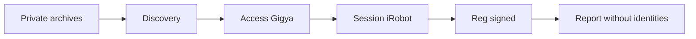

# Native access, session and HTTP reading

- Status: As-built baseline
- Date: 2026-11-23
- Catalog capability ID: native-api
- Last verified: 2026-11-23
- Owners: ha-roomba-home maintainer
- Scope: independently researching client for access and signed reading.
- Related issues/PRs: No local work without publication.
- Required review gates: product, UX, architecture, testing, documentation, and security/operations
- Open decisions blocking readiness: None for this base; HA remains out of reach.

## 1. Executive summary

The researcher can authenticate an account and read his robots without dependent on Home
Assistant or re-using the emulator session. The client MUST keeps the secrets out of his or
her representations and reports. That base document the current conduct and does not propose
a functional change.

## 2. Problem, current behavior, and evidence

The modern application uses a different access from that of earlier Roomba customers. The observed flow is regional discovery, Gigya and native exchange. They were executed 26 actual checks with no malfunctions and see [evidence](../docs/validation.md) and [client](../custom_components/roomba_home/core/client.py).

- Observed behavior: direct access, four partnerships and HTTP Readings.
- Intentional contract: Validate destinations, share concurrent renewal and do not register
  payLoads.
- Known debt and limitations: complete renewal with password, no natural expiry or MFA
  tested.
- Unknown rationale: The contractual policy of the supplier's duration and all its Gigya
  code are currently unknown.
- Proposed improvements: persistent token, prolonged recovery and HA adapter in separate
  specification.

## 3. Actors, surfaces, and terminology

| Actor | Objective | Input | Surface |
| --- | --- | --- | --- |
| Research | Repeat reading | explicit CLI | Reduced report |
| Holder | Keep account monitoring | Private archives | No secrets at Git |
| Customer | Get valid session | `ensure_session` | Private model |

Profile means client configuration; assertion signifies Gigya's identity proof and session
refers to temporary credentials of iRobot. No one's equivalent to a confirmed physical
status of the robot.

## 4. Goals, non-goals, and fixed invariants

- API-01: the client MUST accept only validated supplier HTTPS and relative secure routes.
- API-02: the client MUST check `errorCode` from Gigya and the structure or expiry of
  credentials.
- API-03: concurrent renewal MUST share a single access through mutual exclusion.
- API-04: transport MUST limit time and size, retain signed bytes or reject readdresses.
- API-05: tools and errors MUST omits private values at their public exit.

Do not include LAN discovery, physical orders and tuning or HA entities. No automatic
Reattempts of POST are performed and all 403 become a new access.

## 5. Current versus proposed product journey

The current course remains. To change it requires new evidence and to update this SDD,
future integration will only consume them

textual equivalent: private inputs → discovery --- access > session {reading} A bug stops
the sequence before its next dispatch.

## 6. Functional behavior and state model

| State | Input | Next step | Recovery |
| --- | --- | --- | --- |
| No session | Home or invalidation | Access under lock | No partial token published |
| Acceding | First applicant | Validate response | Cancel Free lock |
| Valid | Expiration to more 300 s | Reuse Session | None |
| Coming to expire | Margin reached | New complete access | Reclassified error if malfunction |
| Rejected | Non-zero or Failed HTTP | Rewrite error | The caller decides the action |

The session will only be published after its validation. A second check inside the lock
prevents duplicated accesses. Cancellation doesn't turn into success. A signed reading does
not change the inventory stored by an application.

## 7. User-facing configuration

| Input | Type | Default | Validation and persistence |
| --- | --- | --- | --- |
| Country | Text | ES at CLI | Two ASCII letters, by instance |
| Account | File | Mandatory | Regular, with no symbol and permits 0600 |
| Profile | File | Mandatory | `app_id` and its own identifier; generated without applying secrets |
| Reference capture | File | Absence | Only observed success GER |
| Retirement | File | Absence | Opt-in private, 0600 |

Recommended example: Catalogue reading without capture. Alternative: Replay observed
readings passing private SAR. The CLI doesn't take secrets from the environment. No HA
configuration migration at this stage.

## 8. Clean Architecture design

`models.py` has validation and data; `client.py` session and signing orchestra
`HttpTransport` is the port and aiohttp implements transport `tools/` Comes and normalizes
reports. The core MUST NOT matter HA and the CLI entrypoints.

The supplier's account and responses are private. The discovery is an unreliable entrance
until its domains have been validated. Transport does not have a retrying policy. The
architecture test checks imports and HTTP Fakes check URL, form with body or header without
network.

## 9. UI/UX and content contract

The CLI is currently the interface. The final output is JSON reduced, legible by tools and
without depending on colors. No comments or notifications are published.

- Pending: The process is currently performing validation and there's still no final result.
- Action required: To correct a private file or account, the classification will be shown.
- Blocked: `{"result":"failed","error":"AuthenticationError"}` with non-zero output.
- Partial: report with rows `failed` and preserve checks already performed.
- Complete: quantity of checks, malfunctions and robots with zero output.

Technical messages and guides use English. Public paths are normalized and omit provider data and untrusted Markdown.

## 10. Failure, recovery, and cleanup

| Failed | Outcome | Retirement | Conservation |
| --- | --- | --- | --- |
| Rejected account | AuthenticationError | Non-automatic | No original response |
| Unexpected outline | ProtocolError | Non-automatic | No part-session |
| 403 | Fingerbug | Non-automatic | No presumption of expiry |
| 429 | RateLimited | The phone call. | Stretch 1–900 s |
| Cancellation | It spreads | Retirement | Lok released |
| Failed batch reading | Failed row and non-zero output | Non-automatic | Previous rows preserved |

The phone call closes ClientSession. The explicit session files are closed until the
incumbent closes their campaign and they aren't published.

## 11. Security, permissions, and privacy

The invariants API-01, API-04 and API-05 They're not configurable. TLS verifies network and
hostel. No URLs supplied by a user are signed without validating their path. The SAR doesn't
become fixtures. The tests use synthetic values. The temporary password remains out of Git
and changes them by the incumbent at his end.

## 12. Observability and operational UX

The report lays out standardized routes, classification and JSON type. No values or
identifiers have been put up to them but no demand was required for their strengthening as a
result of these measures with an impact on the production industry's market share (see
Section 3) The renewal checks if they rotate their credentials and whether the robot set is
preserved without revealing any keys. No payloads and metric login with IDs as labels.

## 13. Compatibility, migration, rollout, and rollback

Base verified with app 3.4.1, Country ES and Python 3.14. He doesn't promise other regions
or versions. There's no HA scheme to migrate. To get back to the previous version means stop
running tools and no robot settings have been altered.

## 14. Testing strategy and numeric budget

Minus derived from different risks and parameterized cases count for run entry, with no
duplication of testing between areas.

| Area | Minimum number of different cases | Risks |
| --- | ---: | --- |
| Policies and inputs | 20 | Domains, cross-sectionality and countries with profile have been put to an end |
| Session and concurrence | 12 | Caching, renewal and cancellation. Gigya |
| HTTP contracts | 20 | Signature, errors and exact body |
| Transport and tools | 9 | Limits, closure and privacy with a replay filter |
| Architecture and scanner | 3 | Unvalued dependencies and detections |
| **Total** | **64** | No double computation |

The complete core MUST achieve 100% cover with branches. Unconnected tests aren't expecting
actual watches and they're reading their account. The actual test of 26 checks complements
this suite and does not replace determinist faults.

## 15. Documentation and discoverability

| Path | Change |
| --- | --- |
| README.md | update |
| docs / api.md | create |
| docs / development.md | create |
| docs / validation.md | create |
| SECURITY.md | create |

The [Contents](../docs/index.md) links reference, repetition and boundaries. Catalogue should maintain existing bonds with this base as research evidence

## 16. Acceptance scenarios

1. Due to a valid account, the client gets signed session and catalogue without an app.
2. With 12 simultaneous applicants, only one access was made.
3. At an earlier date, a new credential replaces the old one.
4. To Gigya HTTP 200 with error, the exchange isn't sent iRobot.
5. To an alien's destination, the account isn't passed.
6. Once cancelled, a later request can be continued.
7. A HAR with POST or other hosts does not cause write and send to these hostel.
8. A partial report preserves the results and ends with error.

## 17. Requirements traceability

| Requirement | Component | Test / evidence | Documentation |
| --- | --- | --- | --- |
| API-01 | models / client | test_api_client: URLs and unsafe routes | docs / api.md |
| API-02 | client / models | test_api_client: Gigya and schemes | docs / api.md |
| API-03 | client | test_api_client: concurrence and cancellation | docs / architecture.md |
| API-04 | transport / client | test_transport_and_tools and exact signature | docs / development.md |
| API-05 | tools / models | privacy and compliance tests | SECURITY.md |

## 18. Implementation sequence

To maintain this basis: to change contract and synthetic tests, amend policies but adapt
orchestration or transport. Replay actual authorized evidence if the protocol changes with
an update of reference information as well how we re-energize cataloguing That retrospective
SDD doesn't require additional behavioral changes.

## 19. Definition of Done

- [x] Flow and boundaries drawn to code, actual evidence.
- [x] Credentials and catches outside Git; standard output.
- [x] Suite determinist and architecture check available.
- [x] Forced renewal and live tested inventory.
- [x] Final passing of cover, privacy and catalogue registered in the report.

The last box should be closed with actual performance, but not the existence of a script.

## 20. References and decisions

See [API and primary sources](../docs/api.md), [SDD standard](README.md) and [architecture](../docs/architecture.md). Botocore was chosen for SigV4 rather than applying his own cryptography. The orders and integration do not belong to this base but are specified in [003](003-home-assistant.md).
