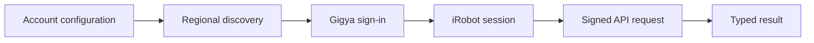

# Native authentication and signed HTTP requests

- Status: As-built baseline
- Date: 2026-11-23
- Catalog capability ID: native-api
- Last verified: 2026-11-28
- Owners: ha-roomba-home maintainer
- Scope: Regional discovery, native authentication, session renewal, and signed HTTP requests
- Related issues/PRs: Native API validation and the Home Assistant release workflow
- Required review gates: product, UX, architecture, testing, documentation, and security/operations
- Open decisions blocking readiness: Natural session expiry during extended operation and interactive account challenges remain unverified.

## 1. Executive summary

The HTTP client authenticates a Roomba Home account and opens a private iRobot
cloud session. Home Assistant and the validation CLI use the same client.
Credentials, signed headers, raw responses, and robot identifiers stay out of
diagnostics and published reports.

## 2. Problem, current behavior, and evidence

Roomba Home uses regional discovery, Gigya authentication, and an iRobot
session exchange. The resulting credentials sign requests against the
discovered iRobot API. The first authorized run completed 26 HTTP checks
and confirmed session replacement. Later household validation exercised the
same account client through releases of Home Assistant. Coverage of other
account regions and interactive challenges depends on further evidence.
[Protocol](../docs/api.md#authentication) · [Validation](../docs/validation.md)

- Observed behavior: Discovery and account authentication produce a signed session and robot inventory.
- Intentional contract: The client validates destinations, shares renewal, and returns typed outcomes.
- Known debt and limitations: Extended operation through natural session expiry and interactive sign-in challenges needs physical evidence.
- Unknown rationale: Roomba's server-side credential duration and challenge policy have not been established.
- Proposed improvements: Record the renewal outcome in an extended authorized run before changing the session contract.

## 3. Actors, surfaces, and terminology

| Actor | Surface | Result |
| --- | --- | --- |
| Account holder | Home Assistant setup and reauthentication | Supported robot inventory |
| Maintainer | Local validation CLI | Reduced HTTP report |
| Home Assistant adapter | `ensure_session` and typed client methods | Private session and verified responses |

The app profile defines which native client identity is presented. Gigya
supplies the identity assertion. iRobot returns the session used for HTTP
signing and for establishing authorized MQTT connections.

## 4. Goals, non-goals, and fixed invariants

- API-01: The client MUST validate HTTPS provider hosts and relative API paths before sending credentials or signing requests.
- API-02: The client MUST check Gigya's application status, the identity assertion, and the form and expiry of the iRobot session.
- API-03: Concurrent callers MUST share one session renewal using a lock and a second cache check.
- API-04: The transport MUST bound HTTP reads, reject redirects, and preserve the exact bytes used in request signing.
- API-05: Representations, errors, diagnostics, and public evidence MUST omit private values.

MQTT state, physical commands, and entity behavior have their own contracts.
Higher-level map, schedule, and routine services govern the operations that
write through the HTTP client.

## 5. Current versus proposed product journey

Home Assistant collects the account details, validates the account, and
offers the associated supported robots. The local CLI accepts private input
files and records a reduced report for protocol validation.

## 6. Functional behavior and state model

| State | Condition | Next step |
| --- | --- | --- |
| No session | First use or explicit invalidation | Authenticate under the renewal lock |
| Authenticating | Discovery and sign-in in progress | Publish the session only after validation |
| Ready | Cached credentials are outside the 300-second renewal margin | Reuse the session |
| Near expiry | The renewal margin has been reached | Authenticate again under the same lock |
| Rejected | Authentication or validation failed | Return a classified error to the caller |

Cancellation releases the lock. The next caller checks the cache and can
try again. Each HTTP response is validated for the particular operation.

## 7. User-facing configuration

| Input | Where supplied | Validation |
| --- | --- | --- |
| Country | Home Assistant or CLI | Two ASCII letters, normalized to uppercase |
| Credentials | Private Home Assistant entry or protected CLI file | Required account and password |
| App profile | Generated during Home Assistant setup or CLI bootstrap | Stable native client configuration |
| Reference capture | Optional, local validation CLI | Replay only previously successful JSON GET requests |
| Session output | Optional, local validation CLI | Private file outside the checkout with mode 0600 |

[Installation](../docs/installation.md) · [Development](../docs/development.md)

## 8. Clean Architecture design

`core/models.py` holds private data structures and URL validation.
`core/client.py` coordinates discovery, authentication, signing, and typed
operations. `HttpTransport` is the port. `AiohttpTransport` implements it
using a client session owned by the caller. The core has no Home Assistant
or CLI dependency. The command line entry points and Home Assistant compose
the same core with their own lifecycle and presentation.

## 9. UI/UX and content contract

Home Assistant distinguishes invalid authentication, rate limits,
unsupported responses, and connection failures. Reauthentication uses
Home Assistant's native flow. The validation CLI emits structured results
with classified failures and status codes. Individual successful checks
remain visible when a batch is incomplete.

- Pending: The account or response is being validated.
- Action required: Home Assistant requests reauthentication or the CLI identifies invalid input.
- Blocked: A classified error stops the operation at the affected stage.
- Partial: The CLI preserves verified rows in an incomplete validation batch.
- Complete: A valid session or typed response is available to the caller.

## 10. Failure, recovery, and cleanup

| Failure | Outcome |
| --- | --- |
| Nonzero Gigya status | `AuthenticationError` with the provider code |
| Unexpected discovery, assertion, session, or response | `ProtocolError` with a fixed message |
| Other HTTP failure such as 403 | `ApiError` with the numeric status |
| HTTP 429 | `RateLimited` with a delay bounded to 1–900 seconds |
| Cancellation | Release the lock and propagate cancellation |

Transport timeouts and body size are bounded. The default response limit is
8 MiB and the total request timeout is 30 seconds. The caller owns retry
policy. The client issues one request per invocation and does not follow
redirects or silently replay writes.

## 11. Security, permissions, and privacy

Use normal TLS validation. Discovery output must pass the provider host
checks before account details are sent. The signed path and method must pass
the client restrictions. The replay tool accepts only the observed
successful JSON GET requests within its provider scope. Credentials and
captures must stay in private storage and outside the repository.

## 12. Observability and operational UX

Report route categories, statuses, and failure classifications. Privacy
tests cover representations, reports, and repository files. The authorized
renewal check verifies that the credentials can be replaced and the robot
inventory remains reachable without printing private values.

## 13. Compatibility, migration, rollout, and rollback

Evidence covers Roomba Home Android 3.4.1, an account in Spain, Python 3.14,
and Home Assistant Core 2026.11.2. Home Assistant updates retain its account
entry and profile. Independent CLI validation takes its inputs from local
files and does not change the robot's settings.

## 14. Testing strategy and numeric budget

| Area | Minimum independent cases | Coverage |
| --- | ---: | --- |
| Input policy | 20 | Hosts, paths, country, and profile |
| Session lifecycle | 12 | Reuse, concurrency, expiry margin, and cancellation |
| HTTP contracts | 20 | Status, signature, exact bytes, and responses |
| Transport and tooling | 9 | Limits, cleanup, replay, and redaction |
| Architecture and privacy | 3 | Dependencies, representations, and report boundaries |
| **Total** | **64** | Independent baseline cases |

The full suite requires 100% statement and branch coverage. Use fakes and
controlled clocks for failures. Keep authorized physical evidence separate
from deterministic regression tests.

## 15. Documentation and discoverability

The API reference explains the protocol. The development guide explains
private CLI validation. The installation guide explains Home Assistant's
account setup and storage. The security policy defines published evidence.
[API](../docs/api.md) · [Development](../docs/development.md) ·
[Installation](../docs/installation.md) · [Security](../SECURITY.md)

## 16. Acceptance scenarios

1. Authenticate a valid account and read its signed inventory from both supported entry points.
2. Start concurrent session requests and observe a single exchange.
3. Advance the test clock into the renewal margin and replace the session.
4. Reject a nonzero Gigya result without contacting the iRobot login endpoint.
5. Reject an invalid destination before transferring account data.
6. Cancel an exchange and allow a later caller to proceed.
7. Refuse captured writes and requests outside the approved replay scope.
8. Preserve verified rows and return failure for an incomplete validation batch.

## 17. Requirements traceability

| Requirement | Component | Test |
| --- | --- | --- |
| API-01 and API-02 | `core/models.py`, `core/client.py` | [API client tests](../tests/test_api_client.py) |
| API-03 | `RoombaClient.ensure_session` | [Concurrency and cancellation tests](../tests/test_api_client.py) |
| API-04 | `core/transport.py`, signed request | [Transport tests](../tests/test_transport_and_tools.py) |
| API-05 | Core models and local tools | [Architecture and privacy tests](../tests/test_architecture_and_privacy.py) |

## 18. Implementation sequence

When a provider contract changes, record the authorized evidence, update
its typed contract, and add a synthetic regression that preserves failure
and retry behavior. Verify the same flow through the affected entry points.

## 19. Definition of Done

- [x] The client is shared by Home Assistant and local validation tools.
- [x] Host, route, signing, renewal, and privacy boundaries have deterministic tests.
- [x] Authorized account validation recorded inventory and session replacement.
- [x] The repository enforces full coverage, privacy, and specification checks.

## 20. References and decisions

Botocore supplies SigV4 signing. The MQTT authentication derived from the
session is covered in the next specification. The Home Assistant adapter
owns configuration and command outcomes.
[MQTT](002-mqtt-state.md) · [Home Assistant](003-home-assistant.md) ·
[Architecture](../docs/architecture.md)
