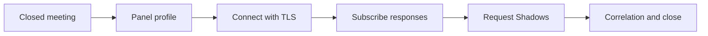

# Modern robot state via MQTT

- Status: As-built baseline
- Date: 2026-11-23
- Catalog capability ID: mqtt-state
- Last verified: 2026-11-23
- Owners: ha-roomba-home maintainer
- Scope: WebSocket connection and name shadows scattering.
- Related issues/PRs: No local work without publication.
- Required review gates: product, UX, architecture, testing, documentation, and security/operations
- Open decisions blocking readiness: No scattering, continuous monitoring and out of reach commands.

## 1. Executive summary

The researcher can check the cloud status of modern models using native session tokens. The
Reader MUST publish only applications `get` and correlated his answers. Stored status and
robot connectivity are different facts. That base did not propose a functional change.

## 2. Problem, current behavior, and evidence

The classic Shadow contains only a share of modern data. The app uses its own name and
WebSocket authentication states. They have been contrasted with real connections: two links,
four classic shadows and 27 modern responses, including three absences 404.

- Observed behavior: eight types of Shadow responded correctly to three modern robots.
- Intentional contract: TLS, tokens per group and robot prefixes with a reading correlation.
- Known debt and limitations: A blocking reader with no reconnection or reduction of
  continuous events.
- Unknown rationale: `ro-sensor` does not exist in proven robots and their general matrix is
  unknown.
- Proposed improvements: persistent coordinator and confirmed orders at the SDD 003.

Evidence at [validation](../docs/validation.md), [reference](../docs/api.md) and [Adapter](../custom_components/roomba_home/core/mqtt.py).

## 3. Actors, surfaces, and terminology

| Actor | Objective | Input | Surface |
| --- | --- | --- | --- |
| Research | Consult status | CLI MQTT | Quantities per Shadow |
| Broker | Authorisation of devices | Named Token | CONNACK and SUBINK |
| Shadow service | Repurchase status | Application `get` | Accepted / rejected |

A Shadow's a versed cloud document. CONNACK accepts the connection and SUBINK agrees with
subscriptions. No one confirms that a physical order has been enforced.

## 4. Goals, non-goals, and fixed invariants

- MQ-01: profile MUST restrict endpoint IoT, header and theme to valid session values.
- MQ-02: the reader MUST sign up to concrete responses in lots of as many and eight before
  posting readings, without `retain`.
- MQ-03: each response MUST coincide with the topic and `clientToken` and other people's
  messages do not complete their reading.
- MQ-04: each phase MUST have a time limit and close the client even if it fails.
- MQ-05: an absence 404 MUST to be preserved as a rejection of capacity without purporting
  valid status.

Out of reach: automatic reconnection, commands and write `rw-` with LAN credentials.

## 5. Current versus proposed product journey

The base preserves its current course and will have to be run by the future consumer outside
his or her asynchronous loop, with a decision about how they can re-engage.

Textual equivalent: session → profile --- connection > subscribing ► reading • closure.

## 6. Functional behavior and state model

| State | Status | Transition | Outcome |
| --- | --- | --- | --- |
| Prepared | Validated profile | Connect | No previous publications |
| Connected | CONNACK accepted | Subscribe exact issues | Judgement of auth stops |
| Subscribed | SUBACK accepted | To publish `get` | Without a blind backlash |
| Receiving | Topic and token match | Unite response by robot / Shadow pair | Duplicate substitutes for the same pair |
| Complete | All pairs responded | Unconnect | Rejected and rejected responses |
| Failed | Timeout or Rejection of Transport | Unconnect | ProtocolError without payload |

The reader does not maintain a derivative status between consultations. The documents
received are neither merged nor presented as current events. The messages that are too big,
but JSON with another token or theme have been ignored.

## 7. User-facing configuration

| Input | Default | Limit | Persistence |
| --- | --- | --- | --- |
| Session file | Mandatory | Private regular 0600 | External to Checkout |
| Shadows | Nine observed | Only known list | By call |
| Timeout | 15 seconds per phase | That's bigger than 0 and maximum 60 | Per reader |
| Report | Mandatory | Do not place session | Quantities and types only |

Recommended: 9 shadows for research. A library alternative: `ro-currentstate` and
`rw-constatus` for a minimum reading. A client MQTT have to share `client_id` with another
simultaneous instance. No migration.

## 8. Clean Architecture design

`MqttProfile` translate the session, `MqttShadowReader` composes the protocol and Paho
implements transport. The injection factory allows to simulate broken and malfunctions. The
document remains within `ShadowReply` and its representation is closed.

The adapter MUST NOT import HA or CLI. Architecture tests check direction and the fake
broker checks header, TLS with order of subscription or themes. The library doesn't read
archives or decide to persistency. The CLI does not interpret drums and doesn't determine
physical availability.

## 9. UI/UX and content contract

- Pending: an ongoing consultation with no final result.
- Action required: to provide an effective session and avoid another client with the same
  identifier.
- Blocked: No zero error and output classification with an incomplete connection or
  response.
- Partial: A successful final report isn't issued if responses are missing and rejected
  documents do count as answers.
- Complete: report with connections, responses and quantity by Shadow / code.

The CLI writes JSON and the documentation uses English. It does not contain
IDs, complete themes or documents. Do not create notifications. The guide's tables are
legible with no colors or diagram.

## 10. Failure, recovery, and cleanup

A invalid profile fails before connecting. A rejected CONNACK / SUBINK or an unaccepted
sending stops reading. A timeout isn't interpreted as an offline robot. In all these cases
we demand to get off and stop the thread. The call can be renewed and a new explicit
consultation will run. No payloads have been persisting and no publications are sent after
re-connecting.

## 11. Security, permissions, and privacy

TLS valid host and chain. RR and LF are not supported by heads. Ids or prefixes reject
comodines with unexpected separators) The devices have to be put into session. Subscriptions
are non-global. The documents may contain hashes, maps and names: MUST stay private even if
reading is successful.

## 12. Observability and operational UX

The report reduces responses to Shadow, acceptance and code. The absence of a Shadow is
visible without revealing the device's identity. The supplier's textual motif and his or her
physical update are not registered `get`. The production frequency and backoff shall be
defined with the future coordinator.

## 13. Compatibility, migration, rollout, and rollback

Valid in the observed modern family and with an inventory that also includes old robot. An
old model can turn down the nine shadows. No guarantee for other families. To stop the
process will put back a test: only readings have been made. There is no system of
persistence MQTT to migrate.

## 14. Testing strategy and numeric budget

| Area | Minimum number of different cases | Risks |
| --- | ---: | --- |
| Profile and privacy | 8 | Host, header and device |
| Transport and correlation | 8 | Success 404, 4 Rejections and Timeout & AWS batches |
| Consultation Setup | 6 | Three time limits and three invalid numerals |
| **Total** | **22** | No double computation |

`tests/test_mqtt.py` run these cases with a fake broker. The cover of the adapter MUST be
100% with branches. The actual evidence also checks handshake and response compatibility,
but does not atprove physical monitoring.

## 15. Documentation and discoverability

| Path | Change |
| --- | --- |
| docs / api.md | create |
| docs / architecture.md | create |
| docs / development.md | create |
| docs / validation.md | create |
| SECURITY.md | create |

The [guide](../docs/development.md) explain how to run the reader and his reference lists Shadows without including private values.

## 16. Acceptance scenarios

1. With valid token, authorized devices are connected and read.
2. A missing Shadow returns correlated rejection without inventing data.
3. A message with another token or topic doesn't complete an application.
4. A denial of connection does not cause publications.
5. A refusal to sign up doesn't cause publications.
6. A lost response leads to timeout and closure.
7. A profile with comodines or other endpoint fails before connecting.
8. The complete report contains no identifier or original document.

## 17. Requirements traceability

| Requirement | Component | Test / evidence | Documentation |
| --- | --- | --- | --- |
| MQ-01 | MqttProfile | Mutations of host, header and device | SECURITY.md |
| MQ-02 | MqttShadowReader | TLS and themes just get | docs / api.md |
| MQ-03 | message callback | Other people's messages, corrupt and different words | docs / architecture.md |
| MQ-04 | read / finally | Rejected and timeout | docs / development.md |
| MQ-05 | ShadowReply | Rejection 404 synthetic and real | docs / validation.md |

## 18. Implementation sequence

The maintenance first changes contracts and broker cases, after profile with an adapter or a
CLI guide. A real reading with an independent client is repeated and catalogued. That
database does not require an addition of writing or reconnection.

## 19. Definition of Done

- [x] Configure contrasted with an app and actual reading test.
- [x] Private profile, attached themes and closed up implemented.
- [x] 22 synthetic cases cover risks and boundaries.
- [x] Final performance of reusable tool and registered catalogue.
- [x] The limits of freshness, compatibility and explicit scope.

## 20. References and decisions

[Reference MQTT and AWS sources](../docs/api.md), [native meeting](001-native-api.md) and [That's been scheduled.](003-home-assistant.md). Specific themes have been chosen following AWS's recommendation and the introduction of an app code was avoided. The reader returns private documents, non-entities and derivative states.
