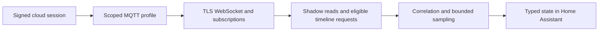

# Robot state and live observations over MQTT

- Status: As-built baseline
- Date: 2026-11-23
- Catalog capability ID: mqtt-state
- Last verified: 2026-11-28
- Owners: ha-roomba-home maintainer
- Scope: Named shadows, authorized live-map messages, and correlated mission timeline reports
- Related issues/PRs: Native state validation and household live-map trials
- Required review gates: product, UX, architecture, testing, documentation, and security/operations
- Open decisions blocking readiness: The availability of additional shadows and live messages on other models remains unverified.

## 1. Executive summary

The MQTT reader retrieves named Roomba cloud shadows and, during a
recognized mission, can sample live position and timeline events.
Home Assistant projects accepted data into state and measures connectivity
from its dedicated source. Every read owns a bounded connection.

## 2. Problem, current behavior, and evidence

Roomba Home uses TLS WebSockets and per-group authorization tokens to read
named shadows and receive live mission data. The initial validation
established both accepted responses and correlated 404s. Later household
trials confirmed position batches, timeline updates, and the state
transition into an active recharge.
[MQTT protocol](../docs/api.md) ·
[Active recharge trial](../docs/validation.md#charging-during-the-same-cleaning-mission)

Shadow inventory and live support can differ by robot. A rejected shadow
indicates that the requested document was unavailable. Connectivity
requires a separate accepted observation.

- Observed behavior: Named replies, positions, and timeline reports are available for the validated model.
- Intentional contract: MQTT reads have explicit authorization scope, correlation, and deadlines.
- Known debt and limitations: Shadow and live-message support can vary by model and firmware.
- Unknown rationale: Some robots reject `ro-sensor` with a correlated 404.
- Proposed improvements: Verify further message types on their target firmware before adding them to the allowlist.

## 3. Actors, surfaces, and terminology

| Actor | Surface | Result |
| --- | --- | --- |
| Local maintainer | MQTT validation CLI | Reduced counts by shadow and response code |
| Home Assistant coordinator | `MqttProfile` and `MqttShadowReader` | Correlated state and live observations |
| Roomba broker | Scoped WebSocket connection | CONNACK, SUBACK, shadow replies, and live messages |

A shadow is a cloud document. CONNACK and SUBACK acknowledge the connection
and subscription. Physical command confirmation requires a separate
correlated observation.

## 4. Goals, non-goals, and fixed invariants

- MQ-01: The profile MUST constrain broker hosts, headers, device prefixes, and topics to validated session data.
- MQ-02: The reader MUST subscribe to named response topics before publishing reads and limit each batch to eight filters.
- MQ-03: The reader MUST match shadow replies to the topic and request token, and timeline replies to the nonce and mission number.
- MQ-04: The reader MUST bound connection, subscription, and receive waits and close when a read finishes or fails.
- MQ-05: The reader MUST preserve correlated rejections as unavailable documents.
- MQ-06: Live observations MUST be authorized, fresh, and non-retained. Position batches MUST stay bounded.

Physical commands and settings writes use the separate command adapter.
The polling coordinator owns read cadence, renewal, and retry timing.

## 5. Current versus proposed product journey

The validation CLI reports counts from an explicit shadow read. During
Home Assistant polling, the coordinator can add authorized live-map topics
and timeline requests for a corroborated mission.

## 6. Functional behavior and state model

| Stage | Requirement | Result |
| --- | --- | --- |
| Profile | Valid broker and associated devices | Authorized topics and credentials |
| Connect | Successful CONNACK | Begin subscription |
| Subscribe | Successful named shadow SUBACK | Send shadow reads and eligible timeline requests |
| Receive | Matching topic and request token or timeline nonce | Save correlated replies and recent live batches |
| Complete | All mandatory replies or permitted partial read | Return collected data and close |
| Failed | Timeout, transport failure, or rejected mandatory subscription | Return classified failure and close |

The reader can preserve accepted responses at its deadline when partial
reads are enabled. A timeline is tied to both the request and the reported
mission number. The coordinator checks its freshness and mission start
before using it. Apply the same scoping to positions and raw-route
references.

## 7. User-facing configuration

| Input | Default | Validation |
| --- | --- | --- |
| MQTT profile | Derived from the current iRobot session | Valid host, token group, and robot association |
| Named shadows | Known allowlist in the validation CLI | Only observed names |
| Per-phase timeout | 15 seconds in the reader | Greater than zero and at most 60 seconds |
| Live observations | Off in the default integration options | Approved topics and an active associated mission |
| Validation output | Local file selected by the CLI user | Counts and classifications without account data |

Run a local CLI with its own native profile. Concurrent clients sharing a
client ID can replace each other's broker connection.
[Development guide](../docs/development.md)

## 8. Clean Architecture design

`core/mqtt.py` validates profiles, builds scoped requests, and performs
bounded operations through Paho. `core/live_maps.py` and
`core/live_route.py` parse mission and position observations. Neither
depends on Home Assistant. The Home Assistant coordinator owns scheduling,
execution off the event loop, state projection, and entity availability.
Tests provide a fake Paho client at the transport boundary.

## 9. UI/UX and content contract

Home Assistant displays typed telemetry when it can establish a sufficiently
fresh observation. A missing optional shadow leaves its fields unavailable.
The validation CLI classifies completed, partial, and failed reads without
exposing raw documents. The live map status explains missing or stale
position data.

- Pending: The reader is connecting, subscribing, or waiting for a correlated reply.
- Action required: The local validator requires a valid private session file.
- Blocked: A connection or mandatory subscription failure stops the read.
- Partial: Accepted responses remain available where partial reads are enabled.
- Complete: The read returns correlated replies and closes its connection.

## 10. Failure, recovery, and cleanup

The reader closes its connection and network loop on normal completion,
timeout, and failure. Rejected authentication or a mandatory subscription
failure stops the operation before shadow publication. Malformed,
uncorrelated, or stale observations cannot satisfy the read. The
coordinator schedules a later attempt and can retain accepted readings from
other robots when partial reads are enabled.

## 11. Security, permissions, and privacy

Validate TLS host and chain. Reject invalid headers and wildcard device
identifiers. Use only the current session's robot associations and topics.
Keep MQTT credentials, raw documents, and live positions private. Home
Assistant map APIs enforce per-entity read permission before exposing
projected data.

## 12. Observability and operational UX

Record shadow category, acceptance, and response code in reduced reports.
Home Assistant exposes connection, last successful cloud read, and
mission-specific measures separately. Live position and timeline data expire
independently of account connectivity.

## 13. Compatibility, migration, rollout, and rollback

The observed Max 700 Combo works on the validated account and iRobot
deployment. Other models and firmware can have a different shadow
inventory. Bounded MQTT reads use transient connections. Home Assistant
owns any local history or user-configured persistence.

## 14. Testing strategy and numeric budget

| Area | Minimum independent cases | Coverage |
| --- | ---: | --- |
| Profile and privacy | 8 | Scope, host, headers, and redaction |
| Transport and correlation | 8 | Replies, timeout, subscription, and batching |
| Reader setup | 6 | Inputs and operation bounds |
| **Total** | **22** | Independent baseline cases |

Mission-specific tests also cover nonce correlation, malformed and stale
positions, and partial samples. The full suite requires 100% statement and
branch coverage. Household trials verify actual remote behavior separately.
[MQTT tests](../tests/test_mqtt.py) · [Live-map tests](../tests/test_live_maps.py)

## 15. Documentation and discoverability

Describe the shadow inventory and normalized payloads in the API and
telemetry references. Keep private CLI examples in the development guide.
Use the household validation log for behavior observed in Home Assistant.
[API](../docs/api.md) · [Telemetry](../docs/telemetry.md) ·
[Development](../docs/development.md) · [Validation](../docs/validation.md)

## 16. Acceptance scenarios

1. Connect and read the devices authorized by a valid token group.
2. Preserve a correlated shadow rejection and leave unavailable fields unknown.
3. Ignore an unrelated token, topic, mission number, or timeline nonce.
4. Stop before read publication when connection or mandatory subscription fails.
5. Return accepted partial data where allowed and close at the deadline.
6. Reject a profile containing an invalid host, header, or topic component.
7. Accept only eligible position and timeline observations for the active mission.
8. Reduce output without exposing a robot identifier or an original document.

## 17. Requirements traceability

| Requirement | Component | Test |
| --- | --- | --- |
| MQ-01 | `MqttProfile` | [Profile validation](../tests/test_mqtt.py) |
| MQ-02 through MQ-05 | `MqttShadowReader` | [Broker and shadow contract](../tests/test_mqtt.py) |
| MQ-06 | Live-map parser and coordinator | [Position and timeline tests](../tests/test_live_maps.py), [Home Assistant projection](../tests/ha/test_live_map_entities.py) |

## 18. Implementation sequence

Verify the authorized source before adding a shadow or a live observation
type. Specify scope, freshness, failure, and recovery. Add a transport or
projection regression test as appropriate and confirm the behavior through
the affected Home Assistant entry point.

## 19. Definition of Done

- [x] Read known shadows over a scoped TLS connection.
- [x] Correlate replies and preserve the distinction between missing data and connectivity.
- [x] Project fresh live position and timeline observations.
- [x] Verify the behavior in synthetic tests and on an authorized physical robot.

## 20. References and decisions

AWS IoT receives distinct named shadow filters in bounded subscription
batches. Home Assistant's coordinator handles polling and confirmation
through the separate command contract.
[Native session](001-native-api.md) · [Home Assistant](003-home-assistant.md) ·
[Native commands](004-command-validation.md) ·
[Interactive floor maps](008-mission-detail-and-map-card.md)
