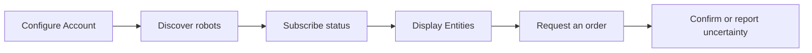

# Integration Home Assistant and confirmed monitoring

- Status: As-built baseline
- Date: 2026-11-23
- Catalog capability ID: home-assistant
- Last verified: 2026-11-23
- Owners: ha-roomba-home maintainer
- Scope: HA adapter on account, robot entities and confirmed orders.
- Related issues/PRs: No local work without publication.
- Required review gates: product, UX, architecture, testing, documentation, and security/operations
- Open decisions blocking readiness: None for regular consultation with continuous events out of reach.

## 1. Executive summary

A configurable integration from the HA interface with a modern robot vacuum entity, battery
and mission error sensors as well an connectivity sensor is implemented. The orders MUST are
advertised as completed only if there is evidence of the result. The local version was
manually installed at HA Green 2026.11.2 with 3 devices, 12 entities and physical monitoring
checked from ha. It has not been published at GitHub. That base did not propose additional
changes.

## 2. Problem, current behavior, and evidence

The account can be read by [HTTP](001-native-api.md) and [MQTT](002-mqtt-state.md) and now have HA entities. My Verisure It serves as an organisation reference, account management and performance monitoring; its protocol does not move to Roomba.

The available evidence and its boundaries are at [validation](../docs/validation.md).
- Observed behavior: config flow, robot and recharging entities passing through the Harness
  HA 2026.11.2 and domestic installation 0.1.0 confirmed 12 entities and the monitoring
  cycle. The extension 0.2.0 was registered with the Telemetery SDD.
- Intentional contract: stable identity, after-order confirmation and censor diagnoses; the
  cadences of 0.2.0 are defined in a telemetry SDD.
- Known debt and limitations: with no persistent stream, re-establishment or prolonged
  validation of natural expiry.
- Unknown rationale: Not all the physical codes and compatibility of other families are
  available.
- Proposed improvements: continuous events, resumption and additional capabilities after
  obtaining specific evidence.

## 3. Actors, surfaces, and terminology

| Actor | Necessity | Input | Surface |
| --- | --- | --- | --- |
| Holder | Configure several robots | Config flow | Devices and entities |
| User HA | Clean, pause and come back | Vacuum actions | explicit status and error |
| Automation | Assess confirmed status | Entities | Values with availability |
| Maintainer | Investigate Fills | Diagnostics | Censored information |

An account may include several old homes and devices. Observed capacity, cloud status and
connectivity are different concepts.

## 4. Goals, non-goals, and fixed invariants

- HA-01: flow MUST Validation of access, preventing duplication and maintaining a stable
  identity at his or her own expense.
- HA-02: every modern robot MUST have their own device and entity with no name collisions.
- HA-03: availability and battery MUST Unknown, unconnected and valid zero.
- HA-04: an order MUST be explicit, cut and confirmed; it isn't automatically referred after
  timeout.
- HA-05: reload and download MUST close jobs, connections and subscriptions.
- HA-06: diagnoses and logs MUST censor account, tokens and maps.
- HA-07: allow to change robot selection from existing account options.

First range: catalogue, status and start. Continuous events, zones and programming with
changes in tuning. Maintenance or interactive maps require additional evidence as well No
factory / reset, untying and account management propose.

## 5. Current versus proposed product journey

| Stage | Current | Proposal |
| --- | --- | --- |
| Configure | Form HA and Reauth | It's preserved. |
| State | Consultation MQTT each 60 seconds at rest and 15 during activity | Ongoing events require another campaign |
| Control | Measures with status confirmation | It's preserved. |
| Installation | Manual copies of local version | Publication only at request |

Textual equivalent: configuration → discovery --- status > entities {explicit request}
confirmation or unconfirmed result, with no blind repetition.

## 6. Functional behavior and state model

The co-ordinator renews a shared session and requests matching document clientToken. Do not
reduce continuous events or retain an version store. Availability requires a successful
consultation and explicit robot connectivity. Unknown values remains unknown, without
turning absent drums to zero. Each blocking operation is serialised and run outside the HA
loop.

| State | Meaning | Action permitted |
| --- | --- | --- |
| Configure | Valying an account and skills | Cancel without partial entities |
| Available | sufficiently recent and connected status | Compatible actions |
| Unconnected | Intent sign of low connection | Readings and orders rejected |
| Unknown | Without sufficient evidence | Request an update |
| Order outstanding | Request sent, without confirmation | Expected established limit |
| Unconfirmed result | Timeout without confirmation | Read status and do not double order |
| Reauth | Rejected credentials | To request intervention by the incumbent |

The format and its transitions are at [SDD orders](004-command-validation.md). After sending an order we have been consulted every five seconds: up 40 seconds for start, pause and cancellation or 120 To come back. Failed reading or timeout remains unconfirmed result and does not repeat the publication. To start a mission from pause is rejected: sum up isn't yet validated. The battery and error are separate sensors; phase, cycle or final result also appear in attributes of the vacuum.

## 7. User-facing configuration

| Input | Default | Validation | Persistence |
| --- | --- | --- | --- |
| Account and key | Mandatory | Real access, with no log of values | Config entry with HA |
| Country | EN | Two letters and an account country | On account |
| Robot selection | Modern compatible | Ids of its own catalogue | On account |

Recommended example: an entrance with the three modern robots. Alternative: enabling only
one for an initial test. Reauth retains profile and entities. The profile is generated with
non-secret configuration and preserved by entry. The end user shall not issue catches or
tokens.

The options flow MUST read the compatible robots on the existing account and
preserve credentials, app profile, and device and entity registry identities.
Deselecting a robot stops its reads and controls. Reselecting it restores
entity customizations and saved preferences. A canceled flow or failed
inventory retains the previous selection. An empty selection is rejected.

## 8. Clean Architecture design

The core conserves session and protocols. An implementation coordinator has both available
and results. The HA adapter has config entries, device / entity registration and
translations with diagnoses. Pao returns snapshots to the coordinator and does not change
entities directly from his thread.

MUST there is an import check and clearance, cancellation or renewal tests. The blocker
calls will be an executor and the cancellation expects their close-down before releasing his
lock. The platforms have no HTTP phone calls. The evidence checks these restrictions.

## 9. UI/UX and content contract

- Pending: `last_command_result` is `pending` while state confirmation is in progress.
- Action required: Reauthenticate the account in the provided flow.
- Blocked: A disconnected robot cannot accept a command.
- Partial: The command was sent and remains unconfirmed. Refresh state before retrying.
- Complete: The state confirms the command. Applicable physical errors remain visible.

Integration strings use English and stable keys. Standard Home Assistant
controls present explicit text for unknown and blocked states.

The visual identity uses the app icon submitted by its incumbent. They are distributed `brand/icon.png` (256×256) and `brand/icon@2x.png` (512×512) with alpha and without metadata, as per local HA mechanism. The provenance, conversion and boundaries are described in [visual identity](../docs/branding.md).

The extension of telemetries, problem sensors and robot events are regulated by [your SDD](005-telemetry-and-problems.md). It preserves unique_id of the original 12 entities and adds an entity to its proven robot fields.

## 10. Failure, recovery, and cleanup

429 transmissions retry_after A transport error will be recouped at later consultations as
per standard HA planning. No reconnection loop of his own. A Reauth active account rejection
and an optional absent Shadow preserve their unknown values. A timeout of order preserves
"unconfirmed result and never sends back the action. Loading or canceling have to stop tasks
and disconnect customers; a recharge will not create duplicated entities.

## 11. Security, permissions, and privacy

It applies [SECURITY.md](../SECURITY.md). No information from the campaign shall be included in fixtures, assets and services or snapshots. No actions that publish arbitrary issues or JSON provided by the user will be exposed. The user will not install capture certificates to use final integration.

## 12. Observability and operational UX

Diagnostics: version, number of devices and model. Connectivity with activity as well at
mission error or command results No IDs, names and payloads. The results separate request,
acceptance of service and physical confirmation. Temporary disconnection is shown as
available with no spam repairs.

## 13. Compatibility, migration, rollout, and rollback

The validated version is HA 2026.11.2 with its dependencies restrictions. Three robots and
twelve entities pass loading, recharging or downloading into the official Harness. Readings
from the coordinator are also contrasted with an actual account. The physical orders were
validated by independent native client and with standard controls of a HA Green home
installation. That was also where three devices, twelve entities and recharging were
checked. The additional HA test exceeded the intended time of vacuuming as recorded by his
report. The old models are excluded. Config entry 1 version with no earlier migration.
Withdrawal of entrance closes connections without deleting maps or robots. The local code is
an unpublished version 0.1.0.

## 14. Testing strategy and numeric budget

Minimum budget, additional to the client's Suite. The distribution is checked by file so
that an UI and authentication are not counted twice:

| Area | Minimum number of different cases | Risks |
| --- | ---: | --- |
| Flow and Reauth | 14 | Test / ha test_flow.py: errors, identity and selection |
| Coordinator and life cycle | 15 | tests / ha test_coordinator.py: commands, timeout and closure. 429 and isolation |
| Entities and presentation | 11 | Test / ha test_entities.py: states, IDs and diagnoses. Recharge & download |
| **Total** | **40** | No double computation or replacement with client's tests |

MUST pass the Suite about its stated HA version, Hassfest. 100% coverage with branches in new modules and physical evidence of each order advertised. The [validation](../docs/validation.md) record the performance and / or test_state.py adds pure cases of unknown data and observed transitions.

## 15. Documentation and discoverability

| Path | Change |
| --- | --- |
| README.md | update |
| docs / index.md | update |
| docs / architecture.md | update |
| docs / validation.md | update |
| docs / installation.md | create |
| docs / usage.md | create |
| specs / catalog.json | update |

The guides explain the installation, configuration and actions of this version with generic
examples without campaign data.

## 16. Acceptance scenarios

1. To set up an account discover all three robots as independent devices.
2. Repeat configuration doesn't create duplicates.
3. Reauth retains entities and automations.
4. A remote robot doesn't issue an order requested.
5. A warrant without confirmation does not change an entity to success and doesn't repeat
   itself.
6. Messages without the corresponding clientToken do not complete a consultation.
7. Download and reload preserves entities with outstanding operations.
8. Diagnostics and logs pass inspections of private data or translations.
9. Add, deselect and re-choose a robot from the options preserves an ID's with
   customization or preferences of existing robots.

## 17. Requirements traceability

| Requirement | Component | Test or evidence | Documentation |
| --- | --- | --- | --- |
| HA-01 | config_flow.py | Test / ha test_flow.py | docs / installation.md |
| HA-02/03 | coordinator.py and platforms | tests / ha test_entities.py and tests /test_state.py | docs / usage.md |
| HA-04 | async_command and issuer | tests / ha test_coordinator.py and physical evidence | docs / api.md |
| HA-05 | async_close and download | Performance Test, Cancellation and Recharging & Loading | docs / architecture.md |
| HA-06 | diagnostics.py and translations | Test for diagnostics, scanner and hassfest | SECURITY.md |
| HA-07 | Options flow and reload | `tests/ha/test_flow.py` covers inventory failures, persistent registry identity, and restored preferences | [Installation](../docs/installation.md) |

Each implementation and testing path is registered in the catalogue.

## 18. Implementation sequence

To HA-07, first check identities and preferences after recharging the entrance. Then add the
flow and check high, bad choice or recovery. To maintain the base: update contract and
testing before an adapter, check reading or repeat authorized physical tests as you change
your protocol. Continuous and resumption events require an extension of the contract with
new evidence.

## 19. Definition of Done

- [x] Regular consultation chosen and continuous events beyond today's reach.
- [x] HA-01 a HA-06 implemented and tested.
- [x] Loading, recharging and Reauth.
- [x] Native orders confirmed with physical robot and return to the dock.
- [x] Final passing of cover, hassest and privacy.
- [x] Home installation, 12 entities and recharge with orders from HA checked.

## 20. References and decisions

[My Verisure](https://github.com/efraespada/my_verisure), [config flow official](https://contributors.home-assistant.io/core/integrations/config-flow/), [API](../docs/api.md) and [SDD standard](README.md). It was chosen cloud_polling to have verifiable conduct without presenting a persistent stream as validated. The documentation MUST preserve the difference between physical client tests, HA with simulated provider and actual account reading as well to control from home installation.
