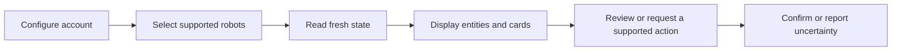

# Home Assistant integration and confirmed control

- Status: As-built baseline
- Date: 2026-11-23
- Catalog capability ID: home-assistant
- Last verified: 2026-11-28
- Owners: ha-roomba-home maintainer
- Scope: Account setup, robot selection, lifecycle, state projection, and confirmed control
- Related issues/PRs: Household deployment and the Home Assistant validation workflow
- Required review gates: product, UX, architecture, testing, documentation, and security/operations
- Open decisions blocking readiness: Firmware-specific capabilities and unverified native workflows are tracked in their capability specifications.

## 1. Executive summary

Roomba Home connects a Home Assistant configuration entry to a Roomba Home
account. Each selected supported robot has its own device and entities.
Recognized docks have child devices. Actions expose confirmation from
Roomba and preserve explicit uncertainty when the expected result has not
arrived.

## 2. Problem, current behavior, and evidence

The integration uses Roomba's native signed HTTP and MQTT contracts. It
started with setup, per-robot status, and the standard vacuum actions.
Later releases added typed telemetry, floor plans, device settings, and
reviewed map, routine, and schedule workflows. Home Assistant Core
2026.11.2 has been exercised with three robots and their docks. The
installed 0.104.5 integration recovered an active recharge under the
same mission after a Core restart.
[Validation](../docs/validation.md) · [Active recharge](../docs/validation.md#charging-during-the-same-cleaning-mission)

- Observed behavior: Supported robots and docks retain their entities across updates and reloads.
- Intentional contract: The integration uses typed Roomba observations and guards physical actions against fresh state.
- Known debt and limitations: Initial provisioning, factory reset, and a wider model matrix still require verification.
- Unknown rationale: Firmware-specific differences in device capabilities depend on further provider evidence.
- Proposed improvements: Extend each capability through its own contract and physical acceptance criteria.

## 3. Actors, surfaces, and terminology

| Actor | Surface | Result |
| --- | --- | --- |
| Account holder | Setup, options, and reauthentication | One entry with selected robots |
| Operator | Vacuum actions and interactive floor plans | Reviewed or confirmed control |
| Automation author | Entities, events, and services | Typed values and explicit availability |
| Maintainer | Diagnostics and validation | Redacted operating evidence |

Availability combines a sufficiently fresh source with explicit robot
connectivity. Device capability, reported state, and command confirmation
have distinct sources and lifetimes.

## 4. Goals, non-goals, and fixed invariants

- HA-01: The config flow MUST validate authentication, prevent duplicate entries, and preserve account identity.
- HA-02: Each selected supported robot MUST have its own device and stable entity identifiers.
- HA-03: State projections MUST distinguish a verified zero, an unavailable field, and a disconnected device.
- HA-04: Control MUST be guarded, confirmed from matching state, and issued once per request.
- HA-05: Reload and unload MUST clean up tasks, subscriptions, and owned operations.
- HA-06: Diagnostic exports MUST omit credentials, account identifiers, robot names, and floor data.
- HA-07: Selection changes MUST preserve registry identity and saved preferences.

Companion specifications cover capability-specific controls and map
workflows. Initial provisioning, factory reset, and enrollment changes
require their own verified contracts.

## 5. Current versus proposed product journey

Install from a GitHub release through HACS or with a manual component copy.
Home Assistant options control robot selection and opt-in map features.
Each command uses the matching selected robot and current capabilities.

## 6. Functional behavior and state model

Poll the account every 60 seconds at rest and every 15 seconds during
reported activity. Read slower telemetry on its own cadence and reuse
fresh results across entities. Eligible live map observations and
timeline reports can arrive during active reads. A separately authorized
subscription also receives positions between account polls. Preserve
per-robot availability during permitted partial responses.

| State | Source | Result |
| --- | --- | --- |
| Available | Fresh connected state | Display supported readings and allow valid controls |
| Disconnected | Explicit provider connectivity | Mark the device unavailable |
| Unknown | Missing or stale observation | Leave the field unavailable |
| Pending action | Dispatched command awaiting evidence | Continue bounded confirmation reads |
| Unconfirmed action | No qualifying observation in the window | Expose uncertainty and retain actual reported state |
| Reauthentication | Rejected account credentials | Start the account reauthentication flow |

Confirmation reads use five-second intervals. The initial window is 40
seconds for start, pause, and stop, with 120 seconds for dock arrival.
A confirmed same-mission return can continue under regular polls past
that window. Start resumes an existing paused mission. A new mission
uses the chosen settings.
[Command validation](004-command-validation.md) ·
[Telemetry and freshness](005-telemetry-and-problems.md)

## 7. User-facing configuration

| Input | Default | Persistence |
| --- | --- | --- |
| Account and password | Required | Private config entry |
| Country | ES | Normalized two-letter country code |
| Selected robots | Supported inventory | At least one robot |
| Saved maps and live room updates | Off | Entry option |

Reauthentication keeps the existing entry, device identities, app profile,
and robot selection. The options flow reads the current supported
inventory. Deselecting a robot stops its reads and controls. Reselecting it
restores existing registry customizations and saved preferences. A canceled
flow or failed inventory read preserves the existing selection.
[Installation and setup](../docs/installation.md)

## 8. Clean Architecture design

The core contains the domain, use cases, typed state, and protocol
adapters. Home Assistant configuration, registries, entities, and
WebSocket endpoints compose that core. The account coordinator supplies
the read and control ports and owns cloud scheduling. Blocking
MQTT operations run outside the event loop and are scoped to their account
and connection group. Entities render Home Assistant state and delegate
controls through the coordinator.

## 9. UI/UX and content contract

Show a pending action while confirmation is in progress. Distinguish
blocked actions, unconfirmed outcomes, and explicit device errors. Keep
stable translation keys for entity names and error reasons. The local
integration icon comes from the supplied, converted app artwork.
[Usage](../docs/usage.md) · [Branding](../docs/branding.md)

- Pending: A dispatched action is waiting for a matching observation.
- Action required: The integration asks for reauthentication or a missing prerequisite is shown.
- Blocked: Reported state, capabilities, or permissions prevent the action.
- Partial: The action was sent and its result remains unconfirmed.
- Complete: The expected physical state has been confirmed.

## 10. Failure, recovery, and cleanup

Respect provider rate limits and bounded read backoff. Keep accepted
partial data for eligible reads. A missing optional response leaves its
fields unavailable. Reauthentication preserves entity identities.
Cancellation, unload, and reload clean up background work. An unconfirmed
write is not repeated by the integration.

## 11. Security, permissions, and privacy

Keep account and session data in private Home Assistant storage.
Use existing entity permissions for floor plans and control, correlate
the reviewed robot and action, and validate current capabilities before
dispatch. Keep raw native traffic, maps, and session files out of
diagnostic exports. Home Assistant uses the normal provider TLS connection.
[Security](../SECURITY.md)

## 12. Observability and operational UX

Expose vacuum activity, battery, connection, and typed problem data through
entities. Keep command dispatch and confirmed outcomes separate. The
diagnostic export provides an integration version and aggregate device
information with redacted identities. Maps, live routes, and history are
available from their authorized cards and services.

## 13. Compatibility, migration, rollout, and rollback

The validated environment uses Home Assistant Core 2026.11.2 and the
Max 700 Combo SKU X185240. Update or roll back the component version with
the Home Assistant entry intact. Upgrades preserve robot and dock
identities. Unloading the config entry releases its local resources.
[Supported models and upgrades](../docs/installation.md)

## 14. Testing strategy and numeric budget

| Area | Minimum independent cases | Coverage |
| --- | ---: | --- |
| Setup, options, and reauthentication | 14 | Identity, validation, and selection |
| Coordinator and lifecycle | 15 | Scheduling, failures, command confirmation, and cleanup |
| Entities and presentation | 11 | State, diagnostics, availability, and stable identities |
| **Total** | **40** | Independent baseline cases |

Run full statement and branch coverage on the supported Home Assistant
version. Include hassfest, privacy, and specification checks. Keep the
simulated and household verification records distinct.
[Development guide](../docs/development.md) · [CI](../.github/workflows/validate.yml)

## 15. Documentation and discoverability

The README links installation, setup, usage, and examples. The validation
log records physical results and uses crops of the relevant Home Assistant
cards. The specification catalog links each capability to its implementation
and tests.
[README](../README.md) · [Architecture](../docs/architecture.md) ·
[Validation](../docs/validation.md) · [Catalog](CATALOG.md)

## 16. Acceptance scenarios

1. Select multiple robots from a valid account and see distinct devices and entities.
2. Reject a duplicate entry for the same account.
3. Reauthenticate and preserve existing entities and automations.
4. Block a command when its robot or required data is unavailable.
5. Report an unconfirmed command without republishing it.
6. Ignore responses with the wrong scope or correlation values.
7. Unload or reload safely with work in flight.
8. Export redacted diagnostics and validate the translated strings.
9. Deselect and reselect a robot without losing customizations or preferences.

## 17. Requirements traceability

| Requirement | Component | Test |
| --- | --- | --- |
| HA-01 and HA-07 | `config_flow.py` | [Setup and options](../tests/ha/test_flow.py) |
| HA-02 and HA-03 | Coordinator and entity platforms | [Entities](../tests/ha/test_entities.py), [Core state](../tests/test_state.py) |
| HA-04 and HA-05 | Command application and coordinator lifecycle | [Coordinator](../tests/ha/test_coordinator.py), [Installed validation](../docs/validation.md) |
| HA-06 | `diagnostics.py` and translated strings | [Entity diagnostics](../tests/ha/test_entities.py), [Privacy checks](../tests/test_architecture_and_privacy.py) |

## 18. Implementation sequence

Add new device capabilities at the typed boundary. Define availability
and permissions, implement the action or observation, and cover its
failure behavior before exposing it through Home Assistant. Verify the
normal UI or automation entry point against the authorized test robot.

## 19. Definition of Done

- [x] Setup, selection, reauthentication, reload, and unload are verified.
- [x] Devices and entities preserve identity and report typed availability.
- [x] Confirmed control has synthetic and physical evidence.
- [x] The repository enforces full coverage, hassfest, privacy, and specification checks.
- [x] Household releases have been verified after installation and restart.

## 20. References and decisions

The design takes account setup and per-device organization from My
Verisure. Roomba Home uses the Roomba-specific provider contracts and
Home Assistant's `cloud_polling` IoT class. The active map subscription
is scoped independently of the polling connection.
[My Verisure](https://github.com/efraespada/my_verisure) ·
[Native API](001-native-api.md) · [MQTT](002-mqtt-state.md) ·
[Live maps](008-mission-detail-and-map-card.md)
