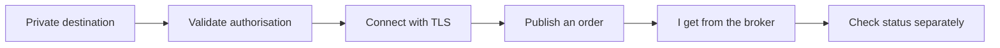

# Native orders and physical validation

- Status: As-built baseline
- Date: 2026-11-23
- Catalog capability ID: native-commands
- Last verified: 2026-11-26
- Owners: ha-roomba-home maintainer
- Scope: Native command dispatch and independent verification of physical results.
- Related issues/PRs: No local work without publication.
- Required review gates: product, UX, architecture, testing, documentation, and security/operations
- Open decisions blocking readiness: Physical verification of additional provider command variants.

## 1. Executive summary

The client sends supported robot commands over MQTT. The transport receipt
records broker acceptance, and the Home Assistant use case checks the
physical result. An authorized cycle verifies the observed behavior for
the tested device and command.

## 2. Problem, current behavior, and evidence

The HTTP readings do not contain the motion orders. The topic was identified `{irbtTopics}/things/{robot_id}/cmd` at the native SSK and was contrasted with an independent test: vacuuming in mode 2, pause after 210 seconds and cancellation. The [report](../docs/validation.md) retains only normalised transitions.

- Observed behavior: start production run / clean; pause produce stop and clear, drop
  cancels with cycle none.
- Intentional contract: strict enumeration, a single consignment and TLS with physical
  result unconfirmed by PUBACK.
- Known debt and limitations: connection by order with no persistent coordinator, resumption
  or tested areas.
- Unknown rationale: No supplier's guarantees for duplicates or all physical errors are
  available.
- Proposed improvements: confirmation and availability at the co-ordinator provided for by
  SDD 003.

## 3. Actors, surfaces, and terminology

| Actor | Objective | Input | Surface |
| --- | --- | --- | --- |
| Holder | To give permission to have a physical test | Robot and concrete duration | App and physical observation |
| Research | Validate protocol | CLI and private destination | Transport receipt |
| Robot | To conduct the mission | Cloud command | Subsequent status |

PUBACK's acceptance of transport and physical confirmation is a later contrasted mission
transition. Canceling and returning to the dock are different orders.

The current area can be skipped when the robot advertises the capability
and the live timeline identifies an active room or zone. An identifiable
travel destination uses the same policy. The map card reviews a specific
destination and the coordinator refreshes that mission and destination
before sending once. A newly reported skipped event for that area in the
same mission confirms the result.
[Skip validation](../docs/validation.md#skip-the-current-destination)

## 4. Goals, non-goals, and fixed invariants

- CMD-01: The emitter MUST serialize only typed, supported commands.
- CMD-02: selection MUST belong to the inventory and token with validated SKU, topic without
  injection.
- CMD-03: the issuer MUST send once with QoS 1 and retain false, without automatic retrying.
- CMD-04: the receipt MUST declare physical result `unconfirmed` even after PUBACK.
- CMD-05: errors and output MUST omit private destination, tokens and original payloads.
- CMD-06: A skip MUST use a fresh, scoped destination. Confirm it with a new
  matching event in the same mission and reject a changed review before dispatch.

It does not include reset, clear maps and fringes. Retirement changes have been added to
them by area planning or cleanup as an integral part of the system's production operations
with a high level The tool isn't an automation engine.

## 5. Current versus proposed product journey

The emitter sends a single command. Home Assistant coordinates preparation
and checks the reported result independently.

Textual equivalent: destination → validation --- connection > unique sending {receipt} •
independent reading of result. A receipt doesn't advance the last step.

## 6. Functional behavior and state model

| Stage | Evidence | Retirement |
| --- | --- | --- |
| Prepared | Inum, timestamp and valid destination | Can connect |
| Connected | CONNACK accepted | Can publish once |
| Sended | Publish Local Accepted | WAIT PUBACK TOGETHER |
| Accepted by broker | PUBACK | Reforms `unconfirmed` for physical result |
| Untrue | Error or timeout | He doesn't repeat his order. |

Physical tests read the robot state before and after each command. Pause
keeps the current mission active. Cancel ends it. In a whole-area Max 700
Combo trial, a direct return during active vacuuming left the robot
cleaning. Cancel produced an idle state. A subsequent return reached the
dock and cleared the mission cycle with error code 0.
[Whole-area trial](../docs/validation.md#whole-area-and-directed-cleaning-scope)

## 7. User-facing configuration

| Input | Default | Validation | Persistence |
| --- | --- | --- | --- |
| Session | Mandatory | Private archives and credentials not close to expire | External |
| Destination | Mandatory | Private file with robot_id associated | External |
| Order | Mandatory | Closed numbering | By implementation |

Recommended for research: check earlier connectivity, mission and physical status.
Alternative: library with controlled test composition. There's no way to publish JSON or
arbitrary issues.

## 8. Clean Architecture design

`Command` and `command_body` they define vocabulary and serialisation. `MqttCommandSender`
Valid session / destination and composes paho. The CLI reads files and presents a receipt.
The mission confirmation belongs to the call and not transport adapter.

The core MUST NOT matter HA or interpoints. The client's factory is for injection to test
Rejections without moving robots. The tests explicitly check QoS, lack of retention and
closure. No persisting orders.

## 9. UI/UX and content contract

- Pending: currently sending with no physical success announced.
- Action required: To identify the destination and check its status before operation.
- Blocked: an alien destination, a model that isn't valid or expired session prevents
  sending.
- Partial: uncertain publication and read status before applying again for action.
- Complete: receipt with `accepted_by_broker: true` and `physical_result: unconfirmed`.

The CLI, its keys, and the guide use English. It doesn't depend
on color. It does not produce notifications or messages to other services.

## 10. Failure, recovery, and cleanup

A bug prior to sending doesn't publish. A subsequent malfunction can have an uncertain
physical result and does not cause repetition. At any rate, the paho loop will be turned off
and stopped. The test campaign controls the run time and emits pause, cancellation or return
as authorized cleaning actions rather than re-trying to start.

## 11. Security, permissions, and privacy

Only session robots and family tested are allowed. Ids, prefixes and header are validated
before passing tokens. The library verifies TLS and does not accept arbitrary issues. Count,
names and maps with raw evidence MUST to get out of Git. The authorisation of physical
testing is obtained from the holder.

## 12. Observability and operational UX

The receipt indicates only order and stage of acceptance. The campaign report indicates
duration, phases and results with no names or IDs. A run / clear transition is different
from CONNACK and PUBINK. The physical errors are preserved for the assessment of a test and
they aren't hidden under an effective transport result.

## 13. Compatibility, migration, rollout, and rollback

On SKU X185240, physical trials verified whole-area vacuuming from the
dock, pausing, cancelling, and returning after cancellation. A direct
return during active vacuuming remains unconfirmed. Check the reported
robot state after a timeout because the command may already have been
published.

## 14. Testing strategy and numeric budget

| Area | Minimum number of different cases | Risks |
| --- | ---: | --- |
| Payload and vocabulary | 9 | Four orders, four invalid tipprints and arbitrary chain |
| Sending and errors | 4 | Non-physical receipt, rejection and malfunctioning |
| Destination and authorisation | 6 | Other ID, injection and nil. SKU) token or prefix |
| **Total** | **19** | No double computation |

The cover with branches of commands.py MUST achieve 100%. No usual tests have been put into
network. The physical campaign is opt-in and complements the fake broker. Before announcing
another monitoring context, his evidence and budget should be expanded.

## 15. Documentation and discoverability

| Path | Change |
| --- | --- |
| docs / api.md | update |
| docs / development.md | update |
| docs / validation.md | update |
| docs / architecture.md | update |
| specs /003- man...assistant.md | update |

The [Contents](../docs/index.md) links reference and research boundaries.

## 16. Acceptance scenarios

1. A valid start serializes only vacuuming without activating fringes.
2. A non-commercial or wild destination doesn't cause a connection.
3. Unvalidated model does not allow commands.
4. A refusal to transport closed the client and did not repeat.
5. PUBACK produces unconfirmed receipt physically.
6. In actual test, run / clean follows start and stop or clear a pause.
7. Stop cancels the mission and return is confirmed as a separate operation.
8. The output contains no private destination or original responses.

## 17. Requirements traceability

| Requirement | Component | Test / evidence | Document |
| --- | --- | --- | --- |
| CMD-01 | Command / command_body | 9 payload and actual evidence cases | docs / api.md |
| CMD-02 | Issuer builder | 6 | SECURITY.md |
| CMD-03 | send / finally | 4 sending and error cases | docs / development.md |
| CMD-04 | CommandReceipt | Non-physical receipt test | docs / architecture.md |
| CMD-05 | CLI and errors | Privacy and Inspection Tests | docs / validation.md |
| CMD-06 | Mission command policy and live timeline projection | Fresh and stale reviews, one send, matched skip, and a physical transition to the next area | [Skip validation](../docs/validation.md#skip-the-current-destination) |

## 18. Implementation sequence

The maintenance first updates enum, contract and synthetic cases after adaptor with CLI or
documentation. The protocol changes require an authorized physical test and final status
registration. No production HA is added from this retrospective SDD.

## 19. Definition of Done

- [x] Vocabulary and theme contrasted with native SDK & actual robot.
- [x] Unique sending, TLS and non-physical closure.
- [x] 19 synthetic cases cover payload, clearance and malfunctions.
- [x] Final status of the physical cycle and final validation registered.
- [x] Catalogue and documentation updated with evidence without private data.

## 20. References and decisions

[API](../docs/api.md), [Readings MQTT](002-mqtt-state.md), [That's been scheduled.](003-home-assistant.md) and [SDD standard](README.md). No code from the app was added. The Research Issuer remains separate from future HA availability, confirmation and reconnection policies.
