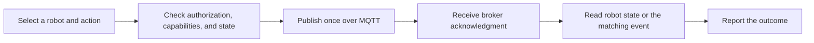

# Native robot commands and physical validation

- Status: As-built baseline
- Date: 2026-11-23
- Catalog capability ID: native-commands
- Last verified: 2026-11-27
- Owners: ha-roomba-home maintainer
- Scope: Dispatch supported robot commands and verify their reported effects.
- Related issues/PRs: [Command confirmation recovery](https://github.com/efraespada/ha-roomba-home/pull/38)
- Required review gates: product, UX, architecture, testing, documentation, and security/operations
- Open decisions blocking readiness: Physical verification of additional firmware behaviors and command variants.

## 1. Executive summary

Home Assistant validates a requested action against the selected robot and
sends a typed command over MQTT. Broker acceptance records delivery to the
broker. A separate Roomba state read verifies the robot's response. Each
physical trial applies to the tested model, firmware, and command.

## 2. Problem, current behavior, and evidence

- Observed behavior: The Android client publishes to
  `{irbtTopics}/things/{robot_id}/cmd`. The first physical trial on the Max
  700 Combo observed the `clean` cycle after start, a stopped phase during
  pause, and the `none` cycle after canceling. Later trials exercised
  [directed cleaning](../docs/validation.md#directed-vacuum-then-mop) and
  [returning from active cleaning](../docs/validation.md#return-during-active-cleaning).
- Intentional contract: Validate capabilities and authorization before
  publication. Publish each command once over TLS. Confirm its effect
  through a fresh state read or a matching event.
- Known debt and limitations: The transport opens a dedicated MQTT
  connection for each publication. Hardware coverage varies by command,
  region, and model. The [capability matrix](../docs/capabilities.md) lists
  physical cases still pending.
- Unknown rationale: The provider's duplicate-delivery guarantees and
  behavior after every physical fault remain unknown.
- Proposed improvements: Add physical coverage for supported variants
  as their preconditions and outcomes are verified.

## 3. Actors, surfaces, and terminology

| Actor | Objective | Input | Surface |
| --- | --- | --- | --- |
| Home Assistant operator | Control an associated robot | Vacuum entity and action | Entity controls, map card, or automation |
| Maintainer | Verify a contract with authorized hardware | Scoped command and baseline state | Tests and anonymized evidence |
| Robot | Carry out a mission or dock operation | Authorized broker command | Reported state, timeline, and history |

A **PUBACK** acknowledges receipt at the MQTT broker. **Confirmation**
requires a matching robot state or mission event. Cancel ends the mission.
Return sends the robot to its dock. Pause preserves the current mission.

## 4. Goals, non-goals, and fixed invariants

- **CMD-01** The transport MUST serialize only typed, supported commands.
- **CMD-02** The selected robot MUST belong to the authenticated account
  and the relevant MQTT token group. Validate its model and topic segments.
- **CMD-03** Each command MUST publish once with QoS 1 and retain disabled.
- **CMD-04** A broker receipt MUST keep the physical result `unconfirmed`.
- **CMD-05** Errors and public evidence MUST omit private identifiers,
  authentication material, and raw household payloads.
- **CMD-06** Skip MUST use a fresh, reviewed destination. A new matching
  skip event in the same mission confirms its result.
- **CMD-07** On the Max 700 Combo, a return during active cleaning MUST
  wait for the same mission to pause before publishing `dock`. If the
  robot starts returning on its own, observe arrival without publishing `dock`.
- **CMD-08** After dispatch, a successful account refresh that omits the
  connection state MAY be followed by another read. Preserve the existing
  deadline and one publish per command. A missing state cannot confirm an action.

This capability covers typed device commands and their verification. Map
editing and backup recovery are specified separately. [Map editor SDD](009-map-zone-editor.md)

## 5. Current versus proposed product journey

Home Assistant validates the action, publishes the command and reports the
progress of confirmation. New commands follow the same sequence with
capability and result checks specific to that operation.

## 6. Functional behavior and state model

| Stage | Evidence | Next step |
| --- | --- | --- |
| Prepared | Valid action, destination, and robot state | Open the MQTT connection |
| Connected | Broker accepts the TLS connection | Publish once |
| Accepted by broker | `PUBACK` | Read the robot state within the confirmation window |
| Confirmed | Matching state or newly reported event | Present the confirmed result |
| Unconfirmed | Failure or expired confirmation window | Report uncertainty without resending |

The Max 700 Combo return flow observes the same active mission after
`pause`. A matching paused state permits `dock`. When the mission finishes
while the pause is pending, a reported return or arrival can confirm the
operation without further publication. A new active pad wash within the
same mission grants up to five minutes from the first wash observation.
The robot or dock reporting a fault or a different mission ends this
additional wait. Confirmation still requires a docked robot with an
ended mission. The wash can extend the deadline once.
[Return trial](../docs/validation.md#return-during-active-cleaning) ·
[Mop-only return trial](../docs/validation.md#household-mop-only-route-and-return)

## 7. User-facing configuration

| Input | Source | Validation |
| --- | --- | --- |
| Account session | Roomba Home config entry | Authenticated account and current MQTT token |
| Robot | Linked vacuum or dock entity | Associated and selected in the integration |
| Action | Standard vacuum controls or a Roomba Home action | Typed command, device capability, and preconditions |
| Cleaning settings | Next-cleaning preferences or reviewed destinations | Supported mode and values for each requested area |

The diagnostic command-line tool uses a private session and destination
file. It returns a broker receipt. [Development guide](../docs/development.md)

## 8. Clean Architecture design

`Command` and `command_body` define the typed transport vocabulary.
`MqttCommandSender` validates the session, builds the target topic, and
publishes through Paho. A client factory lets tests exercise transport
behavior with a fake broker. The sender owns connection cleanup.

The application policy depends on `ControlPort`. It checks command
preconditions and evaluates fresh observations. The Home Assistant
coordinator binds the port to one associated robot, obtains provider
state, and reports the command status to entities. The core policy has
no Home Assistant dependency. [Architecture](../docs/architecture.md)

## 9. UI/UX and content contract

- Pending: `pending` reports dispatch or state confirmation in progress.
- Action required: The dashboard asks the operator to review a changed map
  destination or resolve a reported precondition before retrying.
- Blocked: Home Assistant explains when the robot or the requested action
  is unavailable.
- Partial: `submitted` allows limited or deferred confirmation. `unconfirmed`
  records an uncertain physical result after a failed read or deadline.
- Complete: `confirmed` records a matching robot state or event.

Locate remains `submitted` after broker acceptance. The CLI presents the
broker receipt as machine-readable JSON.
[Command results](../docs/usage.md#command-confirmation)

## 10. Failure, recovery, and cleanup

Failed validation prevents publication. A successful refresh that omits
connection state can be followed by another read within the original
window. An explicit offline report or failed account refresh ends
confirmation for ordinary commands. Reboot waits for an observed
connection cycle. An expired window leaves the result `unconfirmed`.

The MQTT sender closes its connection on every exit. Service and control
policy tests cover recovered reads, timeouts, unload, and no repeated
publication. [Control policy tests](../tests/test_application.py)

## 11. Security, permissions, and privacy

Token selection is scoped to the associated robot. The sender validates
model and topic segments and verifies TLS. Home Assistant authorizes
writes through the linked entity. Physical trials require authorization
for the selected device. Public artifacts retain sanitized outcomes and
omit raw session data, floor geometry, and private identifiers.

## 12. Observability and operational UX

The broker receipt records transport delivery and leaves physical effects
unconfirmed. The Home Assistant command-result sensor reflects semantic
confirmation. Trial evidence records durations, phases, outcome, and
fault codes. For a skip, the timeline must identify the same destination
and show a new skip event within that mission.
[Skip validation](../docs/validation.md#skip-the-current-destination)

## 13. Compatibility, migration, rollout, and rollback

Physical evidence covers the Max 700 Combo (X185240). Expose commands
according to the connected robot's reported capabilities. Pause before
return applies to active cleaning on this model, with separate handling
for mapping and mop preparation. A restart or upgrade preserves the robot
entities and account associations. [Installation and rollback](../docs/installation.md)

## 14. Testing strategy and numeric budget

| Area | Minimum cases | Focus |
| --- | ---: | --- |
| Payload and vocabulary | 9 | Typed commands, valid settings, invalid timestamps, and arbitrary strings |
| Sending and errors | 4 | Broker receipt, transport rejection, closure, and one publish |
| Destination and authorization | 6 | Association, model, token group, and topic validation |
| **Total** | **19** | The application tests add semantic confirmation and its failure cases. |

The command transport and application policy require 100% line and branch
coverage as part of the integration suite. Fixtures exercise confirmation
and errors without sending robot commands. Authorized hardware scenarios
verify outcomes that fixtures cannot establish.

## 15. Documentation and discoverability

| Document | Purpose |
| --- | --- |
| [Usage](../docs/usage.md) | Entity controls, actions, and confirmation status |
| [API](../docs/api.md) | Observed command payloads and provider responses |
| [Architecture](../docs/architecture.md) | Application and transport boundaries |
| [Validation](../docs/validation.md) | Physical verification and remaining gaps |
| [Development](../docs/development.md) | Test commands and evidence handling |

## 16. Acceptance scenarios

1. A supported start publishes a typed payload for the selected robot.
2. An invalid, unauthorized, or unvalidated target prevents a broker connection.
3. A failed publication closes its connection and leaves the result uncertain.
4. `PUBACK` alone leaves the physical receipt `unconfirmed`.
5. Fresh state confirms start, pause, cancel, and return independently.
6. Return from active Max 700 Combo cleaning sends `dock` only after the same mission pauses.
7. A transient missing state can recover during the original confirmation window without an additional publish.
8. A timeout retains uncertainty and public evidence omits private data.

## 17. Requirements traceability

| Requirement | Component | Test or evidence |
| --- | --- | --- |
| CMD-01 | `Command`, `command_body` | [Typed payload tests](../tests/test_commands.py) |
| CMD-02 | `MqttCommandSender` | [Association, model, and topic checks](../tests/test_commands.py) |
| CMD-03 | `MqttCommandSender.send` | [Broker and failure tests](../tests/test_commands.py) |
| CMD-04 | `CommandReceipt` | [Broker receipt test](../tests/test_commands.py) |
| CMD-05 | Transport errors and evidence tooling | [Privacy scan](../scripts/check_privacy.py) and [public validation](../docs/validation.md) |
| CMD-06 | Control policy and live timeline | [Policy tests](../tests/test_application.py) and [physical skip](../docs/validation.md#skip-the-current-destination) |
| CMD-07 | Return-to-base policy | [Policy tests](../tests/test_application.py), [Home Assistant service tests](../tests/ha/test_cleaning_controls.py), [physical return](../docs/validation.md#return-during-active-cleaning), and [post-return wash observation](../docs/validation.md#household-mop-only-route-and-return) |
| CMD-08 | Confirmation polling and coordinator adapter | [Policy tests](../tests/test_application.py) and [coordinator tests](../tests/ha/test_coordinator.py) |

## 18. Implementation sequence

Verify the command contract and prerequisites, then implement the typed
payload and transport tests. Add the confirmation rule in the core policy
and wire it through the device entity or service. Run the full suite and
record scoped hardware evidence before advertising physical verification.

## 19. Definition of Done

- [x] The transport validates and sends supported commands once over TLS.
- [x] The core distinguishes broker acceptance and physical confirmation.
- [x] Tests cover authorization, failures, and confirmation boundaries.
- [x] Physical outcomes and remaining cases are documented.
- [x] The SDD catalog and public evidence pass validation and privacy checks.

## 20. References and decisions

[MQTT state SDD](002-mqtt-state.md) · [Home Assistant SDD](003-home-assistant.md) ·
[API reference](../docs/api.md) · [SDD standard](README.md)
