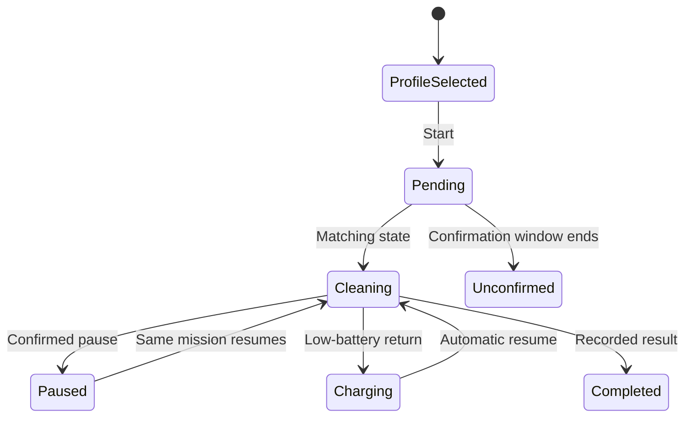

# Cleaning modes and per-area profiles

- Status: Draft
- Date: 2026-11-23
- Catalog capability ID: cleaning-profiles
- Last verified: 2026-11-28
- Owners: ha-roomba-home maintainer
- Scope: Cleaning modes, next-cleaning preferences, ordered regional profiles, and physical confirmation
- Related issues/PRs: Household cleaning trials and two-pass progress fixes
- Required review gates: product, UX, architecture, testing, documentation, and security/operations
- Open decisions blocking readiness: Physical completion after automatic recharge and the effect of every supported preference combination.

## 1. Executive summary

A combination robot uses a Home Assistant vacuum entity with additional
controls for cleaning profiles. Choose a profile for the next mission or
assign a separate profile to each ordered destination in a saved routine.
Roomba status and history verify the physical result.

## 2. Problem, current behavior, and evidence

- Observed behavior: The Max 700 Combo advertises vacuum, mop, simultaneous cleaning, and vacuum followed by mopping. Its room timeline reports started and completed passes.
- Intentional contract: Preserve per-robot identity and preferences. Validate supported modes and parameters before dispatch.
- Known debt and limitations: A single test cannot verify the physical effect of every power, moisture, and pass combination.
- Unknown rationale: Future firmware may add capabilities or use different settings.
- Proposed improvements: Observe a natural two-pass finish after recharge and verify the resulting room and mission history.

Roomba uses native operating mode 2 for vacuum, 4 for mop, 6 for
simultaneous cleaning, and 512 for vacuum then mop. Device capability
flags describe support. The request carries the selected mode and its
applicable settings. Signed observations establish outcomes.
[Directed sequence](../docs/validation.md#directed-vacuum-then-mop) ·
[Two-pass comparison](../docs/validation.md#earlier-room-visits-during-a-two-pass-clean)

## 3. Actors, surfaces, and terminology

| Actor | Surface | Result |
| --- | --- | --- |
| Operator | Vacuum entity and next-cleaning controls | Start with a verified mode and profile |
| Routine author | Map card routine editor | Ordered destinations with individual preferences |
| Automation author | Standard entities and typed Roomba actions | Configure and run a supported profile |
| Maintainer | Validation and signed observations | Verified command, stages, and outcome |

A requested profile is the preference for a future start. The reported
mode describes the current robot. The completed mission result describes
the work the robot recorded.

## 4. Goals, non-goals, and fixed invariants

- CLN-01: Expose cleaning modes only on a robot that advertises the relevant capability.
- CLN-02: Validate suction, moisture, SmartScrub, carpet boost, and pass settings against the selected mode and robot.
- CLN-03: Include only applicable settings in a command and retain the other saved preferences.
- CLN-04: Preserve valid preferences across restart, reload, and robot reselection.
- CLN-05: Confirm the physical action from a fresh matching observation.
- CLN-06: Keep the cleaning domain and application independent of Home Assistant and transport libraries.
- CLN-07: The complete component MUST maintain 100% statement and branch coverage.
- CLN-08: Verify controls and reported state on an authorized physical robot.
- CLN-09: Record both phases and the final outcome of a directed vacuum-then-mop mission.
- CLN-10: Verify requested two-pass settings and reported pass outcomes separately.

Pairing, account changes, floor editing, and replacement of consumables
have their own scope and validation.

## 5. Current versus proposed product journey

1. Choose a mode and its settings using the next-cleaning controls or the routine editor.
2. Review the ordered areas and their profiles when cleaning a saved selection.
3. Start once and observe the reported mission.
4. Pause or resume that mission. Inspect the completed history after return.

## 6. Functional behavior and state model

The domain uses a semantic mode and typed profile. The protocol adapter
maps them to native values and validates support. Supplied parameters
must fit their mode and verified ranges. Optional unset parameters
use the robot's defaults. Mop profiles omit suction and carpet boost.
Vacuum profiles omit moisture and SmartScrub. A supported profile can
request two passes.

The directed command places each destination's settings beside that
destination. The distinct `ordered` setting preserves the requested
sequence when supported. Saved routines retain their ordered destination
list and profiles through read-back.
[Saved routines](010-saved-cleaning-routines.md)

Pause and resume preserve the current mission and profile. Edits to the
next profile take effect at the next start. If a pause-before-dock
request observes that the same mission finished, a valid idle state can
permit the dock step. Confirm arrival through the normal command contract.

A directed vacuum-then-mop request uses mode 512 for the destination
and includes its applicable settings. Confirm a new mission when Roomba
reports an expected cleaning mode. Verify both stages and the outcome
against the same mission identity.
[API evidence](../docs/api.md#directed-vacuum-then-mop)

A room event's pass count describes recorded progress. A requested
two-pass profile describes user intent. A natural finish requires the
signed final outcome. Charging during the same mission preserves the
reported time already spent on the room.
[Requested settings and reported passes](../docs/validation.md#requested-settings-and-reported-passes) ·
[Charging trial](../docs/validation.md#charging-during-the-same-cleaning-mission)

## 7. User-facing configuration

The next-cleaning controls store per-robot preferences in Home Assistant.
Unset values use supported defaults. Controls identify which settings
apply to the next run. In supported device settings, persistent suction,
double pass, and carpet boost are separate from one-off preferences.
Confirm persistent settings with a matching reported read.

Automatic emptying uses the dock's supported frequency modes. A
custom area threshold is expressed in square metres and requires the
verified area-based mode.
[Usage](../docs/usage.md) · [Dock capabilities](007-device-capabilities.md)

## 8. Clean Architecture design

`core/cleaning.py` defines modes, capabilities, and immutable profiles.
`core/cleaning_protocol.py` serializes native parameters.
`core/application.py` validates preconditions, dispatches through
`ControlPort`, and confirms the result. The Home Assistant adapter
owns entities, translations, and preference storage.

If a mop command reaches a verified preparation phase, retain the sent
result until the same mission begins the expected cleaning mode. The
coordinator tracks that state for up to five minutes and retains
explicit cancel while the robot prepares.

## 9. UI/UX and content contract

Use stable labels and accessible control names. The current mission
readout, selected next profile, and recorded result are separate values.

- Pending: The command was sent and the integration awaits a state update.
- Action required: A reported prerequisite prevents the chosen profile.
- Blocked: Current capabilities, readiness, or profile validation prevent dispatch.
- Partial: The broker accepted the command and its physical result remains unconfirmed.
- Complete: Roomba reports the expected outcome for the operation.

## 10. Failure, recovery, and cleanup

Validate the restored and selected profile before publishing. Preserve
the saved profile after a failed or unconfirmed attempt. Commands are
serialized per robot and are issued once per request. Unload closes
owned connections and tasks.

## 11. Security, permissions, and privacy

Scope physical validation to the approved robot. Apply the integration's
typed actions and existing entity permissions. Keep raw captures, maps,
account information, and private robot identifiers out of published
evidence.

## 12. Observability and operational UX

Expose the last command outcome, reported active mode, and history result
independently. Record the tested mode, verified parameters, and relative
timing in reduced evidence. Label auto-recharge and later resumption
with the robot's actual phase.

## 13. Compatibility, migration, rollout, and rollback

The verified model is SKU X185240 with Home Assistant Core 2026.11.2.
Upgrade without changing the config entry, per-robot entity IDs, or saved
preferences. Roll back with a verified component release.
[Installation](../docs/installation.md)

## 14. Testing strategy and numeric budget

| Area | Minimum independent cases | Coverage |
| --- | ---: | --- |
| Mode and parameter combinations | 30 | Capability flags, bounds, and supported values |
| Serialization and transport | 12 | Native modes, applicable parameters, and cleanup |
| Command application | 15 | Readiness, dispatch, and state confirmation |
| Home Assistant | 20 | Entities, persistence, services, and reload |
| **Total** | **77** | Independent baseline cases |

The full suite requires 100% statement and branch coverage. Synthetic
coverage verifies combinations and failures. Record actual firmware
and observed settings for physical cases.

## 15. Documentation and discoverability

The README and usage guide explain the vacuum entity, presets, ordered
area profiles, and automations. The validation log records the applicable
settings and actual mission results.
[Usage](../docs/usage.md) · [Validation](../docs/validation.md) ·
[Capabilities](../docs/capabilities.md)

## 16. Acceptance scenarios

1. Select a supported mop profile and confirm reported mopping after mode 4.
2. Verify mode 6 and mode 512 under their corresponding capabilities.
3. Change modes and preserve settings that apply to the previous mode.
4. Reject an unsupported parameter or mode before publication.
5. Change preferences for one robot and confine dispatch to that robot.
6. Resume a paused mission with its original profile after changing the next profile.
7. Leave an unconfirmed broker receipt pending until fresh state supplies the result or the confirmation window ends.
8. Reload or restart and preserve entity IDs and valid saved profiles.
9. Exercise the full synthetic matrix without physical credentials.
10. Verify installed controls and reported state in Home Assistant.
11. Run a directed vacuum-then-mop mission and match both phases, return, and history.
12. Match a two-pass request, observed recharge, automatic resume, and final room result.

## 17. Requirements traceability

| Requirement | Component | Verification |
| --- | --- | --- |
| CLN-01 through CLN-03 | Cleaning domain and serializer | [Cleaning tests](../tests/test_cleaning.py), [Command tests](../tests/test_commands.py) |
| CLN-04 | Preference storage and HA controls | [Cleaning controls](../tests/ha/test_cleaning_controls.py) |
| CLN-05 | Command application | [Application tests](../tests/test_application.py) |
| CLN-06 and CLN-07 | Ports and coverage gates | [Architecture tests](../tests/test_architecture_and_privacy.py), [CI](../.github/workflows/validate.yml) |
| CLN-08 and CLN-09 | Installed controls and history | [Physical directed sequence](../docs/validation.md#directed-vacuum-then-mop) |
| CLN-10 | Live and recorded area results | [Two-pass comparison](../docs/validation.md#earlier-room-visits-during-a-two-pass-clean), [Saved zone verification](../docs/validation.md#saved-zone-passes-and-live-stage-timing) |

## 18. Implementation sequence

Verify the model and settings from authorized observations. Add typed
validation and serialization tests. Verify the supported control and
its physical stages and record any pending outcomes in the capability
matrix.

## 19. Definition of Done

- [x] Publish verified modes and applicable next-cleaning controls.
- [x] Preserve valid preferences and verify separate ordered area profiles.
- [x] Verify both phases and the outcome for a physical directed sequence.
- [x] Run the full synthetic suite and update downstream documentation.
- [ ] Observe a natural two-pass finish after automatic recharge.

## 20. References and decisions

The standard Home Assistant vacuum entity supplies the combination
robot's primary controls. Typed settings, map areas, and routines
extend it under the same robot. The physical automatic-resume scenario
follows MAP-03.
[Home Assistant vacuum entity](https://contributors.home-assistant.io/core/entities/vacuum/) ·
[Mission detail](008-mission-detail-and-map-card.md) ·
[Native commands](004-command-validation.md) ·
[Saved routines](010-saved-cleaning-routines.md)
