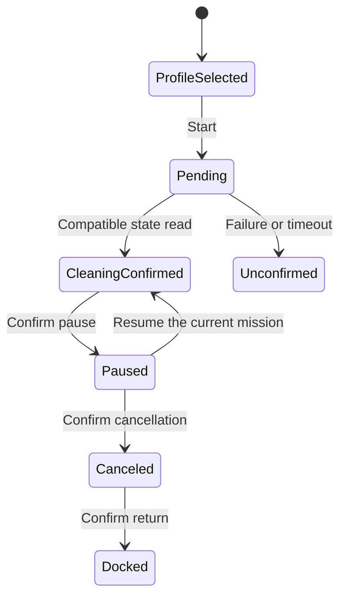
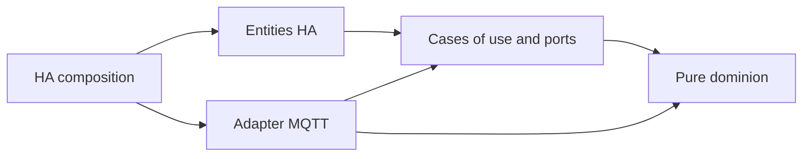

# Cleaning modes and profiles

- Status: Draft
- Date: 2026-11-23
- Catalog capability ID: cleaning-profiles
- Last verified: 2026-11-23
- Owners: ha-roomba-home maintainer
- Scope: Modes, combinations and adjustments of the next robot mission.
- Related issues/PRs: The incumbent's request and local work without publication.
- Required review gates: product, UX, architecture, testing, documentation, and security/operations
- Open decisions blocking readiness: To confirm the stages of sequential, resumption and physical application for all adjustments.

## 1. Executive summary

A combined robot MUST retains an empty entity and a HA device. Additional controls select
the profile of next cleanup. The integration MUST differentiate local preferences, order
sent and accused of the broker. None of them alone prove that the ground clearance has been
completed.

## 2. Problem, current behavior, and evidence

- Observed behavior: start at 0.2.0 He's always requested. operatingMode 2, vacuuming.
- Intentional contract: preserve existing IDs, authentication and controls.
- Known debt and limitations: No selection of mode or starting parameters; command policy
  lies with the HA adapter.
- Unknown rationale: The semantics of future supplier's capabilities and values are unknown.
- Proposed improvements: typed profiles, capacity validation and independent HA use cases
  with standard translated controls.

The SDK of Roomba Home 3.4.1 Distinguishes the capacity mask from order values: vacuum 2,
mop 4 simultaneous 6 and sequential 512. Capacity oMode 550 The four possibilities have been
announced and they are NOT physical validation. The order parameters include suctionLevel,
padWetness.padPlate, swScrub, twoPass and carpetBoost. The catches and the SSK extracted are
closed.

## 3. Actors, surfaces, and terminology

| Actor | Surface | Outcome |
| --- | --- | --- |
| Holder | Device and vacuum entity | Choose profile and start, pause or resume. |
| Automation | select, number and switch vacuum.start | Combine parameters without JSON from the supplier |
| Maintainer | Suite, SDD and sound evidence | Check contract, malfunctions and physical validation |

Requested profile means local preference for the next start. Reported mode means robot data.
A change of preference doesn't move the robot.

## 4. Goals, non-goals, and fixed invariants

- CLN-01: Expand all forms advertised with a physically tested model.
- CLN-02: allow all valid combinations of power, moisture and SmartScrub and carpet boost
  announced by the robot.
- CLN-03: Do not send monitoring parameters vacuuming in mopping and parameters mopping in
  vacuuming To preserve preferences as they change their way.
- CLN-04: Keep selection between reloads and re-starts. Validate while regaining preferences
- CLN-05: never confuse PUBACK with physical success, confirm transitions and later
  readings.
- CLN-06: maintain domain and use cases without importation HA, Pato or HTTP.
- CLN-07: achieve 100% cover of judgements and branches from the component, with no
  artificial exclusions.
- CLN-08: check up, controls and telemetry with an Icon on the domestic HA or authorized
  robot.
- CLN-09 (pending): Validate a complete vacuum-then-mop mission.

No maps, accounts and mistakes or consumables are deleted. The motion tests are limited to
the authorized robot and have an automatic final timings. Absence capacity doesn't mean
compatible.

## 5. Current versus proposed product journey

| Stage | 0.2.0 | Proposal |
| --- | --- | --- |
| Prepare | To start always aspires | Choose Mode and parameters for next cleaning |
| Run | Vacuum, pause and cancel. | Start with profile and resume conserving mission |
| Check | Informed Mode and Adjustment Sensors | Differentiated frequencies and readings |
| Reboot HA | No preferences | Reget valid preferences and existing IDs |

The textual flow is to choose, send once and check after pausing or resigning. Unconfirmed
result requires refresher before repeated and never automatically remands an order of
movement.

## 6. Functional behavior and state model

The mode is modelled as semantic enum, separate from transport code and support bits. The
boundaries are obtained from chap with strict integers and high boolean. Each set value MUST
will be validated before sending. The controls without proven capacity are not established.
A withdrawal capacity invalids the selection and blocks its sending.

Unselected optional parameters are omitted and the robot retains its values. The selected
parameters are included only in applicable modes. Mop without sending power and carpetBoost;
vacuum does not send moisture or SmartScrub. Two passes are applied to the forms that
support his model. No sign of an incompatible combination from a catalogue with another
robot's type.

Pause and resume operate on the same active mission. The profile of a new
mission does not change an already active one. Vacuum then mop requires
evidence of both stages within the same mission to confirm the command.

CLN-09 MUST observe vacuuming, mop preparation where applicable, mopping,
and a final result under the same mission identity. Verify both modes in
mission history and record the return to the dock. Regional testing requires
a robot that advertises the mode and a verified directed command.

## 7. User-facing configuration

Initial mode: vacuum, preserving previous behavior. Optional options start without local
overwriting. A monitoring can show information as a reference if there's no preference and
the documentation MUST explain that precedence. The preferences are stored by entrance and
robot with no credentials or supplier's documents, using an outline but validation.

The profile changes are local and do not alter an ongoing mission. The IU MUST identify
controls as parameters for next cleaning. No account, robot selection and configuration
entry version are changed.

The default robot power appears as a configuration number when the robots report valid and
advertised vacuuming. The writing MUST respect the announced range, demand that a robot be
connected and at rest with `rw-settings.state.reported.suctionLevel`. The next cleaning
preferences and existing identifiers are preserved.

`twoPass` and `carpetBoost` they are persistent booleans when the capacity and reading of
adjustments have been present. The Scriptures MUST check `state.reported` before giving the
change as confirmed. The surface monitoring for automatic emptying MUST require the current
surface modality, robot capacity and an empty information base. MUST represent m² and retain
the existing entity records as well with its preferences.

## 8. Clean Architecture design

Domination: modes, capabilities and immutable profile with compatibility policies.
Application: prepare start, check presconditions and confirm result using semantic ports.
Provider adapter: serialize the profile and publish once. HA adapter: entities, translations
and persistency. The coordinator is status composition and exchange, with no supplier
constants or combination rules.

If an order with mopping Reforms Preparation of mop in the requested mode, maintain result
as sent. To confirm at a regular reading the clearance phase of that same mission,
identified by number and start. The monitoring lasts up to five minutes and allows the user
To cancel while preparing.

Institutions depend on their use and they have a domain. The adaptors implement ports and
their composition connects them. Test of imports MUST prevent domain dependencies to HA or
infrastructure.

## 9. UI/UX and content contract

| State | Main message / information | Action |
| --- | --- | --- |
| Prepared | Next cleanup: Mop and moisture 2 | Start |
| Outstanding | Last order: pending and awaiting robot reading | Wait |
| Confirmed | Cleansing and information: mopping | Peas |
| Required action | Fitted Robot; conserved profile | Check Connection |
| Partial | Order accepted and an unconfirmed physical result | Refreshing status |
| Failed | Non-compatible profile and order not sent | Choose valid option |
| Completed | At the dock; mission completed according to robot | Prepare next cleanup |

Labels and options use English, with stable internal values and accessible names. The
icon is decorative and text also communicates states with dark, mobile issues without
images. Sensors do not become controls by changing their name only.

## 10. Failure, recovery, and cleanup

The orders are serialised on their own. Availability with prior reading is valid. A
mistransport, cancellation and disposal error leave an unconfirmed result with a retention
of preferences. No blind retard. Invalid restoration does not provoke movement or be quietly
accepted. Connections and attached jobs are closed even after canceling HA tasks.

## 11. Security, permissions, and privacy

The physical authorisation shall be limited to the robot indicated by his or her holder.
Private scripts MUST check name and local SKU without posting IDs. The orders do not support
JSON, topics or arbitrary commands. Documentation and fixtures are synthetic. Credentials,
maps and catches are out of the repository.

## 12. Observability and operational UX

Keep last_command_result and informed sensors. Diagnostics include quantity of capabilities
and preferences, never IDs or names. Public evidence records mode, parameters and relative
times. It does not declare an unobserved stage complete.

## 13. Compatibility, migration, rollout, and rollback

Keep HA 2026.11.2, SKU X185240, unique_id and current devices. Install with an exclusive
backup of the component configuration check and reset. Check Recovery and Retirement after
Loan. Keep earlier package for rollback and do not modify other forms of integration.

## 14. Testing strategy and numeric budget

| Area | New minimum cases | Risk covered |
| --- | ---: | --- |
| valid master and cartesian product | 30 | Bits, types and ranges |
| Serialization and transport | 12 | Accurate code, parameter exclusion and closure |
| Cases of use | 15 | Retirement, confirmation and cancellation |
| HA and restoration | 20 | Options, translations and services |
| Total | 77 | Additional cases to previous Suite |

Coverage MUST be 100% in judgements and branches of the complete component. The scenarios
have to check for significant results or errors Ruff, Hassfest and privacy have to pass
through links with a catalogue. Fitted physical tests cover all four representative modes
and options, with the complete valid matrix tested without movement. The domestic validation
MUST record actual results.

## 15. Documentation and discoverability

Updating README, use and API with architecture. Add instructions for mop and an example of
automation with generic IDs. To explain local preferences with respect to information
adjustments, boundaries of sequential mode and without duplication recovery.

## 16. Acceptance scenarios

1. Select Mop and start publish mode 4 and confirms compatible activity.
2. To choose simultaneous or sequential uses 6 or 512 without confusing support with order.
3. Change vacuum a mop retains chosen power but does not send it to the mop.
4. Non-range values or absent capabilities do not produce publications.
5. Two robots have independent preferences and only the target moves.
6. To leave and resume retains the profile of his mission, even if he changes next.
7. A transition-free PUBACK remains unconfirmed and isn't automatically retreated.
8. Reboot and reload preserves IDs, preferences or a single entity by monitoring.
9. The Suite cover 100% of branches and sentences, with no actual credentials.
10. A domestic ha displays icon and controls as well with an authorized robot.
11. A complete sequential mission reports vacuuming and mopping ground under the same
    identity and leave a confirmed final result in his track record.

## 17. Requirements traceability

| Requirement | Implementation | Evidence required |
| --- | --- | --- |
| CLN-01/02/03 | Domain, serializer and controls | Mast of combinations and physical tests |
| CLN-04 | HA persistency adapter | Rearm, re-start and invalid values |
| CLN-05 | Case of using orders | PUBACK, transition and shortterm monitoring |
| CLN-06 | Ports and composition | Executable restrictions on dependencies |
| CLN-07 | Suite and CI | cover report 100 |
| CLN-08 | Deployment and evidence | Fan domestic, modes and entities with icon |
| CLN-09 | Confirmation and History | Pending both phases of the same mission, history result, and return to dock |

## 18. Implementation sequence

To conduct SDK and capabilities, to define domain or contract with closed private probes.
Implement use cases as well at the same time that they have been put in place for an end of
their work but also give them more information about how best we can do so by using a
complete array (if necessary):

## 19. Definition of Done

- [ ] Four physically contrasted forms and representative options.
- [x] Controlls of established and restored announced combinations.
- [x] Cases of separate use and domain with HA or transport by port.
- [x] 100% cover, high quality testing and monitoring budget.
- [ ] Documentation, SDDs and updated cataloguing with no private data.
- [ ] Home installation, recharging and status monitoring with an icon.

## 20. References and decisions

[Standard SDD](README.md), [telemetry](005-telemetry-and-problems.md), [orders](004-command-validation.md), [HA vacuum entity](https://contributors.home-assistant.io/core/entities/vacuum/). A vacuum entity is also used for the combined sink with select, number and switch controls under that same device. The announced support guides discovery and physical evidence determines what can be declared proven.

Full sequential validation follows MAP-03. [Mission detail and interactive maps](008-mission-detail-and-map-card.md)
