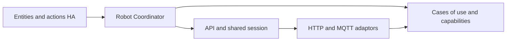

# Capability-guided robot and dock controls

- Status: Draft
- Date: 2026-11-23
- Catalog capability ID: device-capabilities
- Last verified: 2026-11-28
- Owners: ha-roomba-home maintainer
- Scope: Capability discovery, per-robot state, map controls, and verified dock operations.
- Related issues/PRs: Android capability comparison and household integration validation.
- Required review gates: product, UX, architecture, testing, documentation, and security/operations
- Open decisions blocking readiness: Physical completion after automatic recharge, the effect of every regional setting, automatic emptying at the configured threshold, and device setup and removal contracts.

## 1. Executive summary

The integration adapts vacuuming, mopping, maintenance, and map controls
to verified device capabilities. Each operation requires a supported
provider contract and current preconditions. Unknown support remains
unknown in the UI and guards.

## 2. Problem, current behavior, and evidence

- Observed behavior: The account coordinator reads associated Max 700 Combo robots and their recognized docks. A two-pass run reported an active recharge under the same mission identity.
- Intentional contract: Preserve existing identifiers, scope every operation, and confirm it from fresh provider evidence.
- Known debt and limitations: Some device behaviors require additional physical verification under representative settings.
- Unknown rationale: Other models and firmware may expose different capability values and state transitions.
- Proposed improvements: Extend the verified capability matrix with physical or protocol evidence for each supported operation.

The observed inventory included three X185240 robots and a legacy model.
Signed reads confirmed the modern shadow inventory, parts data, and map
destinations. Provider capability flags determine which controls apply.
[Active recharge](../docs/validation.md#charging-during-the-same-cleaning-mission)

The Android device review confirmed the following Max 700 Combo surfaces.
The comparison uses signed robot data and the manufacturer's public
model catalogs where applicable.

| Android surface | Integration status |
|---|---|
| Robot name, model, software version, last software update | Device and firmware entities, with the robot and dock software and update status in the card |
| Robot serial in the About screen | Verified asset lookup and Home Assistant device metadata |
| Automatic pad washing, emptying by routine or area, voice language and volume, child and pet lock, locate, and reboot | Implemented device or dock controls. The emptying selector uses the three [confirmed Android choices](../docs/api.md#automatic-dock-emptying) and retains the area number for custom thresholds. |
| Dock controls from the floor plan and robot page | The floor plan card opens controls for the same linked dock buttons and reports which operations are running. [Native panel comparison](../docs/validation.md#dock-controls-on-the-floor-plan) |
| Component use and remaining life, including maintenance resets | Implemented; three Android hour values and usage bars matched signed values |
| Battery and activity on the robot page | Reported in the map card header and its device-only overview. [Overview validation](../docs/validation.md#robot-status-without-a-floor-plan) |
| Wi-Fi settings and reconnection | The card shows Roomba connection diagnostics and links the vendor's reconnection guide. The Max 700 Combo app asks for confirmation before clearing its Wi-Fi configuration. Provisioning and recovery require separate verification. |
| Factory reset and remove robot | App entry point observed; account removal, device reset, and recovery require verification |
| Part SKUs and replacement or care links | Validated model catalog projected on existing sensors and in the maintenance view |
| General user guide and robot help | The card and an action expose the verified manual, setup links, diagnostic code lookup, and four-step Max 700 Combo preparation checklist. |

[Android device settings comparison](../docs/validation.md#android-device-settings-comparison)

## 3. Actors, surfaces, and terminology

| Actor | Surface | Result |
| --- | --- | --- |
| Operator | Robot and dock devices | Available settings and controls |
| Automation author | Standard entities and typed actions | Validated parameters and confirmed state |
| Maintainer | Capability matrix and physical evidence | Observed support, implemented controls, and pending tests |

Reported support, a verified command contract, and physical validation
have distinct meanings. Preserve the difference between unsupported,
unavailable, unknown, and a verified false or zero.

## 4. Goals, non-goals, and fixed invariants

- CAP-01: Project cleaning, dock, map, and region capabilities from verified device data.
- CAP-02: Derive Home Assistant supported features and controls from those capabilities.
- CAP-03: Share the account session and scheduling while preserving per-robot availability.
- CAP-04: Expose verified dock operations, locate, and reboot through their supported Home Assistant controls.
- CAP-05: Verify operation results and respect retry backoff for shared reads.
- CAP-06: Preserve registry identities and record verified and pending provider contracts.
- CAP-07: Maintain 100% statement and branch coverage and test supported operations against authorized hardware.
- CAP-08: Validate a complete mission targeting a saved cleaning zone.
- CAP-09: Expose the floor plan, robot position, heading, path, and verified live progress from Roomba.
- CAP-10: Expose voice volume and child and pet lock as verified robot configuration controls.
- CAP-11: Configure water temperature, wash frequency, automatic solution dispensing, and drying duration on compatible docks.
- CAP-12: Rename the robot and select a reported installed voice through native Home Assistant configuration entities.
- CAP-13: Expose a normal reboot with connection-cycle confirmation and list the model's downloadable voices.
- CAP-14: Install and select a catalog voice with a correlated software
  status and voice inventory. The card reviews the locale and any
  replaced voice, rechecks the reviewed inventory on dispatch, and updates
  the installed selector after confirmation.
- CAP-15: Reset a supported robot or dock counter after completed maintenance.
- CAP-16: Expose installed robot and dock software and the reported robot
  installation time. Check Roomba's public firmware catalog on demand in
  the card or a response-only action. Require read access for the card and
  preserve current installed values in the card when the catalog is unavailable.
- CAP-17: Expose the provider-reported serial on the associated Home Assistant device.
- CAP-18: Manage weekly and one-time schedules from the floor plan. Show
  the recognized destination order and per-area settings and let the owner
  change either independently of timing and activation. Support ordered
  rooms, saved zones, and mapped furniture. Keep ISO weekdays in the
  Home Assistant boundary and translate the provider's Sunday value.
- CAP-19: Show part SKUs and verified market-scoped replacement and care
  links beside the signed robot and dock counters. Keep catalog references
  available if the counter read fails. Require read access to the linked robot.
  Show usage bars from the signed percentage and format remaining time in
  hours without changing sensor precision. Offer part descriptions when a
  verified model and part match the catalog's description key.
- CAP-20: Expose the native automatic emptying choices on the linked dock.
  Preserve the existing area number, unit conversion, and raw code sensor.
  Verify changes through the same signed settings shadow and require a
  connected robot with no active mission and a recognized emptying dock.
  Use the mission report for the recorded emptying count. The configured
  area and the mission's cleaned area alone cannot predict that count.
- CAP-21: Offer the owner’s manual, verified help links and provider code
  lookup by model, interface language and country. Separate provider error
  families and link only documented current faults. Authorize card reads
  using the selected vacuum's read permissions and keep help usable when
  maps are disabled.
- CAP-22: Present the four verified setup steps for the Max 700 Combo
  inside Robot help and include them in its read response. Match the
  Android order and link iRobot's instructions. Unknown models return
  no checklist. Opening it has no device or account side effects.
- CAP-23: Show supported manual dock actions and their observed activity in
  the map card. Route confirmed actions through the existing linked Home
  Assistant buttons and their normal safety checks and result handling.
- CAP-24: Expose the available robot and dock state independently of map
  availability. Preserve read and control permissions, and distinguish
  unknown connectivity from a reported disconnection.
- CAP-25: Expose the UTC activation day from the signed assets of an
  associated robot as a date sensor. Reuse the serial number lookup and
  refresh schedule. Discover the sensor on the first valid response and
  retain its last verified value when a later asset read omits the date
  or fails. Keep the date usable when the account can refresh and the
  robot is disconnected. Exclude it from diagnostic exports.
- CAP-26: Offer reviewed maintenance counter resets from the card for a
  supported part with an available counter. Require control access to
  the selected vacuum, identify the part in the review, and use the
  existing Home Assistant reset action once after confirmation. Refresh
  the displayed counters and scope the result to the dialog that sent it.
- CAP-27: Group the existing robot and dock configuration values in the
  card. Filter each row by entity read permission and require its control
  permission and a current connected, idle robot for edits. Use the
  existing entity services and reread the affected settings after each
  confirmed save. Keep the panel usable without maps.
- CAP-28: Review locate and reboot for the selected robot in Device
  settings. Reread the control permissions and entity association before
  invoking the existing service. Report locate submission and confirm a
  reboot after the robot disconnects and reconnects. Keep a pending action
  scoped to its originating robot if the panel closes.
- CAP-29: Show the selected robot's Roomba connection state, metadata time,
  last cloud read, and numeric code in Device settings. Distinguish an
  explicit disconnection, a missing provider state, and an account refresh
  failure. Preserve authorized historical timestamps during an outage.
  Respect each diagnostic entity's read permissions and use the existing
  Roomba coordinator without an extra provider request or map dependency.
- CAP-30: Show a reminder for each supported part with signed usage of
  100% or a known remaining quantity of zero. Scope reminders to the
  selected robot and recognized dock. Open the existing Maintenance
  panel from the reminder. Keep dismissal local to the card view and
  hide reminders while signed part data are unavailable.

Use recorded provider contracts for endpoints and device capabilities.
Scope physical trials and temporary edits to the authorized robot and
map. Preserve existing data and use synthetic fixtures for fault cases.

## 5. Current versus proposed product journey

| Stage | Current behavior |
| --- | --- |
| Discover | Select supported robots and derive controls from typed provider capabilities |
| Configure | Choose next-cleaning preferences and supported persistent settings |
| Clean areas | Review destinations against the active floor revision |
| Use the dock | Inspect its status and run supported maintenance operations |
| Recover | Preserve per-device availability and respect scheduled read backoff |

## 6. Functional behavior and state model

The capability model MUST preserve typed and unknown values. It combines
association data, `cap`, `digiCap`, and verified shadow fields. Confirm
dock presence and functions independently of robot-level capability flags.

The vacuum uses the standard Home Assistant states and supported feature
flags. Battery, diagnostics, and typed readings have their own entities.

Use the selected robot's map and revision to validate each scheduled
destination. Read the current household and a single editable group
before changing a start or enabled state. Support the provider's weekly
and one-time frequencies. A one-time start uses the next occurrence of
the selected local clock time. New entries start disabled. Timing and
activation writes MUST preserve the command, area order, and cleaning
preferences and confirm them through a fresh read. Per-area edits MUST
validate the reviewed current revision and destination IDs, keep the enabled
state, and keep the exact occurrence when the owner leaves the timing alone.
Recognize the timed one-time app format and keep validated inactive mop
preferences available when changing the mode in the editor. Removal MUST verify
the robot and schedule group and confirm absence after one write.
For ordered furniture schedules, resolve each temporary region to its
current furniture polygon and persistent furniture ID. Reject stale map
reviews and omit per-area edit controls for incomplete polygon links.
Keep private room, schedule, and robot identifiers out of the published
evidence and diagnostics. [Schedule contract](../docs/api.md#cloud-schedule-frequency-and-ownership)

Action `roomba_home.clean_point` requires digital spot support and an active
room on the selected map. It converts two room-relative fractions to a
native coordinate strictly inside the room and map borders and outside
keep-out areas. A wet mode also requires usable no-mop geometry and a
center outside those zones. Virtual walls prevent validation when the
reachable side is unknown. The action sends `point_clean` once with the map,
its version, and the supported mode selected for this point. Omitting the
mode keeps the vacuum behavior of existing automations. Point mode follows
the same four capability-gated choices as the official app. A dock fault
detected after sending a wet point command reports the dock-readiness error
and ends confirmation without retrying.
Roomba's live state can establish submission and mission history can later
confirm the exact command. [Point cleaning contract and evidence](../docs/api.md#spot-cleaning-and-map-coordinates)

The dashboard exposes point selection to operators with entity control
permission. Pointer and keyboard inputs mark the same room-relative target
in the overhead and 3D views. The card requires confirmation of the mode
and location before dispatch.
The card supplies the reviewed map ID, revision, and destination inventory
to the action. The backend rejects stale reviews before publishing.

## 7. User-facing configuration

Keep the account entry, robot selection, and valid preferences. Use the
central capability model to derive controls. Preserve an existing entity
when an optional source goes missing and make its value unavailable.
Diagnostic entities can be disabled in the Home Assistant registry.

Persistent moisture and SmartScrub controls MUST require supported
capability and a valid reported value. Serialize each write with the
robot's operations and confirm it through `rw-settings.state.reported`.
Validate that the robot is idle before writing a field. Store next-cleaning
preferences independently in Home Assistant.

Voice volume accepts integers from 0 to 100. Child and pet lock accepts a
boolean and controls the robot's physical buttons. Discover both controls from
their valid `rw-settings.state.reported` values. Keep the control's entity ID
when a reading disappears and mark it unavailable until the field returns.
Reuse the per-robot settings operation so changes are serialized with commands,
limited to one field, and confirmed through a fresh reported value. Preserve
existing read-only sensors and next-cleaning preferences.

The robot name follows the typed `rw-settings.name` value when available.
Keep the Home Assistant device identifier, entity IDs, and user-assigned
device alias when the name changes. Keep the name out of generic telemetry
and diagnostic exports. Voice selection requires a current, valid code and
a choice from the robot's installed language inventory. Route both writes
through the existing serialized, confirmed settings operation.

The public voice catalog action subtracts the installed language codes
reported by the selected robot from the codes offered for its model.
Return the selected code separately and surface unavailable inventories
as errors. Request the catalog without account credentials or robot IDs.

Installation uses the model catalog's voice metapackage and a fresh
language deployment identifier. Require a connected, docked robot with
reported language slots and no pending deployment. Serialize the write
with other operations for that robot. Confirm the matching deployment
with the installed inventory and selected voice, or report the correlated
firmware error or bounded timeout.

Use a native configuration button for reboot. Publish once for the
associated connected robot, then confirm only after Roomba reports that
its connection went offline and returned. Unknown readings do not count
as disconnection. Keep the per-robot operation lock until confirmation
or the bounded timeout.

Mop wash temperature, wash frequency, and automatic solution dispensing
require a recognized dock with wash capability. Drying duration requires
a recognized dock with dry capability. Create controls only for values
verified for the Max 700. Route them through the same confirmed settings
operation and keep them on the linked dock device. Changing wash frequency
writes `pwReturn` alone and keeps the raw area and time interval readings.
[Native tokens and meanings](../docs/api.md#max-700-automatic-mop-wash-settings)

Allow a manual wash while a Max 700 Combo dock is actively drying. Apply
the standard wash readiness and fault checks. Confirm the wash from its
own component transition. Preserve other commands' busy-state checks.

Require explicit confirmation of completed maintenance for a counter reset.
Use an enabled counter from a fresh read of the target robot. Publish a
single signed reset for that part and update the sensor after a matching
acknowledgement and a fresh zero usage value.

Read the last software installation time from `rw-software` and preserve
its timezone when projecting the sensor. Query the firmware catalog only
with the model and reported installed versions. An empty provider list
allows an up-to-date response. Other versions are candidates, and a failed
query leaves the status unavailable. Keep firmware rollout under Roomba's
control.

## 8. Clean Architecture design

The domain models capabilities, cleaning profiles, destinations, and dock
readiness. Application use cases take typed robot observations and confirm
the requested transitions. The integration adapters handle signed HTTP,
MQTT, and Home Assistant storage. The coordinator composes these layers
and shares the cloud session across the selected robots. The entity
platforms expose the projected data and translated controls.

Each device has its own state projection and availability. The core
policies run independently of Home Assistant. The shared transport
serializes operations on its MQTT client identity, while a per-robot lock
keeps command validation, dispatch, and confirmation in order for that
robot.

## 9. UI/UX and content contract

| State | Main text or information | Next action |
| --- | --- | --- |
| Prepared | Supported profile and verified destinations | Review or start |
| Pending | Waiting for robot or dock confirmation | Inspect reported state |
| Unavailable | A required observation is missing | Check connectivity |
| Partial | Some optional device data is unavailable | Inspect source availability |
| Unconfirmed | The command is awaiting evidence or timed out | Check state before retrying |
| Complete | Roomba reported the expected result | Review mission or maintenance details |

Entity names use English translation keys. Preserve stable automation
values and accessible status text. Distinguish unsupported settings,
authentication failures, and rate limits.

## 10. Failure, recovery, and cleanup

Retry eligible reads with bounded backoff and respect provider
`Retry-After`. Reauthenticate when credentials are rejected. Preserve
accepted data from other robots or sources after a partial failure.
Advance a device's last cloud read only after its fast state is accepted.
Scheduled and manual refreshes share the same read backoff. Keep known
map associations after a failed read, and replace them after a valid
response, including an empty list. Revalidate the destination against a
fresh map before a directed write.

Apply the supported mop readiness checks to every wet destination. Use
reported pad, reservoir, dock, and preparation states to identify a
blocker. Preserve missing observations as unknown. Check active errors
and a reported missing dust bin for vacuum. Recheck dock state before
each manual operation. Report an unconfirmed write without republishing.

Unload closes subscriptions, timers, and owned tasks. Physical tests use
the authorized device and record the result independently of test timing.

## 11. Security, permissions, and privacy

Keep temporary credentials and captures outside the repository. Publish
reduced evidence without private names or identifiers. Validate inputs
through typed action schemas. Scope a request to the selected associated
robot, authorized entity, and current capabilities.

## 12. Observability and operational UX

Keep problem codes by source and deduplicate event transitions. Use a
matching reported state to confirm an operation. A wash record proves that
the dock washed the mop. A mopping observation verifies activity on the
floor. Track the reported `condNotReady` set and its explicit resolution.
Preserve phase and cycle independently. When Roomba reports charging
with an open cleaning cycle, keep the mission active and display the
charging phase. Retain verified room cleaning time up to dock departure.
Use signed history for pauses, recharges, and mode-specific measurements.
Compute the next weekly or one-time start using
the robot's reported IANA time zone and complete enabled-schedule data.
A one-time prediction requires a provider creation timestamp and a known
date. Keep the next start unknown if the earliest local time is ambiguous.
History and schedule counts require accepted provider responses. A valid
empty list produces zero. A failed read leaves the count unknown and
preserves the independent robot state. The estimate action uses the
current map and supported room profile. The live countdown also requires
an eligible stage and verified elapsed work.

## 13. Compatibility, migration, rollout, and rollback

The verified environment uses Home Assistant Core 2026.11.2. Preserve
existing entity IDs and the dock association when changing device
grouping. Verify new categories against their own provider contract.
Run the configuration check and keep the previous release available for
rollback when installing a change.

## 14. Testing strategy and numeric budget

| Area | Minimum new cases | Risk |
| --- | ---: | --- |
| Capability projection | 20 | Supported, partial, and unknown robot or dock capabilities |
| Dock and robot actions | 15 | Presence, readiness, and matching confirmation |
| Regions, maps, and schedules | 15 | Authorization, revisions, and multiple destinations |
| Cleaning a map point | 12 | Robot modes, mop readiness, map boundaries, restrictions, and confirmation |
| Coordination and recovery | 15 | Source isolation, backoff, and scoped results |
| Home Assistant presentation | 10 | Entity IDs, actions, and translation |
| **Total** | **87** | Independent baseline cases |

Run the complete suite with 100% statement and branch coverage. Keep
synthetic and physical evidence distinct. Physical verification records
the visible control, signed result, and any recovery required.

## 15. Documentation and discoverability

Update the capability matrix and describe each entity or action beside
its verified provider source and tests.
[Capabilities](../docs/capabilities.md) · [API](../docs/api.md) · [Usage](../docs/usage.md)

## 16. Acceptance scenarios

1. A vacuum-only capability supplies vacuum controls for the robot.
2. Unknown capabilities remain unavailable and cannot authorize a write.
3. A combination robot exposes its verified cleaning modes and standard states.
4. Require recognized dock support for emptying, washing, and drying controls.
5. Scope region commands to the reviewed map and revision.
6. Respect backoff after a temporary failure and preserve state for other robots.
7. Renew the shared session at its margin and request reauthentication after rejected credentials.
8. Report uncertain writes without automatic redispatch.
9. Preserve entity identities and settings through reload and upgrade.
10. Verify the icon, normal controls, and reported state on the authorized installation.
11. Select a saved zone, verify reported cleaned area, and confirm the
    exact zone and outcome in mission history.
12. The floor plan uses the robot's current map version. A fresh mission position
    identifies the current room only when it lies strictly within one labeled
    room. The path preserves sequence gaps. Coverage, completion percentage,
    and time remaining require independent mission evidence.
13. Change voice volume and child and pet lock while the authorized robot is
    docked. Confirm each value from Roomba, preserve the next-cleaning profile,
    and restore both original values.
14. On the authorized dock, exercise each verified temperature, frequency,
    solution dispensing state, and drying duration. Confirm each choice and
    restore the original settings with the robot still docked. A dock with
    partial capabilities offers only the supported controls.
15. Mark a point in an active room on the rotated map and review it before
    dispatch. Confirm a point entered with the keyboard projects to the same
    place. Reject invalid geometry and a stale map or inventory review.
    Reject wet modes inside a no-mop zone and modes disabled by the robot.
    [Card tests](../tests/frontend/map-card.test.cjs) · [Action tests](../tests/ha/test_areas.py)
16. Change and restore the name and voice of the authorized docked robot.
    Preserve device identity and the HA alias. Verify that the voice selector
    refuses a code absent from the latest installed inventory.
17. Reboot the authorized robot once and observe disconnection and
    reconnection. Check its map and settings and observe any interrupted
    dock activity. List voices and verify the reported installed codes are
    excluded from the list of downloads.
18. Install a catalog voice while the authorized robot is docked. Confirm
    software progress, the matching deployment, and the newly installed
    and selected code. Verify replacement of the previous download and
    preservation of factory voices. Exercise a mismatched deployment,
    reported firmware error, and timeout with fixtures.
19. Open the maintenance view for a Max 700 Combo before enabling maps.
    Verify that replacement references match the model catalog, the filter
    shares its signed usage with the existing sensor, and the dust bag can
    show a link with its counter disabled. Compare displayed hours and bar
    values with Android for the three timed parts. Expand filter guidance
    and verify that an available regional guide takes precedence. Check
    access denials, unavailable counters, wrong-market or mismatched SKU
    links, and unrecognized model or description IDs.
20. Set per-routine emptying, then the 50 m² preset. Set per-routine
    emptying again and write a custom area while the number displays an
    unknown value. Restore the 25 m² preset. Confirm each signed frequency
    and both entities' states, preserve their device association, and
    verify that an unknown native scheme or missing dock blocks writes.
21. Open Robot help for the selected vacuum and confirm the owner's manual
    matches Android's regional PDF. Look up one article from each
    diagnostic family. Validate overlapping codes, repeated entries,
    rejected links, stale robot state, and denied access. Compare the
    card response and action return with maps disabled.
    Move the card to another dashboard container while help is open.
    Restore the native modal and preserve the selected article.
22. Confirm that the Max 700 Combo checklist starts collapsed and expands
    to show brush placement, filling the dock, charging, and preparing
    the rooms in that order. Check that the read-only action and card
    agree and that an unverified SKU omits the checklist.
23. Open Robot software for the selected vacuum and verify the robot build,
    dock version, update day, and catalog status against Android. Check
    the retry control, catalog candidates, catalog failures, and denied
    reads. Exercise the view with maps disabled and a different device
    selected before an outstanding read returns.
24. Open Device settings and compare the available robot and dock rows
    with Android. Save a robot setting and a dock setting, then restore
    them through the card and confirm both readbacks. Check permissions,
    active missions, a custom emptying threshold, and changing robots
    while a save is outstanding.
25. Open Download voices for the selected robot. Compare the current
    and downloadable voices, review a replacement, and confirm that
    a changed inventory prevents a write. Validate read-only access,
    a pending deployment, progress, and the resulting installed and
    selected voices after the confirmed installation.
26. Review Locate robot and Reboot robot before dispatch. Check that the
    card refuses a changed action target or permission and sends the
    existing service once. Verify the locate submission and reboot
    reconnection outcomes, including a timed-out reboot with no repeat.
27. Expand Connection in Device settings while connected and with maps
    disabled. Compare the timestamps and raw code to the same robot's
    diagnostic readings. Exercise missing data, a denied sensor, an
    explicit disconnection, and a failed cloud refresh. Confirm the
    reconnection guide opens independently of device control permission.

## 17. Requirements traceability

| Requirement | Surface | Evidence required |
| --- | --- | --- |
| CAP-01/02 | Capability projection and entities | Supported, unsupported, and unavailable values |
| CAP-03 | Account and robot coordinators | Session reuse, isolation, and request counts |
| CAP-04 | Vacuum and dock actions | Typed contracts and physical verification |
| CAP-05 | Confirmation and recovery | Controlled clocks, failure, and follow-up reads |
| CAP-06 | Registry and documentation | Stable IDs across reload and update |
| CAP-07 | Validation and deployment | Full coverage, repository checks, and household evidence |
| CAP-08 | Saved-zone cleaning | Physical run with the exact `zid`, history result, and return. [Validation](../docs/validation.md#immediate-saved-zone-selection-in-0250) |
| CAP-09 | Native map image, room, live movement, obstacles, coverage, and estimated time | [Mission and floor card specification](008-mission-detail-and-map-card.md) and [physical validation](../docs/validation.md#continuous-position-and-cleaning-coverage) |
| CAP-10 | Voice volume number and child and pet lock switch | [Native shadow payload](../docs/api.md#voice-volume-and-child-and-pet-lock), [Home Assistant service tests](../tests/ha/test_cleaning_controls.py), and [robot validation](../docs/validation.md#robot-configuration-controls) |
| CAP-11 | Dock configuration selectors and switch | [Native values](../docs/evidence/2026-11-25-dock-preferences.json), [Home Assistant service tests](../tests/ha/test_cleaning_controls.py), and [dock validation](../docs/validation.md#automatic-mop-wash-settings) |
| CAP-12 | Robot name text entity and installed voice selector | [Reported values and restoration](../docs/evidence/2026-11-25-robot-identity.json) and [Home Assistant service tests](../tests/ha/test_cleaning_controls.py) |
| CAP-13 | Reboot button and voice catalog action | [Physical validation](../docs/evidence/2026-11-25-reboot-and-voice-catalog.json), [control tests](../tests/test_application.py), and [Home Assistant actions](../tests/ha/test_cleaning_controls.py) |
| CAP-14 | Reviewed voice installation in the card and the existing action | [Installation evidence](../docs/validation.md#voice-pack-installation), [protocol tests](../tests/test_voice_catalog.py), [coordinator tests](../tests/ha/test_coordinator.py), and [card tests](../tests/frontend/map-card.test.cjs) |
| CAP-15 | Confirmed reset of one maintenance counter | [Maintenance validation](../docs/validation.md#maintenance-counter-reset), [signed request tests](../tests/test_api_client.py), and [Home Assistant action tests](../tests/ha/test_cleaning_controls.py) |
| CAP-16 | Firmware timestamp sensor, catalog action, and read-only software card | [Device validation](../docs/validation.md#robot-software-status), [catalog tests](../tests/test_api_client.py), [action tests](../tests/ha/test_cleaning_controls.py), [WebSocket tests](../tests/ha/test_roomba_map_api.py), and [card tests](../tests/frontend/map-card.test.cjs) |
| CAP-17 | Robot device registry serial number | [Android and API comparison](../docs/validation.md#robot-serial-number), [signed lookup tests](../tests/test_api_client.py), and [registry refresh tests](../tests/ha/test_telemetry_entities.py) |
| CAP-18 | Schedule editor and typed Home Assistant actions | [Schedule API](../docs/api.md#cloud-schedule-frequency-and-ownership), [action tests](../tests/ha/test_schedules.py), [card tests](../tests/frontend/map-card.test.cjs), and [signed trial](../docs/validation.md#schedule-editor-and-per-area-settings) |
| CAP-19 | Maintenance view and part sensor attributes | [Catalog parser tests](../tests/test_maintenance.py), [WebSocket tests](../tests/ha/test_roomba_map_api.py), and [catalog validation](../docs/validation.md#maintenance-catalog-and-links) |
| CAP-20 | Dock emptying selector and existing area number | [Native values](../docs/api.md#automatic-dock-emptying), [entity tests](../tests/ha/test_cleaning_controls.py), [write confirmation tests](../tests/ha/test_coordinator.py), [signed setting trial](../docs/validation.md#automatic-dock-emptying-frequency), and [physical comparison](../docs/validation.md#saved-routine-dock-frequency-comparison) |
| CAP-21 | Robot help panel and read action | [Catalog and article validation](../docs/validation.md#robot-help-catalog), [protocol tests](../tests/test_help_catalog.py), [WebSocket tests](../tests/ha/test_roomba_map_api.py), and [panel tests](../tests/frontend/map-card.test.cjs) |
| CAP-22 | Max 700 Combo first-clean checklist | [Android comparison](../docs/validation.md#first-clean-preparation), [model tests](../tests/test_help_catalog.py), [action tests](../tests/ha/test_cleaning_controls.py), and [panel tests](../tests/frontend/map-card.test.cjs) |
| CAP-23 | Dock controls and state on the floor plan | [Native panel comparison](../docs/validation.md#dock-controls-on-the-floor-plan), [linked dock entity tests](../tests/ha/test_dock_and_history.py), and [map snapshot tests](../tests/ha/test_roomba_map_api.py) |
| CAP-24 | Device status and controls without map geometry | [Overview validation](../docs/validation.md#robot-status-without-a-floor-plan) and [overview tests](../tests/ha/test_roomba_map_api.py) |
| CAP-25 | Robot activation date sensor | [Native and signed validation](../docs/validation.md#robot-activation-date), [asset client tests](../tests/test_api_client.py), and [entity refresh tests](../tests/ha/test_telemetry_entities.py) |
| CAP-26 | Reviewed counter reset from the maintenance panel | [Native control comparison](../docs/validation.md#counter-reset-from-the-maintenance-panel), [WebSocket permissions](../tests/ha/test_roomba_map_api.py), and [card tests](../tests/frontend/map-card.test.cjs) |
| CAP-30 | Signed maintenance reminders on the robot card | [Native observation](../docs/validation.md#maintenance-reminders), [counter tests](../tests/test_maintenance.py), [WebSocket tests](../tests/ha/test_roomba_map_api.py), and [card tests](../tests/frontend/map-card.test.cjs) |
| CAP-27 | Device settings panel with linked entity actions | [Android and card validation](../docs/validation.md#device-settings-on-the-card), [WebSocket permissions](../tests/ha/test_roomba_map_api.py), and [card tests](../tests/frontend/map-card.test.cjs) |
| CAP-28 | Reviewed locate and reboot on the card | [Card validation](../docs/validation.md#locate-and-reboot-from-device-settings), [WebSocket permissions](../tests/ha/test_roomba_map_api.py), [transport tests](../tests/test_application.py), and [card tests](../tests/frontend/map-card.test.cjs) |
| CAP-29 | Roomba connection diagnostics in Device settings | [Native and card validation](../docs/validation.md#connection-details-in-device-settings), [WebSocket permissions](../tests/ha/test_roomba_map_api.py), and [card tests](../tests/frontend/map-card.test.cjs) |

CAP-09 includes floor plans, room labels, position, heading, trajectory,
coverage, and estimates supported by Roomba. Enable the map option to expose
one Home Assistant image per active, visible saved map. The live feed starts
with the provider's signed announcement and uses only the exact topic checked
against the robot's discovered deployment. An independently authenticated
subscription delivers position updates between the account's state polls. The
provider associates floor identity with the correlated mission timeline.
On devices with multiple saved floors, live positions are projected onto
the mission's verified floor and retained for its bound revision.
[Multiple saved floor validation](../docs/validation.md#multiple-saved-floors)

The current room requires exactly one containing room polygon and a label.
Boundaries, holes, overlaps, and expired positions produce an unknown room.
The marker and timestamp expire at `update_expire_ts`. The collected path
persists until the mission changes or ends. Public evidence and diagnostics
omit room names, geometry, positions, and signed URLs.
Floor plan labels use a bundled Unicode font and canonical normalization.
The padded label must fit within the room and avoid holes, other labels,
and the active position marker.
Long labels may be shortened inside the image. The active position marker
draws above the labels, and room telemetry keeps the original name.

Two live vacuum runs produced `pos_update.cur_path` and `update_expire_ts`.
All 222 distinct observed coordinates matched a unique room polygon in the
active saved geometry. The app showed the active room and about seven minutes.
The matching room-and-profile estimate was 397 seconds. The live timeline
returned start and relocation events for the same mission. The integration
estimates remaining time and coverage from provider measurements.
A verified compressed snapshot format supplies earlier positions and temporary
obstacles. A mission-wide percentage still requires a provider denominator.
[Live progress evidence](../docs/evidence/2026-11-24-live-progress.json) ·
[Coverage and obstacle validation](../docs/validation.md#live-coverage-reconstruction)

Early household trials verified targeted vacuuming, pause, resume,
cancel, and manual emptying. One early sequential attempt ended before
its second phase. A later trial verified both physical phases and their
matching history under the same mission.
[Initial household validation](../docs/validation.md#upgrade-and-timed-cleaning-with-030) ·
[Directed sequence](../docs/validation.md#directed-vacuum-then-mop)

The 0.4.0 household schedule trial used a disabled test schedule. A
read-back confirmed its day, time, and order. Removing it restored the
original schedule list. [Schedule evidence](../docs/evidence/2026-11-23-schedule-writes.json)

## 18. Implementation sequence

Confirm the provider capability, preconditions, and result for a new
operation. Add the typed projection and adapter tests. Verify the normal
Home Assistant control and update the physical evidence.

## 19. Definition of Done

- [x] Project robot and dock capabilities from verified sources.
- [x] Share the account session and preserve per-device recovery and availability.
- [x] Expose verified map targets and controls in Home Assistant.
- [x] Run the full coverage, privacy, and specification checks.
- [x] Record household installation and tested device behavior.
- [ ] Complete the physical firmware and setup scenarios listed in readiness.

## 20. References and decisions

Add capabilities when their source, guards, and result have been verified.
The matrix records current support and the physical cases still open.
[Profiles](006-cleaning-profiles.md) · [Capabilities](../docs/capabilities.md) ·
[API](../docs/api.md) · [Home Assistant vacuum](https://contributors.home-assistant.io/core/entities/vacuum/)

Live progress, saved zones, automatic resume, and map selection follow MAP-02 through MAP-04. [Mission detail and interactive maps](008-mission-detail-and-map-card.md)
