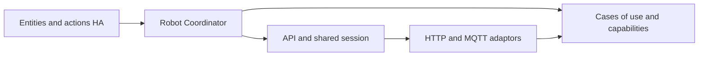

# Capability-guided robot and dock controls

- Status: Draft
- Date: 2026-11-23
- Catalog capability ID: device-capabilities
- Last verified: 2026-11-26
- Owners: ha-roomba-home maintainer
- Scope: A central discovery, robot co-ordination and advanced base with clear regions.
- Related issues/PRs: Extension requested by the incumbent and local development.
- Required review gates: product, UX, architecture, testing, documentation, and security/operations
- Open decisions blocking readiness: Automatic recharge and resume, the effect of every regional setting, physical automatic emptying at the selected frequency, and the device setup and removal contracts.

## 1. Executive summary

Integration MUST adapt to the actual capabilities of each device, including vacuuming,
mopping and maintenance. A list of models isn't good enough. Each operational function
requires evidence of its detection, contract and presconditions. The Unknown MUST be
preserved as unknown.

## 2. Problem, current behavior, and evidence

- Observed behavior: information and consultation shared by account; filter X185240,
  advanced telemetry with monitoring profiles per chap undergoing development.
- Intentional contract: existing IDs, privacy and strict validation with an absence of a blind
  reattempt to move.
- Known debt and limitations: complete central model missing, device co-ordines with basic
  orders or regional monitoring as well at explicit recovery backoff.
- Unknown rationale: The modern contract for the previous generation association isn't
  presumed.
- Proposed improvements: extend from tested responses and SDK to preserve an evidence
  matrix.

The account contains three X185240 and an association R981040. Eight modern shadows, pieces
and catalogue have been read. The authorized robot has an active map with 6 rooms and a
fleeting region. The SDK distinguishes command codes, regions and basic capabilities. To get
to know an enum doesn't prove availability in all models.

The Android device review confirmed the following Max 700 Combo surfaces.
The comparison uses signed robot data and the manufacturer's public
model catalogs where applicable.

| Android surface | Integration status |
|---|---|
| Robot name, model, software version, last software update | Device and firmware entities present |
| Robot serial in the About screen | Verified asset lookup and Home Assistant device metadata |
| Automatic pad washing, emptying by routine or area, voice language and volume, child and pet lock, locate, and reboot | Implemented device or dock controls. The emptying selector uses the three [confirmed Android choices](../docs/api.md#automatic-dock-emptying) and retains the area number for custom thresholds. |
| Component use and remaining life, including maintenance resets | Implemented; three displayed hour values matched the API's remaining minutes |
| Change Wi-Fi | App entry point observed; setup protocol and recovery require verification |
| Factory reset and remove robot | App entry point observed; account removal, device reset, and recovery require verification |
| Part SKUs and replacement or care links | Validated model catalog projected on existing sensors and in the maintenance view |
| General user guide and robot help | The card and an action expose the verified manual, setup links, diagnostic code lookup, and four-step Max 700 Combo preparation checklist. |

[Android device settings comparison](../docs/validation.md#android-device-settings-comparison)

## 3. Actors, surfaces, and terminology

| Actor | Surface | Necessity |
| --- | --- | --- |
| Holder | HA device | Reliable and compatible useful controls |
| Automation | Standard or registered actions | Validated parameters, misinterpretation |
| Maintainer | Matrix, SDDs and Suite & Evidence | Differentiate implemented, inferred and tested with an outstanding |

Reported capacity, verified contract and physical validation are different facts. Absence,
non-compatible and unknown but temporarily unavailable MUST to be represented without
becoming an indiscriminately false or zero.

## 4. Goals, non-goals, and fixed invariants

- CAP-01: centralizing cleaning skills, preferences and maps as well with regions.
- CAP-02: To derive and supported_features of evidence and avoid incompatible operational
  controls.
- CAP-03: share session / API and coordinate status with device availability without
  multiplying unnecessary applications.
- CAP-04: To implement verified operations at the base, to locate and power with appropriate
  HA interfaces.
- CAP-05: reconcilate status and after-command settings, recoup readings with an exponential
  backoff.
- CAP-06: To preserve IDs and functionalities, document unknown contracts with information
  necessary to complete them.
- CAP-07: achieve 100% cover of judgments and branches with valid domestic HA for authorized
  goal.
- CAP-08: Validate a complete mission targeting a saved cleaning zone.
- CAP-09: Expose the floor plan, robot position, heading, path, and verified live progress from Roomba.
- CAP-10: Expose voice volume and child and pet lock as verified robot configuration controls.
- CAP-11: Configure water temperature, wash frequency, automatic solution dispensing, and drying duration on compatible docks.
- CAP-12: Rename the robot and select a reported installed voice through native Home Assistant configuration entities.
- CAP-13: Expose a normal reboot with connection-cycle confirmation and list the model's downloadable voices.
- CAP-14: Install and select a catalog voice with a correlated software status and voice inventory.
- CAP-15: Reset a supported robot or dock counter after completed maintenance.
- CAP-16: Expose installed software and its reported installation time, and check Roomba's public firmware catalog for that model and version.
- CAP-17: Expose the provider-reported serial on the associated Home Assistant device.
- CAP-18: Manage weekly and one-time schedules from the floor plan. Show
  the recognized destination order and per-area settings and let the owner
  change either independently of timing and activation.
- CAP-19: Show part SKUs and verified market-scoped replacement and care
  links beside the signed robot and dock counters. Keep catalog references
  available if the counter read fails. Require read access to the linked robot.
- CAP-20: Expose the native automatic emptying choices on the linked dock.
  Preserve the existing area number, unit conversion, and raw code sensor.
  Verify changes through the same signed settings shadow and require a
  connected robot with no active mission and a recognized emptying dock.
- CAP-21: Offer the owner’s manual, verified help links and provider code
  lookup by model, interface language and country. Separate provider error
  families and link only documented current faults. Authorize card reads
  using the selected vacuum's read permissions and keep help usable when
  maps are disabled.
- CAP-22: Present the four verified setup steps for the Max 700 Combo
  inside Robot help and include them in its read response. Match the
  Android order and link iRobot's instructions. Unknown models return
  no checklist. Opening it has no device or account side effects.

No endpoints, maps and empty states are invented with HA entities or capabilities. No
physical errors are induced and no maps, accounts or data beyond the test have been
modified. No other robot is controlled during the movement campaign.

## 5. Current versus proposed product journey

| Stage | Current | Proposal |
| --- | --- | --- |
| Discover | Filter by SKU | Central model with provenance by capacity |
| Configure | Profiles for next cleaning | Readily admitted additional settings and functions |
| Clean Stations | Just map research | Selection and standard actions by verified regions |
| Operating Base | Sensors | Retirement, washing and drying actions verified |
| Loose Connection | Shared consultation | Availability by device and secure recovery |

## 6. Functional behavior and state model

The central model MUST preserves typed and unknown values. Combines association, chap.
digiCap and shadows with documented earlier catalogues A robot flag does not replace the
presence and capacity of its base.

The vacuum preserves standard HA states. The start, pause and stop functions are only
advertised where verifiable support exists. Batteries, diagnostics and details are specific
entities. The actions already covered by vacuum do not double as buttons.

Use the selected robot's map and revision to validate each scheduled
destination. Read the current household and a single editable group
before changing a start or enabled state. Support the provider's weekly
and one-time frequencies. A one-time start uses the next occurrence of
the selected local clock time. New entries start disabled. Timing and
activation writes MUST preserve the command, area order, and cleaning
preferences and confirm them through a fresh read. Per-area edits MUST
validate the reviewed current revision and destination IDs, keep the enabled
state, and keep the exact occurrence when the owner leaves the timing alone.
Recognize the timed one-time app format and keep validated inactive mop
preferences available when changing the mode in the editor. Removal MUST verify
the robot and schedule group and confirm absence after one write.
Keep private room, schedule, and robot identifiers out of the published
evidence and diagnostics. [Schedule contract](../docs/api.md#cloud-schedule-frequency-and-ownership)

Action `roomba_home.clean_point` requires digital spot support and an active
room on the selected map. It converts two room-relative fractions to a
native coordinate strictly inside the room and map borders and outside
keep-out areas. A wet mode also requires usable no-mop geometry and a
center outside those zones. Virtual walls prevent validation when the
reachable side is unknown. The action sends `point_clean` once with the map,
its version, and the supported mode selected for this point. Omitting the
mode keeps the vacuum behavior of existing automations. Point mode follows
the same four capability-gated choices as the official app. A dock fault
detected after sending a wet point command reports the dock-readiness error
and ends confirmation without retrying.
Roomba's live state can establish submission and mission history can later
confirm the exact command. [Point cleaning contract and evidence](../docs/api.md#spot-cleaning-and-map-coordinates)

The dashboard exposes point selection to operators with entity control
permission. Pointer and keyboard inputs mark the same room-relative target
in the overhead and 3D views. The card requires confirmation of the mode
and location before dispatch.
The card supplies the reviewed map ID, revision, and destination inventory
to the action. The backend rejects stale reviews before publishing.

## 7. User-facing configuration

Keep entry for account, selection of robots and existing preferences. The options come from
the central model. Uncover an optional dataset does not remove the entity found and will
have a built-up value. Retirement checks are currently unavailable and cannot produce an
order. The user can disable diagnostic data from the HA registry.

The preset moisture and SmartScrub MUST appear only when the robot announces its capacity
and publishes a valid value. The script should use the same robot block as his mission
orders and be confirmed with `rw-settings.state.reported`. It's limited to a field of the
robot at rest. The next cleanup preferences are saved in HA's configuration.

Voice volume accepts integers from 0 to 100. Child and pet lock accepts a
boolean and controls the robot's physical buttons. Discover both controls from
their valid `rw-settings.state.reported` values. Keep the control's entity ID
when a reading disappears and mark it unavailable until the field returns.
Reuse the per-robot settings operation so changes are serialized with commands,
limited to one field, and confirmed through a fresh reported value. Preserve
existing read-only sensors and next-cleaning preferences.

The robot name follows the typed `rw-settings.name` value when available.
Keep the Home Assistant device identifier, entity IDs, and user-assigned
device alias when the name changes. Keep the name out of generic telemetry
and diagnostic exports. Voice selection requires a current, valid code and
a choice from the robot's installed language inventory. Route both writes
through the existing serialized, confirmed settings operation.

The public voice catalog action subtracts the installed language codes
reported by the selected robot from the codes offered for its model.
Return the selected code separately and surface unavailable inventories
as errors. Request the catalog without account credentials or robot IDs.

Installation uses the model catalog's voice metapackage and a fresh
language deployment identifier. Require a connected, docked robot with
reported language slots and no pending deployment. Serialize the write
with other operations for that robot. Confirm the matching deployment
with the installed inventory and selected voice, or report the correlated
firmware error or bounded timeout.

Use a native configuration button for reboot. Publish once for the
associated connected robot, then confirm only after Roomba reports that
its connection went offline and returned. Unknown readings do not count
as disconnection. Keep the per-robot operation lock until confirmation
or the bounded timeout.

Mop wash temperature, wash frequency, and automatic solution dispensing
require a recognized dock with wash capability. Drying duration requires
a recognized dock with dry capability. Create controls only for values
verified for the Max 700. Route them through the same confirmed settings
operation and keep them on the linked dock device. Changing wash frequency
writes `pwReturn` alone and keeps the raw area and time interval readings.
[Native tokens and meanings](../docs/api.md#max-700-automatic-mop-wash-settings)

Allow a manual wash while a Max 700 Combo dock is actively drying. Apply
the standard wash readiness and fault checks. Confirm the wash from its
own component transition. Preserve other commands' busy-state checks.

Require explicit confirmation of completed maintenance for a counter reset.
Use an enabled counter from a fresh read of the target robot. Publish a
single signed reset for that part and update the sensor after a matching
acknowledgement and a fresh zero usage value.

Read the last software installation time from `rw-software` and preserve
its timezone when projecting the sensor. Query the firmware catalog only
with the model and reported installed versions. An empty provider list
allows an up-to-date response. Other versions are candidates, and a failed
query leaves the status unavailable. Keep firmware rollout under Roomba's
control.

## 8. Clean Architecture design

The domain models capabilities, cleaning profiles, destinations, and dock
readiness. Application use cases take typed robot observations and confirm
the requested transitions. The integration adapters handle signed HTTP,
MQTT, and Home Assistant storage. The coordinator composes these layers
and shares the cloud session across the selected robots. The entity
platforms expose the projected data and translated controls.

Each device has its own state projection and availability. The core
policies run independently of Home Assistant. The shared transport
serializes operations on its MQTT client identity, while a per-robot lock
keeps command validation, dispatch, and confirmation in order for that
robot.

## 9. UI/UX and content contract

| State | Main text or information | Next action |
| --- | --- | --- |
| Prepared | Mode and options allowed; available rooms | Start |
| Outstanding | Waiting for robot status or base | Wait |
| Not available | Loading lost and conserved preferences | Check Connection |
| Partial | Unspotted map and area monitoring currently unverified | Consult capacity matrix |
| Failed | Unconfirmed order without automatic forwarding | Refresh before repeat |
| Completed | Reported final status and updated sources | Consult mission or maintenance |

Entity labels use English. Stable automation options and explicit state text support the standard UI. Errors distinguish incompatibility, authentication and demand limits.

## 10. Failure, recovery, and cleanup

The idempowerful PET and state readings allow recovery with an exponential clamour. A
Retry-After supplier's MUST respect. Rejected credentials require reauth. The textures or
movements with unconfirmed result are not automatically reworked. The politics does not turn
a bug from an optional robot or source into one of the other. At the end of a shared
connection MQTT, preserve accepted responses. The last reading robot mark only advances with
an accepted quick response to that device. A manual state refresher respects the same
recovery time as a scheduled consultation. To retain the last list of regions after a
decision to consult. The orders directed MUST validate the destination with a new reading of
its map. A valid empty response replaces the previous list.

Before starting or resuming mopping and to check that an explicit absence of mop o Deposit
and base malfunctions, washing or filling. To apply the same check if one of these selected
regions has a mode with mopping. The absence of telemetry from these components remains as
unknown. Check the robot's active error and explicit absence of a powder tank before vacuum.
The explicit updates of the dock have disabled the start of manual operations up to its next
compatible status.

Loan listeners, timings and paired jobs are removed. No yarn MQTT is abandoned. The physical
tests have time and final cleanliness independent of the agent's response times.

## 11. Security, permissions, and privacy

Temporary credentials and catches are preserved outside the repository. No payloads, names
and IDs are registered. The action schemes accept no arbitrary topics or JSON. RULES from
the supplier, size and time of its signatures have their boundaries. The operations are
restricted to the association and device chosen as well with verified capabilities.

## 12. Observability and operational UX

Keep code by source and events without duplication. Show availability by source and final
order result. To register sound evidence with mode, operation and relative times as well at
later stage. Do not complete an inference's information about them A base that washed up the
mop doesn't prove mopping ground. The shortcut and load failure phases are observable even
with the mission code at zero. To preserve and compare the set of conditions for preparing
`condNotReady` while issuing changes, including its explicit resolution. Keep phase and
cycle separately. If the robot reports load phase during a cleaning cycle, show that his or
her mission remains active at the dock and maintain its update cadency. History statistics
preserve activity fields, pauses and recharges separately as well with mode measures when
they appear in the response. Compute the next weekly or one-time start using
the robot's reported IANA time zone and complete enabled-schedule data.
A one-time prediction requires a provider creation timestamp and a known
date. Keep the next start unknown if the earliest local time is ambiguous.
The history
and cloud schedules display robot availability when the capacity is confirmed. A valid empty
result retains a zero count. A failed reading leaves an unknown count and preserves the main
status of his robot. The consumer responses require the supplier's list. The estimate action
will have an available map and project duration per room with supported profile. The prior
calculation is not used as an outstanding time of the active mission.

## 13. Compatibility, migration, rollout, and rollback

Keep HA 2026.11.2 and unique_id existing. The new device categories only extend their
support if your protocol is checked and the earlier robot isn't re-tagged as an account
share supported. To register the recognised base as a child device with an identity derived
from his robot, whose controls and diagnoses have their entity identifier while changing
group. The domestic display requires an exclusive backup of the component, configuration
check and re-start. Keep previous rollback and local icons revised.

## 14. Testing strategy and numeric budget

| Area | Minimum new cases | Risk |
| --- | ---: | --- |
| Unit capabilities and categories | 20 | Expand, partial with vacuum or sink |
| Based and verified actions | 15 | Presence, compatibility and exclusion |
| Regions, maps and schemes | 15 | Other users, version and multiple rooms |
| Cleaning a map point | 12 | Robot modes, mop readiness, map boundaries, restrictions, and confirmation |
| Coordination and recovery | 15 | Isolated sources, backoff and boundaries. |
| Compatibility and presentation HA | 10 | Ids, Services and Platforms |
| Total | 87 | Additional to the profile suite |

Suite complete with 100% of sentences and branches, without artificial omissions; Ruff. The
domestic evidence MUST check controls, states and recovery. Synthetic cases are not
presented as physically certified hardware.

## 15. Documentation and discoverability

To update the matrix by models detected, entities and actions with endpoints or contracts
that have evidence. The final report MUST contains an overview, matrix and entity / actions
with API operations.

## 16. Acceptance scenarios

1. A vacuum cleaner with no capacity to mopping does not create moisture controls or mop.
2. Partial information remains unknown and never enabling an invalid order.
3. A combination exposes verified modes and combinations with their standard HA states.
4. A missing base does not create washing, drying or emptying buttons.
5. The regions sent belong to the interactive target's map and version.
6. A temporary failure respects backoff and keeps the status of other robots isolated.
7. The term of office renews the shared sitting and an opposition to access calls for
   Reauth.
8. A uncertain writing does not double to try and achieve the expected status.
9. Rearms and updates preserve identities or preferences.
10. HA domestic sample icon, controls and final states tested target.
11. Select a saved zone, verify reported cleaned area, and confirm the
    exact zone and outcome in mission history.
12. The floor plan uses the robot's current map version. A fresh mission position
    identifies the current room only when it lies strictly within one labeled
    room. The path preserves sequence gaps. Coverage, completion percentage,
    and time remaining require independent mission evidence.
13. Change voice volume and child and pet lock while the authorized robot is
    docked. Confirm each value from Roomba, preserve the next-cleaning profile,
    and restore both original values.
14. On the authorized dock, exercise each verified temperature, frequency,
    solution dispensing state, and drying duration. Confirm each choice and
    restore the original settings with the robot still docked. A dock with
    partial capabilities offers only the supported controls.
15. Mark a point in an active room on the rotated map and review it before
    dispatch. Confirm a point entered with the keyboard projects to the same
    place. Reject invalid geometry and a stale map or inventory review.
    Reject wet modes inside a no-mop zone and modes disabled by the robot.
    [Card tests](../tests/frontend/map-card.test.cjs) · [Action tests](../tests/ha/test_areas.py)
16. Change and restore the name and voice of the authorized docked robot.
    Preserve device identity and the HA alias. Verify that the voice selector
    refuses a code absent from the latest installed inventory.
17. Reboot the authorized robot once and observe disconnection and
    reconnection. Check its map and settings and observe any interrupted
    dock activity. List voices and verify the reported installed codes are
    excluded from the list of downloads.
18. Install a catalog voice while the authorized robot is docked. Confirm
    software progress, the matching deployment, and the newly installed
    and selected code. Verify replacement of the previous download and
    preservation of factory voices. Exercise a mismatched deployment,
    reported firmware error, and timeout with fixtures.
19. Open the maintenance view for a Max 700 Combo before enabling maps.
    Verify that replacement references match the model catalog, the filter
    shares its signed usage with the existing sensor, and the dust bag can
    show a link with its counter disabled. Check access denials, unavailable
    counters, and wrong-market or mismatched SKU links.
20. Set per-routine emptying, then the 50 m² preset. Set per-routine
    emptying again and write a custom area while the number displays an
    unknown value. Restore the 25 m² preset. Confirm each signed frequency
    and both entities' states, preserve their device association, and
    verify that an unknown native scheme or missing dock blocks writes.
21. Open Robot help for the selected vacuum and confirm the owner's manual
    matches Android's regional PDF. Look up one article from each
    diagnostic family. Validate overlapping codes, repeated entries,
    rejected links, stale robot state, and denied access. Compare the
    card response and action return with maps disabled.
    Move the card to another dashboard container while help is open.
    Restore the native modal and preserve the selected article.
22. Confirm that the Max 700 Combo checklist starts collapsed and expands
    to show brush placement, filling the dock, charging, and preparing
    the rooms in that order. Check that the read-only action and card
    agree and that an unverified SKU omits the checklist.

## 17. Requirements traceability

| Requirement | Surface | Evidence required |
| --- | --- | --- |
| CAP-01/02 | Central model and descriptions | Responses, types and cases by category with negative |
| CAP-03 | Composition and coordinators | Isolation, single session and demand count |
| CAP-04 | Vacuum and registered shares | SDK contracts / actual catches, schemes and tests |
| CAP-05 | Reconciliation and recovery | Control clocks, malfunctions and subsequent reading |
| CAP-06 | Registration and documentation | Before and after IDs with boundaries |
| CAP-07 | Suite and Deployment | Coverage 100%, checks and domestic evidence |
| CAP-08 | Saved-zone cleaning | Physical run with the exact `zid`, history result, and return. [Validation](../docs/validation.md#immediate-saved-zone-selection-in-0250) |
| CAP-09 | Native map image, room, live movement, obstacles, coverage, and estimated time | [Mission and floor card specification](008-mission-detail-and-map-card.md) and [physical validation](../docs/validation.md#continuous-position-and-cleaning-coverage) |
| CAP-10 | Voice volume number and child and pet lock switch | [Native shadow payload](../docs/api.md#voice-volume-and-child-and-pet-lock), [Home Assistant service tests](../tests/ha/test_cleaning_controls.py), and [robot validation](../docs/validation.md#robot-configuration-controls) |
| CAP-11 | Dock configuration selectors and switch | [Native values](../docs/evidence/2026-11-25-dock-preferences.json), [Home Assistant service tests](../tests/ha/test_cleaning_controls.py), and [dock validation](../docs/validation.md#automatic-mop-wash-settings) |
| CAP-12 | Robot name text entity and installed voice selector | [Reported values and restoration](../docs/evidence/2026-11-25-robot-identity.json) and [Home Assistant service tests](../tests/ha/test_cleaning_controls.py) |
| CAP-13 | Reboot button and voice catalog action | [Physical validation](../docs/evidence/2026-11-25-reboot-and-voice-catalog.json), [control tests](../tests/test_application.py), and [Home Assistant actions](../tests/ha/test_cleaning_controls.py) |
| CAP-14 | Install voice action and software status | [Installation evidence](../docs/evidence/2026-11-25-voice-installation.json), [protocol tests](../tests/test_voice_catalog.py), and [coordinator tests](../tests/ha/test_coordinator.py) |
| CAP-15 | Confirmed reset of one maintenance counter | [Maintenance validation](../docs/validation.md#maintenance-counter-reset), [signed request tests](../tests/test_api_client.py), and [Home Assistant action tests](../tests/ha/test_cleaning_controls.py) |
| CAP-16 | Firmware timestamp sensor and catalog status action | [Device validation](../docs/validation.md#robot-software-status), [catalog tests](../tests/test_api_client.py), and [Home Assistant action tests](../tests/ha/test_cleaning_controls.py) |
| CAP-17 | Robot device registry serial number | [Android and API comparison](../docs/validation.md#robot-serial-number), [signed lookup tests](../tests/test_api_client.py), and [registry refresh tests](../tests/ha/test_telemetry_entities.py) |
| CAP-18 | Schedule editor and typed Home Assistant actions | [Schedule API](../docs/api.md#cloud-schedule-frequency-and-ownership), [action tests](../tests/ha/test_schedules.py), [card tests](../tests/frontend/map-card.test.cjs), and [signed trial](../docs/validation.md#schedule-editor-and-per-area-settings) |
| CAP-19 | Maintenance view and part sensor attributes | [Catalog parser tests](../tests/test_maintenance.py), [WebSocket tests](../tests/ha/test_roomba_map_api.py), and [catalog validation](../docs/validation.md#maintenance-catalog-and-links) |
| CAP-20 | Dock emptying selector and existing area number | [Native values](../docs/api.md#automatic-dock-emptying), [entity tests](../tests/ha/test_cleaning_controls.py), [write confirmation tests](../tests/ha/test_coordinator.py), and [signed trial](../docs/validation.md#automatic-dock-emptying-frequency) |
| CAP-21 | Robot help panel and read action | [Catalog and article validation](../docs/validation.md#robot-help-catalog), [protocol tests](../tests/test_help_catalog.py), [WebSocket tests](../tests/ha/test_roomba_map_api.py), and [panel tests](../tests/frontend/map-card.test.cjs) |
| CAP-22 | Max 700 Combo first-clean checklist | [Android comparison](../docs/validation.md#first-clean-preparation), [model tests](../tests/test_help_catalog.py), [action tests](../tests/ha/test_cleaning_controls.py), and [panel tests](../tests/frontend/map-card.test.cjs) |

CAP-09 includes floor plans, room labels, position, heading, trajectory,
coverage, and estimates supported by Roomba. Enable the map option to expose
one Home Assistant image per active, visible saved map. The live feed starts
with the provider's signed announcement and uses only the exact topic checked
against the robot's discovered deployment. An independently authenticated
subscription delivers position updates between the account's state polls. The
provider associates floor identity with the correlated mission timeline.
On devices with multiple saved floors, live positions are projected onto
the mission's verified floor and retained for its bound revision.
[Multiple saved floor validation](../docs/validation.md#multiple-saved-floors)

The current room requires exactly one containing room polygon and a label.
Boundaries, holes, overlaps, and expired positions produce an unknown room.
The marker and timestamp expire at `update_expire_ts`. The collected path
persists until the mission changes or ends. Public evidence and diagnostics
omit room names, geometry, positions, and signed URLs.
Floor plan labels use a bundled Unicode font and canonical normalization.
The padded label must fit within the room and avoid holes, other labels,
and the active position marker.
Long labels may be shortened inside the image. The active position marker
draws above the labels, and room telemetry keeps the original name.

Two live vacuum runs produced `pos_update.cur_path` and `update_expire_ts`.
All 222 distinct observed coordinates matched a unique room polygon in the
active saved geometry. The app showed the active room and about seven minutes.
The matching room-and-profile estimate was 397 seconds. The live timeline
returned start and relocation events for the same mission. The integration
estimates remaining time and coverage from provider measurements.
A verified compressed snapshot format supplies earlier positions and temporary
obstacles. A mission-wide percentage still requires a provider denominator.
[Live progress evidence](../docs/evidence/2026-11-24-live-progress.json) ·
[Coverage and obstacle validation](../docs/validation.md#live-coverage-reconstruction)

The targeted vacuuming, pause and resumption were observed in the authorized robot with type rid. The probes with 512 about a region remained at the dock. The complete with 512 phase of vacuuming and the test was cancelled before stage II. Following maintenance, the domestic server was updated to 0.3.0. The icon was checked, and the vacuuming tiered, mopping with resumption and manual emptying without error. A second test confirmed the start, pause and cancellation while applying for two rooms with a same map on another robot. The room and applied power require more detailed telemetry. [Domestic Validation](../docs/validation.md#upgrade-and-timed-cleaning-with-030)

The time actions of 0.4.0 have been checked at home with a timings disabled. The service confirmed day and hour, while keeping an order. The list after retirement returned to the starting hours. [Evidence of schedules](../docs/evidence/2026-11-23-schedule-writes.json)

## 18. Implementation sequence

To conduct a repository and evidence audit, to centralise skills with regional or base
contracts but also as co-ordinator by device.

## 19. Definition of Done

- [x] Central discovery of capabilities with verified sources.
- [x] Unit co-ordination with shared session and tied recovery.
- [ ] Additional verifiable operations implemented using HA interfaces.
- [ ] Reported regions and maps where the contract is known.
- [x] Coverage 100%, budget and quality of the code checked.
- [ ] complete documentation, matrix and evidence requirements.
- [x] Home update, main controls and proven icon.
- [x] Rearm of entrance 0.3.0 checked onto the domestic server.
- [ ] Final report with the seven deliverables and boundaries without speculative conduct.

## 20. References and decisions

[Standard SDD](README.md), [profiles](006-cleaning-profiles.md), [capacity matrix](../docs/capabilities.md), [API](../docs/api.md), [HA vacuum](https://contributors.home-assistant.io/core/entities/vacuum/). It's progressively expanded from verifiable evidence and missing contracts are explain without quietly reducing the target to an existing code.

Live progress, saved zones, automatic resume, and map selection follow MAP-02 through MAP-04. [Mission detail and interactive maps](008-mission-detail-and-map-card.md)
