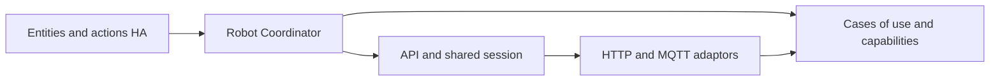

# Fully integrated capacity-guided

- Status: Draft
- Date: 2026-11-23
- Catalog capability ID: device-capabilities
- Last verified: 2026-11-23
- Owners: ha-roomba-home maintainer
- Scope: A central discovery, robot co-ordination and advanced base with clear regions.
- Related issues/PRs: Extension requested by the incumbent and local development.
- Required review gates: product, UX, architecture, testing, documentation, and security/operations
- Open decisions blocking readiness: Physical valuation of complete sequential, zones and regional adjustment effect.

## 1. Executive summary

Integration MUST adapt to the actual capabilities of each device, including vacuuming,
mopping and maintenance. A list of models isn't good enough. Each operational function
requires evidence of its detection, contract and presconditions. The Unknown MUST be
preserved as unknown.

## 2. Problem, current behavior, and evidence

- Observed behavior: information and consultation shared by account; filter X185240,
  advanced telemetry with monitoring profiles per chap undergoing development.
- Intentional contract: existing IDs, privacy and strict validation with an absence of a blind
  reattempt to move.
- Known debt and limitations: complete central model missing, device co-ordines with basic
  orders or regional monitoring as well at explicit recovery backoff.
- Unknown rationale: The modern contract for the previous generation association isn't
  presumed.
- Proposed improvements: extend from tested responses and SDK to preserve an evidence
  matrix.

The account contains three X185240 and an association R981040. Eight modern shadows, pieces
and catalogue have been read. The authorized robot has an active map with 6 rooms and a
fleeting region. The SDK distinguishes command codes, regions and basic capabilities. To get
to know an enum doesn't prove availability in all models.

## 3. Actors, surfaces, and terminology

| Actor | Surface | Necessity |
| --- | --- | --- |
| Holder | HA device | Reliable and compatible useful controls |
| Automation | Standard or registered actions | Validated parameters, misinterpretation |
| Maintainer | Matrix, SDDs and Suite & Evidence | Differentiate implemented, inferred and tested with an outstanding |

Reported capacity, verified contract and physical validation are different facts. Absence,
non-compatible and unknown but temporarily unavailable MUST to be represented without
becoming an indiscriminately false or zero.

## 4. Goals, non-goals, and fixed invariants

- CAP-01: centralizing cleaning skills, preferences and maps as well with regions.
- CAP-02: To derive and supported_features of evidence and avoid incompatible operational
  controls.
- CAP-03: share session / API and coordinate status with device availability without
  multiplying unnecessary applications.
- CAP-04: To implement verified operations at the base, to locate and power with appropriate
  HA interfaces.
- CAP-05: reconcilate status and after-command settings, recoup readings with an exponential
  backoff.
- CAP-06: To preserve IDs and functionalities, document unknown contracts with information
  necessary to complete them.
- CAP-07: achieve 100% cover of judgments and branches with valid domestic HA for authorized
  goal.
- CAP-08 (pending): Validate a complete mission targeting a saved cleaning zone.
- CAP-09: Expose the floor plan, robot position, heading, path, and verified live progress from Roomba.

No endpoints, maps and empty states are invented with HA entities or capabilities. No
physical errors are induced and no maps, accounts or data beyond the test have been
modified. No other robot is controlled during the movement campaign.

## 5. Current versus proposed product journey

| Stage | Current | Proposal |
| --- | --- | --- |
| Discover | Filter by SKU | Central model with provenance by capacity |
| Configure | Profiles for next cleaning | Readily admitted additional settings and functions |
| Clean Stations | Just map research | Selection and standard actions by verified regions |
| Operating Base | Sensors | Retirement, washing and drying actions verified |
| Loose Connection | Shared consultation | Availability by device and secure recovery |

## 6. Functional behavior and state model

The central model MUST preserves typed and unknown values. Combines association, chap.
digiCap and shadows with documented earlier catalogues A robot flag does not replace the
presence and capacity of its base.

The vacuum preserves standard HA states. The start, pause and stop functions are only
advertised where verifiable support exists. Batteries, diagnostics and details are specific
entities. The actions already covered by vacuum do not double as buttons.

Rooms and zones preserve their local IDs or names. They are not published in evidence nor diagnoses) The cleanup MUST uses the select robot's map and version to reject other, unknown or expired IDs. The weekly start can be published after an actual reading of a single robot's home and schedule. The same path allows to change the activation. The writing MUST to preserve command and fields beyond change, with later reading MUST confirm them. The release MUST validate the regions in today's version and keep schedule off. Withdrawal MUST check group and robot's name, but verify their absence after a single write. The test record keeps separate evidence of creation and withdrawal from deactivated schedules. [Schedule contract](../docs/api.md)

Action `roomba_home.clean_point` MUST demand electronic tiup support, vacuuming and an active map room. MUST Validate the version and transform two fractions of a room rectangle into an inner point to his perimeter or outside exclusion zones. MUST publish `point_clean` once with the map and its version. A new remote live viewing mission allows you to mark the order as sent, and a history indicates if that command was `point_clean`. The geometry remains only during the resolution of destination. [Retirement contract and evidence](../docs/api.md#spot-cleaning-and-map-coordinates)

## 7. User-facing configuration

Keep entry for account, selection of robots and existing preferences. The options come from
the central model. Uncover an optional dataset does not remove the entity found and will
have a built-up value. Retirement checks are currently unavailable and cannot produce an
order. The user can disable diagnostic data from the HA registry.

The preset moisture and SmartScrub MUST appear only when the robot announces its capacity
and publishes a valid value. The script should use the same robot block as his mission
orders and be confirmed with `rw-settings.state.reported`. It's limited to a field of the
robot at rest. The next cleanup preferences are saved in HA's configuration.

## 8. Clean Architecture design

Domination: pura skills, preferences and regions. Application: clear, control mission and
operate base by semantic ports. Connectors: HTTP signed, MQTT and HA storage. Composition:
shared account and device coordinator. Platforms: declarative descriptions and translations
without interpreting raw documents on their own.

In text: Each device has its own projection and availability, shares information with the
account or uses policies independently of his framework. The restrictions of imports MUST
are verified with evidence. The shared API has session, boundaries and exclusion of
connections with them client_id. Serializing validation but sending or confirmation by
robot. Robots can expect both confirmations and re-use a status reading currently under way.

## 9. UI/UX and content contract

| State | Main text or information | Next action |
| --- | --- | --- |
| Prepared | Mode and options allowed; available rooms | Start |
| Outstanding | Waiting for robot status or base | Wait |
| Not available | Loading lost and conserved preferences | Check Connection |
| Partial | Unspotted map and area monitoring currently unverified | Consult capacity matrix |
| Failed | Unconfirmed order without automatic forwarding | Refresh before repeat |
| Completed | Reported final status and updated sources | Consult mission or maintenance |

Entity labels use English. Stable automation options and explicit state text support the standard UI. Errors distinguish incompatibility, authentication and demand limits.

## 10. Failure, recovery, and cleanup

The idempowerful PET and state readings allow recovery with an exponential clamour. A
Retry-After supplier's MUST respect. Rejected credentials require reauth. The textures or
movements with unconfirmed result are not automatically reworked. The politics does not turn
a bug from an optional robot or source into one of the other. At the end of a shared
connection MQTT, preserve accepted responses. The last reading robot mark only advances with
an accepted quick response to that device. A manual state refresher respects the same
recovery time as a scheduled consultation. To retain the last list of regions after a
decision to consult. The orders directed MUST validate the destination with a new reading of
its map. A valid empty response replaces the previous list.

Before starting or resuming mopping and to check that an explicit absence of mop o Deposit
and base malfunctions, washing or filling. To apply the same check if one of these selected
regions has a mode with mopping. The absence of telemetry from these components remains as
unknown. Check the robot's active error and explicit absence of a powder tank before vacuum.
The explicit updates of the dock have disabled the start of manual operations up to its next
compatible status.

Loan listeners, timings and paired jobs are removed. No yarn MQTT is abandoned. The physical
tests have time and final cleanliness independent of the agent's response times.

## 11. Security, permissions, and privacy

Temporary credentials and catches are preserved outside the repository. No payloads, names
and IDs are registered. The action schemes accept no arbitrary topics or JSON. RULES from
the supplier, size and time of its signatures have their boundaries. The operations are
restricted to the association and device chosen as well with verified capabilities.

## 12. Observability and operational UX

Keep code by source and events without duplication. Show availability by source and final
order result. To register sound evidence with mode, operation and relative times as well at
later stage. Do not complete an inference's information about them A base that washed up the
mop doesn't prove mopping ground. The shortcut and load failure phases are observable even
with the mission code at zero. To preserve and compare the set of conditions for preparing
`condNotReady` while issuing changes, including its explicit resolution. Keep phase and
cycle separately. If the robot reports load phase during a cleaning cycle, show that his or
her mission remains active at the dock and maintain its update cadency. History statistics
preserve activity fields, pauses and recharges separately as well with mode measures when
they appear in the response. The next weekly schedule is computed in the IANA area reported
by his robot and requires complete information about their active schedules. If the next
hour is ambiguous or nonexistent by a change of time, its value remains unknown. The history
and cloud schedules display robot availability when the capacity is confirmed. A valid empty
result retains a zero count. A failed reading leaves an unknown count and preserves the main
status of his robot. The consumer responses require the supplier's list. The estimate action
will have an available map and project duration per room with supported profile. The prior
calculation is not used as an outstanding time of the active mission.

## 13. Compatibility, migration, rollout, and rollback

Keep HA 2026.11.2 and unique_id existing. The new device categories only extend their
support if your protocol is checked and the earlier robot isn't re-tagged as an account
share supported. To register the recognised base as a child device with an identity derived
from his robot, whose controls and diagnoses have their entity identifier while changing
group. The domestic display requires an exclusive backup of the component, configuration
check and re-start. Keep previous rollback and local icons revised.

## 14. Testing strategy and numeric budget

| Area | Minimum new cases | Risk |
| --- | ---: | --- |
| Unit capabilities and categories | 20 | Expand, partial with vacuum or sink |
| Based and verified actions | 15 | Presence, compatibility and exclusion |
| Regions, maps and schemes | 15 | Other users, version and multiple rooms |
| Vacuuming per point | 12 | Capacities, map boundaries and exclusion zones with HA confirmation or activation |
| Coordination and recovery | 15 | Isolated sources, backoff and boundaries. |
| Compatibility and presentation HA | 10 | Ids, Services and Platforms |
| Total | 87 | Additional to the profile suite |

Suite complete with 100% of sentences and branches, without artificial omissions; Ruff. The
domestic evidence MUST check controls, states and recovery. Synthetic cases are not
presented as physically certified hardware.

## 15. Documentation and discoverability

To update the matrix by models detected, entities and actions with endpoints or contracts
that have evidence. The final report MUST contains an overview, matrix and entity / actions
with API operations.

## 16. Acceptance scenarios

1. A vacuum cleaner with no capacity to mopping does not create moisture controls or mop.
2. Partial information remains unknown and never enabling an invalid order.
3. A combination exposes verified modes and combinations with their standard HA states.
4. A missing base does not create washing, drying or emptying buttons.
5. The regions sent belong to the interactive target's map and version.
6. A temporary failure respects backoff and keeps the status of other robots isolated.
7. The term of office renews the shared sitting and an opposition to access calls for
   Reauth.
8. A uncertain writing does not double to try and achieve the expected status.
9. Rearms and updates preserve identities or preferences.
10. HA domestic sample icon, controls and final states tested target.
11. A mission that selects a saved zone clear surface in this area and the track record
    confirms its destination or final result.
12. The floor plan uses the robot's current map version. A fresh mission position
    identifies the current room only when it lies strictly within one labeled
    room. The path preserves sequence gaps. Coverage, completion percentage,
    and time remaining require independent mission evidence.

## 17. Requirements traceability

| Requirement | Surface | Evidence required |
| --- | --- | --- |
| CAP-01/02 | Central model and descriptions | Responses, types and cases by category with negative |
| CAP-03 | Composition and coordinators | Isolation, single session and demand count |
| CAP-04 | Vacuum and registered shares | SDK contracts / actual catches, schemes and tests |
| CAP-05 | Reconciliation and recovery | Control clocks, malfunctions and subsequent reading |
| CAP-06 | Registration and documentation | Before and after IDs with boundaries |
| CAP-07 | Suite and Deployment | Coverage 100%, checks and domestic evidence |
| CAP-08 | Saved-zone cleaning | Pending a physical run with a listed `zid`, confirmed route, history result, and return |
| CAP-09 | Native map image, current room, and live position timestamp | Two position captures and synthetic HA tests for imagery, gaps, and expiry. Coverage, ETA, and percentage remain pending. |

CAP-09 includes floor plans, room labels, position, heading, trajectory,
coverage, and estimates supported by Roomba. Enable the map option to expose
one Home Assistant image per active, visible saved map. The live feed starts
with the provider's signed announcement and uses only the exact topic checked
against the robot's discovered deployment. Position sampling shares the
account's MQTT connection for a short window during active polling. The
provider does not supply a map version on each frame. Live positions are
projected only when the robot has one available saved map. Positions are
associated with the current mission by its start timestamp and retained only
for that mission and map version.

The current room requires exactly one containing room polygon and a label.
Boundaries, holes, overlaps, and expired positions produce an unknown room.
The marker and timestamp expire at `update_expire_ts`. The collected path
persists until the mission changes or ends. Public evidence and diagnostics
omit room names, geometry, positions, and signed URLs.
Floor plan labels use a bundled Unicode font and canonical normalization.
The padded label must fit within the room and avoid holes, other labels,
and the active position marker.
Long labels may be shortened inside the image. The active position marker
draws above the labels, and room telemetry keeps the original name.

Two live vacuum runs produced `pos_update.cur_path` and `update_expire_ts`.
All 222 distinct observed coordinates matched a unique room polygon in the
active saved geometry. The app showed the active room and about seven minutes.
The matching room-and-profile estimate was 397 seconds. The live timeline
returned start and relocation events for the same mission. Its coverage,
remaining time, and completion percentage still need independent verification.
The compressed raw map format also remains unverified.
[Live progress evidence](../docs/evidence/2026-11-24-live-progress.json)

The targeted vacuuming, pause and resumption were observed in the authorized robot with type rid. The probes with 512 about a region remained at the dock. The complete with 512 phase of vacuuming and the test was cancelled before stage II. Following maintenance, the domestic server was updated to 0.3.0. The icon was checked, and the vacuuming tiered, mopping with resumption and manual emptying without error. A second test confirmed the start, pause and cancellation while applying for two rooms with a same map on another robot. The room and applied power require more detailed telemetry. [Domestic Validation](../docs/validation.md#upgrade-and-timed-cleaning-with-030)

The time actions of 0.4.0 have been checked at home with a timings disabled. The service confirmed day and hour, while keeping an order. The list after retirement returned to the starting hours. [Evidence of schedules](../docs/evidence/2026-11-23-schedule-writes.json)

## 18. Implementation sequence

To conduct a repository and evidence audit, to centralise skills with regional or base
contracts but also as co-ordinator by device.

## 19. Definition of Done

- [x] Central discovery of capabilities with verified sources.
- [x] Unit co-ordination with shared session and tied recovery.
- [ ] Additional verifiable operations implemented using HA interfaces.
- [ ] Reported regions and maps where the contract is known.
- [x] Coverage 100%, budget and quality of the code checked.
- [ ] complete documentation, matrix and evidence requirements.
- [x] Home update, main controls and proven icon.
- [x] Rearm of entrance 0.3.0 checked onto the domestic server.
- [ ] Final report with the seven deliverables and boundaries without speculative conduct.

## 20. References and decisions

[Standard SDD](README.md), [profiles](006-cleaning-profiles.md), [capacity matrix](../docs/capabilities.md), [API](../docs/api.md), [HA vacuum](https://contributors.home-assistant.io/core/entities/vacuum/). It's progressively expanded from verifiable evidence and missing contracts are explain without quietly reducing the target to an existing code.

Live progress, saved zones, automatic resume, and map selection follow MAP-02 through MAP-04. [Mission detail and interactive maps](008-mission-detail-and-map-card.md)
