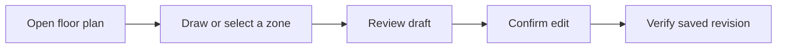

# Map and Zone Editor

- Status: Draft
- Date: 2026-11-24
- Catalog capability ID: map-zone-editor
- Last verified: 2026-11-25
- Owners: ha-roomba-home maintainer
- Scope: Preview and save floor settings, room names and boundaries, cleaning zones, restrictions, and furniture on an associated Roomba floor. Capture and browse private local backups.
- Related issues/PRs: Follow-up to the interactive floor plan.
- Required review gates: product, UX, architecture, testing, documentation, and security/operations
- Open decisions blocking readiness: Verify any further map formats before enabling the same archive-based selection.

## 1. Executive summary

Edit a saved Roomba floor plan in Home Assistant with a preview of the exact
change the robot will receive. Save only after explicit confirmation and
verify the resulting map revision through Roomba.
The card also captures, previews, and exports local copies of the floor.

## 2. Problem, current behavior, and evidence

The interactive floor plan reads rooms, saved zones, and restrictions.
An early v2 edit
route returned HTTP 500. The v1 route added and renamed a temporary rectangle
in the active map's `cleanZones` layer. The same map's associated region list
provided no corresponding `zid`. A test command briefly entered the running
phase before stopping. A later read showed the reverse mismatch on an
associated map where a listed zone had no matching outline. The native SDK
also exposes an MQTT edit exchange with a correlated response and an
operation payload supplied by the app. The observed MQTT traffic during
room editing included a schematic-data read.

The official app created, moved, resized, renamed, and removed a cleaning
zone through the v1 map-version route. Each change persisted in
`cleanZones`, and `rooms_metadata` continued to list zero zone
destinations. The editor must be able to manage saved outlines while
showing their separate availability for cleaning.
[Cleaning-zone write contract](../docs/api.md#cleaning-zone-edits)
[Official app cleaning-zone lifecycle](../docs/validation.md#official-app-cleaning-zone-lifecycle)

The official app's `split_room` HTTPS write returned a new revision with
two room shapes. The app started vacuuming the new room before the
associated inventory listed its ID. During the mission, the inventory
added the room under the same map revision. The app's `arrange_room`
HTTPS write merged that pair into one room with the original ID and outer
boundary. The associated inventory could retain the removed room after
the merge. A later Home Assistant division reused the retained ID. The
Home Assistant card uses the visible `picea` room features from the active
map for room editing and cleaning selection.
[Room edit requests and responses](../docs/api.md#room-division-and-merge)
[Room edit validation](../docs/validation.md#official-app-room-division-and-merge)
[Installed room editor validation](../docs/validation.md#room-boundary-editor-validation-in-0150)
[Installed room boundary recheck](../docs/validation.md#installed-room-boundary-recheck)

The Android capture also verifies custom and preset room labels using
the same map-version route. The returned archive preserved room IDs and
polygons. The card previews a new name and submits the name with its
selected room type. Existing routine and schedule targets use the same
region identifiers.
[Room naming contract](../docs/api.md#room-naming)
[Installed room naming validation](../docs/validation.md#room-naming-validation-in-0170)

Home Assistant supports rectangular cleaning-zone creation, movement,
resizing, renaming, and removal on the same Max 700 map format. The card
offers outlines as edit targets independently of Roomba's cleaning inventory.
[Installed zone editor validation](../docs/validation.md#cleaning-zone-editor-validation)

The Android editor saved keep-out and no-mop rectangles using a verified
whole-layer write. Creating, moving, resizing, or removing a restriction
preserved the other shapes. Existing virtual walls use a separate wire type.
[Restriction contract](../docs/api.md#restriction-edits)
[Restriction validation](../docs/validation.md#restriction-editor-validation-in-0190)

Furniture is a separate layer with provider-supplied object type, source,
orientation, and cleaning outline. The observed app writes replace the
whole layer. The integration's editor must retain the original source
and outline of untouched objects and verify the returned active revision.
Furniture can be selected in routines in the Android app. The integration
requires the verified region encoding before exposing a cleaning action.
[Furniture write evidence](../docs/api.md#furniture-edits)
[Furniture routine contract](../docs/api.md#furniture-targets-in-routines)

## 3. Actors, surfaces, and terminology

The operator edits a zone in the floor plan card. The maintainer verifies
the provider exchange. A draft is local geometry tied to one robot, floor,
and revision. A saved zone is a provider-confirmed region with its own ID.

## 4. Goals, non-goals, and fixed invariants

- EDIT-01: Preview a new or changed cleaning zone using the existing floor plan.
- EDIT-02: Save a named zone, or move, resize, rename, and remove an existing zone when the provider supports those operations.
- EDIT-03: Keep the map and settings consistent across stale revisions, ambiguous results, and concurrent edits.
- EDIT-04: Rename rooms, divide a room with a valid boundary, and merge adjacent rooms where the provider supports it.
- EDIT-05: Create, move, resize, and remove keep-out and no-mop rectangles. Preserve the rest of the policy layer during each replacement write.
- EDIT-06: Save floor names and display orientation and retain the selected floor's geometry, robot position, and cleaning targets.
- EDIT-07: Place, move, resize, rotate, and remove supported furniture. Preserve the other objects and their source during a replacement write. Support verified furniture targets in routines.
- EDIT-08: Start and monitor a mapping-only run on a docked robot, including before it has saved its first map. Preserve pause, resume, cancel, and return controls during the run.
- EDIT-09: Remove one explicitly reviewed floor from the robot's visible map list and verify the resulting list.
- EDIT-10: Capture, preview, pin, retain, and export private floor backups
  per robot. Offer optional automatic capture before an edit or removal.
- EDIT-11: Review and restore the recorded name and orientation on the
  active floor. Revalidate the same robot, floor, revision, inventory, and
  settings after automatic capture and before writing to Roomba.
- EDIT-12: Recover changed or missing supported cleaning zones from an
  associated backup using the original zone identifiers. Review the names,
  outlines, and known active routine and schedule dependencies before one
  verified zone update.
- EDIT-13: Capture program selections linked to supported cleaning zones or furniture
  and recover missing targets in a surviving program on the same floor.
  Review the ordered profiles, verify the restored zone geometry and current
  selection, and preserve the current program name, timing, and enabled state.
- EDIT-14: Recover moved and missing keep-out zones, no-mop zones, and
  virtual walls from a backup with the same floor boundary. Preview changed
  identifiers and preserve unrelated active restrictions. Verify the full
  replacement layer and distinct endpoints for each linear wall.
- EDIT-15: Recover moved and missing furniture placements from a backup of
  the same floor. Review the object types, sources, and linked routines.
  Preserve furniture added later and verify the complete active layer.
- EDIT-16: Recover one room's name and type after confirming its saved and
  active identifiers and footprints. Report missing rooms and changed
  footprints before saving. Verify the selected metadata on the new active
  revision.
- EDIT-17: Create, move, resize, and remove a virtual wall. Accept two
  distinct ordered endpoints when part of the segment lies inside a visible
  room. Keep the edited wall's identifier and the other policy shapes.
- Bulk edits and cross-floor copies require a verified operations contract.
- Roomba remains the owner of robot and map data. Editing a map never starts a cleaning mission.

## 5. Current versus proposed product journey

Text equivalent: Open the floor plan, draw or choose a zone, review the
draft, confirm the edit, and verify the resulting revision.

## 6. Functional behavior and state model

Mapping starts with a separate confirmed action and requires a connected,
docked robot with persistent-map support and no running mission. A new
remote `train` cycle confirms the start. Keep the mapping status through
pause, and refresh the saved map list after the cycle ends.

The floor-removal review includes the selected map, archive revision,
region inventory, and settings. Recheck them against the associated robot's
current floor list under the map write lock. Send the visibility write once.
Confirm the removal only after the map disappears from a fresh list.

Start a draft from a specific saved floor and revision. Validate the geometry
against provider limits, the floor outline, and applicable restrictions.
Allow a rectangle to extend beyond a room where part of it still overlaps
the mapped floor, as seen in the Android captures.
Show the current and proposed shape and allow cancellation before saving.
For a rename, select a visible room from the map or list, enter a name of
up to 31 characters, and choose a supported room type. Preview the new
label. Reconcile the name and type against the resulting archive, preserving
room identities, adjacency, geometry, and restrictions.
For a division, select the room on the map or in the list and preview the
divider across it. Validate the line against the room outline and confirm
the two resulting shapes after saving.
For a merge, let the operator select two rooms on the map or in the lists.
Use the active archive's mutual adjacency to determine valid pairs and
highlight the selected rooms before review. Warn that the affected room
cleaning preferences can reset.
Flag affected routines and schedules whose stored targets may require review.
For the existing dependency review, show matches and explicitly flag sources
or destinations that could not be established. Keep the review read-only.
The backend re-reads the map under the account I/O lock. A different
active revision invalidates each draft. Room edits use the visible geometry
and adjacency of that revision and remain valid through a metadata-only
inventory change. The other map editors also check the raw inventory on
which their drafts were opened. Reconcile each edit against the active
revision and affected geometry. Use visible, version-matched room features
and named native cleaning-zone rectangles as destinations on the verified
Max 700 map format. Omit native zone IDs when their outline has been
removed from the active archive. Preserve legacy destinations outside
the confirmed ID range. Keep a cleaning or routine confirmation open
when the raw inventory changes and the active revision and selectable
destination IDs, kinds, and labels stay the same.
Floor name and orientation use the map settings endpoint. The active
archive revision can stay the same, so compare the settings draft with the
latest saved name and angle. Apply the same rotation to the map, overlays,
live path, and the displayed heading. Convert edited points back to native
coordinates before publishing them.
[Installed floor settings validation](../docs/validation.md#floor-settings-validation-in-0180)
Show **Saved** once the expected geometry and active revision are confirmed.
For a restriction edit, derive the complete replacement from the active
policy layer. Preserve every entry other than the selected restriction.
Disable editing if the layer contains an entry that cannot round-trip.
Confirm the IDs, types, and outlines from the returned archive and its
active revision.
For a zone save or removal, report whether the destination is selectable
under the confirmed active revision. Reconcile the delayed inventory with
the verified archive. If a response is lost, read the current Roomba map
before allowing a retry.

## 7. User-facing configuration

Use the existing map option and the vacuum's Home Assistant permissions.
Offer editing only when the robot and map support a verified write path.
Show the floor, zone name, edit type, and shape at confirmation.
In **Floor settings**, choose a first name of up to 20 characters, rename
a named floor with up to 16 characters, or
preview rotation in 90° increments. Confirm just the selected operation.
In **Edit restrictions**, choose the operation and either a new type or
an existing restriction. Show the proposed outline and confirm the floor
and restriction type before saving. For a virtual wall, show a segment with
two endpoint markers, offer endpoint coordinates, and allow selection by
clicking the displayed line.
In **Edit furniture**, choose the object or furniture type. Use a map click
or coordinates for the center and edit width, depth, and rotation. Show
the existing outlines and directed edge of the proposed placement.

## 8. Clean Architecture design

The core validates edit intent and map geometry. The provider adapter
serializes the verified write and parses the subsequent inventory. The
coordinator owns revision checks and reconciliation. Home Assistant enforces
permissions. The card manages a draft and renders the visual comparison.

## 9. UI/UX and content contract

Retain map zoom and offer either two canvas clicks or keyboard-accessible
coordinate inputs for a rectangular draft. Cancel discards the local draft.
Use clear outlines for existing and proposed shapes. Keep restrictions
visible throughout the edit. Show a specific reason when a change cannot be
saved. A separate confirmation identifies the selected zone before removal.

## 10. Failure, recovery, and cleanup

A failed save keeps the draft visible while its source revision stays current.
A stale edit reloads the current map. If the provider has already applied a change, show its
observed state and avoid sending the write again. Track whether an inverse
edit is supported and verify it before offering rollback.

Local backups store an opt-in, revision-scoped native archive for each robot.
The owner can view a verified snapshot offline, compare its revision and
settings with the current floor, and export it. Keep storage private and
verify the disk write before sending an edit when automatic capture is
enabled. Restore recorded floor settings with a single confirmed write and
verify the active geometry and destination inventory through Roomba. Recover
zone geometry only on a matching coordinate frame, with each archived zone
validated against the active floor. Verify the restored outlines, unrelated
map layers, and the published revision. A program recovery review binds
each confirmation to one program, its active floor, and the proposed ordered
destinations and profiles. Later changes to surviving destinations prevent
the recovery, and partial reads identify the unavailable program source.
Complete floor recovery requires proof
that Roomba restores the archive to its usable floor inventory.

Restriction recovery requires supported policy layers in the archived and
active floor and the same boundary digest. Apply the stored outlines and
line endpoints under their original IDs, retaining current restrictions
added later. A conflicting type or a shape outside visible rooms prevents
the update. Verify the replacement layer and active revision after one
reviewed write.

Furniture recovery verifies the floor boundary and the editable catalog on
both revisions. Compare the archived and active object by identifier,
type, source, outline, and angle. Block an incompatible object type or an
archived footprint that no longer overlaps a visible room. Require a matching
review before the replacement write. Verify the exact object inventory,
source classification, and placements, accounting for small provider heading
rounding and allowing Roomba to recalculate derived cleaning areas. A
separate program confirmation can recover a pruned furniture target once
its original placement matches the active map.

Room detail recovery checks the same floor boundary and matching room
footprints. It confirms one selected room at a time. A room division or merge
can recalculate the outline, which limits exact topology recovery through
these operations. When Roomba replies with a new revision identifier, wait
for it in active inventory and verify its signed archive. The map operation
issues one write.
[Local map history acceptance and trial evidence](../docs/roadmap.md#local-map-history-and-recovery)

## 11. Security, permissions, and privacy

Require entity read access to see the map and control access to submit an
edit. Scope each operation to the selected associated robot and map. Keep
household geometry, provider IDs, and command payloads out of public logs,
fixtures, and screenshots.

## 12. Observability and operational UX

Show draft, saving, saved, changed elsewhere, or unconfirmed status. Keep
redacted operation and response classes for diagnosis. Confirm that unrelated
rooms, zones, and restrictions survive each tested write.

## 13. Compatibility, migration, rollout, and rollback

Deploy writes only for the verified model and map format. Robots with
unverified writes retain the existing interactive floor plan and cleaning
controls. Introduce individual edit operations after validating them.

## 14. Testing strategy and numeric budget

Cover containment, malformed shapes, permission checks, stale revisions,
duplicate requests, timeout reconciliation, and partial confirmation in
synthetic tests. Verify add, edit, and removal with one removable test zone
on one authorized map. Record the resulting revision and protected geometry
comparison after each operation.

## 15. Documentation and discoverability

Add editor controls, model support, and recovery steps to the README and
usage guide when write support is verified. Use synthetic diagrams and
screenshots.

## 16. Acceptance scenarios

1. Draw a valid zone and see the same coordinates and name after saving.
2. Move, resize, or rename only the selected zone.
3. Cancel or reject an out-of-bounds edit without changing the map.
4. Detect a stale revision and require a fresh draft against the current map.
5. Remove the designated test zone and confirm the floor remains usable.
6. Rename one room with an accented label and a supported type. The map
   displays the new name, and the other geometry and linked targets persist.
7. Split a test room and confirm that two room shapes are saved. Select
   either visible room on the active revision. Verify that a merge restores
   the original destination and outer boundary while a stale inventory may
   still list the removed room. Keep a cleaning confirmation open when the
   inventory publishes a room already present in the active archive. Reject
   the confirmation after an actual change to available destinations.
8. Preview the effects on dependent routines before changing a referenced target.
9. Offer a named native rectangle before its inventory entry arrives. Keep
   the cleaning or routine review valid when that inventory catches up.
10. Remove a deleted native zone from the selection even when the inventory
    retains its ID. Preserve listed legacy destinations without outlines.
11. Rename the floor and rotate it while retaining its archive version,
    geometry, and the same cleaning destinations. Cancel a rotation to return
    to the saved orientation. After saving, verify the direction of the live
    heading and the position of map clicks under the same transform.
12. Save separate keep-out and no-mop areas, move and resize each, then
    remove them individually. Verify that other policy entries, room
    outlines, and cleaning zones survive each edit.
13. Show the floor and retain its existing overlays when a policy entry
    cannot be represented in a replacement write. Disable restriction edits.
14. Add and adjust a furniture item while preserving the unrelated
    objects and their sources. Remove the test item and verify the
    original set and map geometry. Confirm a saved routine can target a
    furniture item with its own cleaning settings and order.

## 17. Requirements traceability

| Requirement | Existing boundary | Required verification |
|---|---|---|
| EDIT-01 | [Floor plan card](008-mission-detail-and-map-card.md) | Synthetic UI and geometry tests |
| EDIT-02 | [Roomba API](../docs/api.md) | One confirmed write and read-back per operation |
| EDIT-03 | [Command validation](004-command-validation.md) | Conflict, failure, and idempotency tests |
| EDIT-04 and EDIT-05 | [Map API](../docs/api.md) | Per-operation provider exchange, geometry comparison, and target checks |
| EDIT-06 | [Floor settings API](../docs/api.md#floor-name-and-orientation) | Same-version updates, geometry and heading alignment, and restoring the exact name and angle |
| EDIT-07 | [Furniture API](../docs/api.md#furniture-edits) | Whole-layer write tests, source preservation, rotated outlines, live read-back, and routine dispatch verification |
| EDIT-08 and EDIT-09 | [Map lifecycle API](../docs/api.md#mapping-runs-and-floor-removal) | Mapping transitions, no-map dashboard, stale and unauthorized removal, one signed write, and confirmed inventory |
| EDIT-10 | [Local backups](../docs/api.md#local-map-backup-commands) | [Archive checks](../tests/test_map_snapshots.py), [storage tests](../tests/ha/test_map_history.py), [authenticated routes](../tests/ha/test_roomba_map_api.py), and [physical validation](../docs/validation.md#local-map-backups) |
| EDIT-11 | [Floor settings restoration](../docs/api.md#local-map-backup-commands) | [Settings tests](../tests/test_floor_settings.py), [authenticated routes](../tests/ha/test_roomba_map_api.py), [card tests](../tests/frontend/map-card.test.cjs), and [signed restoration](../docs/validation.md#restoring-backed-up-floor-settings) |
| EDIT-12 | [Cleaning zone recovery](../docs/api.md#local-map-backup-commands) | [Geometry and verification tests](../tests/test_zone_edits.py), [authenticated routes](../tests/ha/test_roomba_map_api.py), [card tests](../tests/frontend/map-card.test.cjs), and [signed recovery](../docs/validation.md#recovering-cleaning-zones) |
| EDIT-13 | [Program destination recovery](../docs/api.md#local-map-backup-commands) | [Selection policy tests](../tests/test_map_programs.py), [authenticated routes](../tests/ha/test_roomba_map_api.py), [card tests](../tests/frontend/map-card.test.cjs), and [signed recovery](../docs/validation.md#recovering-program-destinations) |
| EDIT-14 | [Restriction recovery](../docs/api.md#local-map-backup-commands) | [Policy tests](../tests/test_restriction_edits.py), [authenticated routes](../tests/ha/test_roomba_map_api.py), [card tests](../tests/frontend/map-card.test.cjs), and [signed recovery](../docs/validation.md#recovering-map-restrictions) |
| EDIT-15 | [Furniture recovery](../docs/api.md#local-map-backup-commands) | [Furniture tests](../tests/test_furniture_edits.py), [authenticated routes](../tests/ha/test_roomba_map_api.py), [card tests](../tests/frontend/map-card.test.cjs), and [signed recovery](../docs/validation.md#recovering-furniture-placements) |
| EDIT-16 | [Room detail recovery](../docs/api.md#local-map-backup-commands) | [Room tests](../tests/test_room_edits.py), [authenticated routes](../tests/ha/test_roomba_map_api.py), [card tests](../tests/frontend/map-card.test.cjs), and [signed recovery](../docs/validation.md#recovering-room-names-and-types) |
| EDIT-17 | [Restriction edits](../docs/api.md#restriction-edits) | [Geometry tests](../tests/test_restriction_edits.py), [authenticated lifecycle](../tests/ha/test_roomba_map_api.py), [card tests](../tests/frontend/map-card.test.cjs), and [signed wall trial](../docs/validation.md#editing-virtual-walls) |

## 18. Implementation sequence

The room, cleaning-zone, and restriction lifecycles use the active
archive's identifiers and the verified write adapter. A disposable zone
was saved, launched from the Android app, and published in the associated
inventory during the run. Mission history confirmed the exact destination
and reported cleaned area.
[Saved-zone validation](../docs/validation.md#directed-vacuum-then-mop)

The installed editor then created a different disposable zone and started
cleaning it before the associated inventory listed the target. Removal restored
the selection to the original room and retained the completed zone in
mission history. [Installed zone workflow](../docs/validation.md#immediate-saved-zone-selection-in-0250)

## 19. Definition of Done

- [x] Confirm the provider write protocol for room boundaries and cleaning zones.
- [x] Pass the contract, authorization, UI, and privacy tests for the supported edits.
- [x] Physically validate a saved zone and confirm map integrity after cleanup.
- [x] Document supported operations and known limits.

## 20. References and decisions

[Roomba Home map creation and settings](https://homesupport.irobot.com/articles/en_US/Knowledge/20500) ·
[Planned local map history and recovery](../docs/roadmap.md#local-map-history-and-recovery) ·
[Interactive floor plan](008-mission-detail-and-map-card.md) ·
[Dashboard and household validation](../docs/validation.md#mission-detail-and-dashboard-validation)
