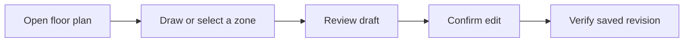

# Map and Zone Editor

- Status: Draft
- Date: 2026-11-24
- Catalog capability ID: map-zone-editor
- Last verified: Not applicable
- Owners: ha-roomba-home maintainer
- Scope: Preview and save changes to zones, room names, and room boundaries on an associated Roomba floor plan.
- Related issues/PRs: Follow-up to the interactive floor plan.
- Required review gates: product, UX, architecture, testing, documentation, and security/operations
- Open decisions blocking readiness: Confirm the Max 700 write protocol, revision checks, geometry limits, and recovery behavior.

## 1. Executive summary

Edit a saved Roomba floor plan in Home Assistant with a preview of the exact
change the robot will receive. Save only after explicit confirmation and
verify the resulting map revision through Roomba.

## 2. Problem, current behavior, and evidence

The interactive floor plan reads rooms, saved zones, and restrictions.
Zone creation and editing currently depend on Roomba Home. A signed trial of
the older map edit route returned HTTP 500 and repeated reads showed no new
zone. The native SDK has multiple map editor paths. The correct contract
for the Max 700 still needs a successful app exchange and read-back.
[Current validation](../docs/validation.md#mission-detail-and-dashboard-validation)

## 3. Actors, surfaces, and terminology

The operator edits a zone in the floor plan card. The maintainer verifies
the provider exchange. A draft is local geometry tied to one robot, floor,
and revision. A saved zone is a provider-confirmed region with its own ID.

## 4. Goals, non-goals, and fixed invariants

- EDIT-01: Preview a new or changed cleaning zone using the existing floor plan.
- EDIT-02: Save a named zone, or move, resize, rename, and remove an existing zone when the provider supports those operations.
- EDIT-03: Keep the map and settings consistent across stale revisions, ambiguous results, and concurrent edits.
- EDIT-04: Rename rooms, divide a room with a valid boundary, and merge adjacent rooms where the provider supports it.
- EDIT-05: Edit keep-out and no-mop zones after verifying their write contracts independently of cleaning zones.
- Floor deletion, bulk edits, and cross-floor copies require a separately verified operations contract.
- Roomba remains the owner of robot and map data. Editing a map never starts a cleaning mission.

## 5. Current versus proposed product journey

Text equivalent: Open the floor plan, draw or choose a zone, review the
draft, confirm the edit, and verify the resulting revision.

## 6. Functional behavior and state model

Start a draft from a specific saved floor and revision. Validate the geometry
against provider limits, the floor outline, and applicable restrictions.
Show the current and proposed shape and allow cancellation before saving.
For a division, verify that the proposed boundary crosses the selected room
and results in two valid polygons. Show both resulting rooms before saving.
For a merge, require adjacent rooms and preview the surviving name. Flag
affected routines and schedules whose stored targets may require review.
The backend re-reads the map under a robot-scoped lock. If the revision has
changed, leave the draft available for review against the new map. Show
**Saved** after reading a new revision containing the expected zone. If a
response is lost, reconcile by reading Roomba before allowing a retry.

## 7. User-facing configuration

Use the existing map option and the vacuum's Home Assistant permissions.
Offer editing only when the robot and map support a verified write path.
Show the floor, zone name, edit type, and shape at confirmation.

## 8. Clean Architecture design

The core validates edit intent and map geometry. The provider adapter
serializes the verified write and parses the subsequent inventory. The
coordinator owns revision checks and reconciliation. Home Assistant enforces
permissions. The card manages a draft and renders the visual comparison.

## 9. UI/UX and content contract

Provide zoom, keyboard-accessible shape handles, and undo within the draft.
Use clear outlines for existing and proposed shapes. Keep restrictions
visible throughout the edit. Show a specific reason when a change cannot be
saved. A separate confirmation identifies the selected zone before removal.

## 10. Failure, recovery, and cleanup

A failed save keeps the draft visible. A stale edit requires review against
the current map. If the provider has already applied a change, show its
observed state and avoid sending the write again. Track whether an inverse
edit is supported and verify it before offering rollback.

## 11. Security, permissions, and privacy

Require entity read access to see the map and control access to submit an
edit. Scope each operation to the selected associated robot and map. Keep
household geometry, provider IDs, and command payloads out of public logs,
fixtures, and screenshots.

## 12. Observability and operational UX

Show draft, saving, saved, changed elsewhere, or unconfirmed status. Keep
redacted operation and response classes for diagnosis. Confirm that unrelated
rooms, zones, and restrictions survive each tested write.

## 13. Compatibility, migration, rollout, and rollback

Deploy writes only for the verified model and map format. Robots with
unverified writes retain the existing interactive floor plan and cleaning
controls. Introduce individual edit operations after validating them.

## 14. Testing strategy and numeric budget

Cover containment, malformed shapes, permission checks, stale revisions,
duplicate requests, timeout reconciliation, and partial confirmation in
synthetic tests. Verify add, edit, and removal with one removable test zone
on one authorized map. Record the resulting revision and protected geometry
comparison after each operation.

## 15. Documentation and discoverability

Add editor controls, model support, and recovery steps to the README and
usage guide when write support is verified. Use synthetic diagrams and
screenshots.

## 16. Acceptance scenarios

1. Draw a valid zone and see the same coordinates and name after saving.
2. Move, resize, or rename only the selected zone.
3. Cancel or reject an out-of-bounds edit without changing the map.
4. Detect a stale revision and preserve the draft for review.
5. Remove the designated test zone and confirm the floor remains usable.
6. Rename one room, then verify the rest of the map and linked targets.
7. Split a test room, validate both resulting regions, then merge them if the verified protocol permits recovery.
8. Preview the effects on dependent routines before changing a referenced target.

## 17. Requirements traceability

| Requirement | Existing boundary | Required verification |
|---|---|---|
| EDIT-01 | [Floor plan card](008-mission-detail-and-map-card.md) | Synthetic UI and geometry tests |
| EDIT-02 | [Roomba API](../docs/api.md) | One confirmed write and read-back per operation |
| EDIT-03 | [Command validation](004-command-validation.md) | Conflict, failure, and idempotency tests |
| EDIT-04 and EDIT-05 | [Map API](../docs/api.md) | Per-operation provider exchange, geometry comparison, and target checks |

## 18. Implementation sequence

Capture and verify the official app's successful add and remove operations.
Build the write adapter and its synthetic tests. Add the visual draft and
confirmation, then validate a disposable zone on the household installation.
Verify room rename, split, merge, and restriction edits independently before
making each available. A dependency preview and an editable copy of a routine
are useful additions when the API can reliably expose the affected targets.

## 19. Definition of Done

- [ ] Confirm the provider write protocol and supported geometry.
- [ ] Pass the contract, authorization, UI, and privacy tests.
- [ ] Physically validate a saved zone and confirm map integrity after cleanup.
- [ ] Document supported operations and known limits.

## 20. References and decisions

[Roomba Home map creation and settings](https://homesupport.irobot.com/articles/en_US/Knowledge/20500) ·
[Interactive floor plan](008-mission-detail-and-map-card.md) ·
[Dashboard and household validation](../docs/validation.md#mission-detail-and-dashboard-validation)
