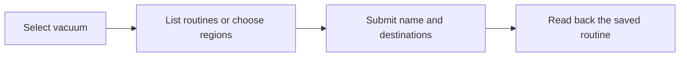

# Saved Cleaning Routines

- Status: Implemented
- Date: 2026-11-24
- Catalog capability ID: saved-cleaning-routines
- Last verified: 2026-11-26
- Owners: ha-roomba-home maintainer
- Scope: List, create, update, remove, and run supported Roomba Home routines for one associated vacuum.
- Related issues/PRs: Interactive map and app feature coverage.
- Required review gates: product, UX, architecture, testing, documentation, and security/operations
- Open decisions blocking readiness: Multi-robot routines and the difference between Android Smart favorites and signed room recommendations.

## 1. Executive summary

Manage saved Roomba Home routines from the floor plan card and Home Assistant
actions. Save room or zone selections with cleaning preferences and confirm
each change through an independent read from Roomba.

## 2. Problem, current behavior, and evidence

Integration actions manage weekly and one-time schedules and can start a selected
region. Roomba Home also stores reusable routines in its edition 1 favorites
collection. A disposable one-room routine was created, renamed, updated with
a different suction setting, and removed through that collection. The
provider assigned its own ID.
[API and validation](../docs/api.md#saved-cleaning-routines)

The Android app saved two furniture targets in a single ordered routine.
Each temporary destination ID linked an individual profile to a native
polygon and stable furniture ID. The saved sample used the same default
settings in both entries. The integration removed the test record through
its normal routine action.
[Furniture routine contract](../docs/api.md#furniture-targets-in-routines)

An individual destination can select vacuum then mop. The saved routine
keeps its regional profile and order. Running the routine uses the
immediate command encoding and confirms the start through reported
activity. [Directed command contract](../docs/api.md#directed-vacuum-then-mop)

An integration client saved a mixed routine with two furniture targets and
a room, each with a distinct suction level. It reordered the targets and
read back their saved profiles. The test restored the original favorite list.
[Mixed routine evidence](../docs/evidence/2026-11-25-furniture-routine.json)

Roomba Home on Android saved four presets for a single room on the active
Max 700 Combo map. All four stored concrete room parameters in a timestamped
start command. Two existing routines supplied an ordered command and the
Normal profile tag with per-area parameters. The favorite records also
provided a duration estimate and confidence for the saved selection.
[Native single-area validation](../docs/validation.md#native-single-area-routines)

## 3. Actors, surfaces, and terminology

The operator uses the vacuum's Home Assistant actions to manage its saved
routines. A routine is a stored start command. A weekly schedule has a
calendar trigger and may carry an independent copy of a routine.

## 4. Goals, non-goals, and fixed invariants

- ROUTINE-01: List recognized saved routines for the selected robot.
- ROUTINE-02: Create an ordered routine on one current map and validate each profile.
- ROUTINE-03: Rename an existing routine or replace its regions and settings.
- ROUTINE-04: Confirm removal through an independent read.
- ROUTINE-05: Visually create, rename, reorder, duplicate, and remove supported
  routines, including each area's cleaning preferences.
- ROUTINE-06: Include furniture in ordered selections with an individual
  cleaning profile and resolve its outline from the active map.
- ROUTINE-07: Start a supported saved routine using its ordered destinations
  and profiles after revalidating the active map and robot state.
- ROUTINE-08: Edit and start recognized native single-area routines and show
  the duration estimate saved by Roomba when available.
- ROUTINE-09: Apply an observed fixed preset to one area or the entire
  selection while preserving area modes and order.
- ROUTINE-10: Estimate an ordered draft from Roomba's room duration table and
  identify unavailable or ambiguous areas before saving or starting.
- ROUTINE-11: Load compatible recent and suggested floor routines and run
  reviewed drafts directly from the current map. Load the native room
  recommendation with its profiles and automatic order.
- ROUTINE-12: Apply Roomba's current Smart recommendations to eligible rooms
  with each area's selected mode and order.
- ROUTINE-13: Recover regional settings and the order preference from verified
  native multi-area favorites. Allow listed or automatic order for rooms and
  saved zones, including after editing or duplicating a favorite.
- ROUTINE-14: Copy an ordered selection of rooms and saved zones into a
  schedule draft, preserving the sequence and each destination's settings.
- ROUTINE-15: Inspect Roomba's remembered settings for current rooms and
  saved zones and copy any compatible recorded variant into an ordered draft.
- ROUTINE-16: Open one-off cleaning preferences from a reviewed map selection.
  Preserve destination order and settings through start confirmation or
  copy them into a new named routine.
- ROUTINE-17: Read and edit a saved routine's icon and color independently
  of its cleaning plan and estimate. Copy its appearance when duplicating.
- ROUTINE-18: Display native list ranks and move an editable routine before
  or after another saved routine for the same robot. Preserve the individual
  routine commands and reject a stale displayed order before publishing.
- Saving, updating, and removing a routine leave the robot's movement state alone.
- The supported edition 1 favorites each address one robot. Multi-robot
  favorite commands require separate protocol evidence.

## 5. Current versus proposed product journey

Text equivalent: Select a vacuum, list its routines or choose regions, submit
the change, and inspect the result read back from Roomba.

## 6. Functional behavior and state model

**Use in schedule** copies a compatible selection on the reviewed floor
into a new draft with no start time. The card loads the schedule list and
keeps the routine record intact. Saving validates the current map first.
The normal schedule action creates a disabled entry. Only listed order is
available for copied schedules.

List typed one-robot start routines and omit deleted, hidden, or unsupported
records. Default routines are read-only. Creation validates a printable name
and up to 32 ordered, distinct regions. A single exact match is idempotent.
An ambiguous match stops before writing. Updates read the current document
and preserve unmodified provider fields. A replacement uses the active map
revision and invalidates prior time estimates. Removal checks the original
identity in the full provider collection.

For furniture, use the stable furniture identifier in the editor. On save,
resolve it in the active map, derive the native target polygon, and link
the polygon to an ordered temporary region and its own profile. Check
the provider's returned region order, furniture links, and settings.
If an existing routine references an object no longer on the map, show
the missing target and keep any unreplaced provider fields intact.
Launch fetches the saved provider record, uses the saved profiles, and
resolves the destinations against the current map. The card asks for
confirmation and shows the saved order. The existing command path checks
robot readiness and observes the resulting state. The confirmation stays
valid when the raw inventory catches up to the same map revision and
selectable destinations. A change to the revision or destination selection
requires another review.
[Installed routine validation](../docs/validation.md#ordered-furniture-routine-validation-in-0210)

A physical two-furniture run finished naturally. Its matched timeline
showed the first furniture destination completed while the second was
active. Both final zone events matched their temporary IDs in the command.
[Ordered completion evidence](../docs/evidence/2026-11-25-ordered-furniture-completion.json)

## 7. User-facing configuration

Use the existing integration account and select a supported vacuum. Provide a
name and region list for creation, or a listed ID and changed fields for an
update. Each region can supply a mode and compatible preferences. The robot's
next-cleaning preferences supply values for omitted fields.

## 8. Clean Architecture design

The core validates and projects favorite documents. The cloud client owns
signing, edition selection, mutation, and reconciliation. The coordinator
validates current map and profile capabilities under the account I/O lock.
Home Assistant resolves entity permissions and exposes typed actions.

## 9. UI/UX and content contract

The Actions screen distinguishes saved routines from scheduled cleanings.
List results include an ID, name, region identifiers, and whether the routine
is editable. The card also presents the recognized order and settings of
routines that can be reproduced from the current floor. Retain name-only
updates for editable routines whose settings or destinations cannot be copied.
Show a distinct failure when a save cannot be confirmed.

## 10. Failure, recovery, and cleanup

A read-back follows uncertain transport failures without a second mutation.
Rate-limited calls respect the provider delay. A stale region replacement is
rejected before writing. A rename preserves targets and settings, including
provider fields outside the integration's control.

Accept the observed timestamped app start and verified ordered Normal and
Replay forms. Validate the recognized common and per-area settings, and let
regional values override common preferences in the timed automatic form.
Keep the original provider command on a rename. An explicit replacement
saves the selected order and reviewed profiles against the current floor.
Furniture uses listed order. Keep the estimate and known confidence in the
list response when the provider returns a single, valid duration in minutes.
The provider can generate the saved estimate from the reviewed command
with an omitted or empty estimate array.

Offer fixed presets for the verified Max 700 model only when its digital
capability and the required settings are available. Apply each preset
using the area's selected mode or the integration's next-cleaning mode.
For a multi-area selection, offer presets common to all effective modes.
Keep ordering and area identities intact and allow manual tuning before
saving. Treat the result as ordinary per-area settings and apply existing
map, capability, and confirmation checks.

The Smart preset reads the current floor's signed room recommendations
on demand. Offer it on supported rooms and on selections that include
eligible rooms. Validate the projected fields for the area's active mode
and current capabilities. Apply each available recommendation in place.
Keep the settings of other areas. Discard delayed replies when the reviewed
floor, effective mode, or draft changes. Use existing save and run flows
with the concrete per-area preferences.

Project remembered mode settings separately from floor geometry. Verify each
room or saved zone against the active signed archive. Keep distinct wire
variants visible and prefer the exact reported last mode code, the only
compatible variant, or the uniquely latest dated variant. Use the draft's
explicit mode when available and otherwise the reported area's last mode or
the next-cleaning mode. Copy only available compatible settings and preserve
destination order. Each compatible profile also has an explicit apply action,
including when two profiles tie for the automatic choice. Recheck its
recorded settings and capabilities before copying. Reject application on
a stale draft floor. Existing
routine and schedule actions own persistence and confirmation.

Read the table for the current floor and confirm its revision both before
and after the read. Resolve the draft preferences through the same validation
as a routine save. Use the reported robot defaults for settings left to
firmware when available. If several compatible rows remain, they must agree
before showing a duration. Return one result per area. Show the total when
every area has an estimate, or a subtotal and its coverage if some are absent.
Discard the draft estimate when its selection, order, settings, or floor changes.

Read the native routine list for the associated floor and recheck the active
revision. Turn a compatible recent command into a draft with its ordered
destinations and recognized preferences. Match furniture IDs and outlines on
the current archive. Offer the clean-all, recommended rooms, and point
suggestions from the provider. The recommended-room draft retains its
room profiles and automatic order. Start a draft after confirmation and
revalidate its map review and profiles through the usual command path.

Offer **Customize cleaning** for a current reviewed area selection.
Initialize an unsaved draft in selection order and reuse the typed per-area
controls, presets, and estimate. Add remaining rooms in map order while
preserving the current order, other destination types, and configured area
profiles. Removing all rooms keeps zones and furniture. Enforce the
destination limit and active floor review before applying bulk selection.
Editing the draft uses no favorite write.
Recheck the active floor, area inventory, and exact settings at start
confirmation. Dispatch through `roomba_home.run_cleaning_draft` and return
to the map after acceptance. **Save as routine** copies the areas and order
preference into the routine editor. A named save from that editor creates
the favorite through the existing action.

Allow a safe Unicode icon and normalized six-digit color for a named
routine. Use the current robot's favorite record as the source of appearance,
and show its preview before saving. A change to appearance preserves provider
fields, including the cleaning command, estimate, and display order.
Confirm the requested icon and color in the signed read before reporting
success. Use the same match for retry detection.

## 11. Security, permissions, and privacy

Require Home Assistant entity permissions and validate the selected robot's
association before accessing the account collection. Keep raw provider
payloads, names, and map IDs out of diagnostics and published fixtures.

## 12. Observability and operational UX

Return confirmed actions with the provider's routine ID. Log only error
classes. An unconfirmed result directs the operator to list routines again
before retrying.

## 13. Compatibility, migration, rollout, and rollback

Existing integration configuration and weekly schedule identifiers carry
forward. The added actions start with Max 700 evidence and safely reject
unrecognized routine records. Removing the integration leaves saved routines
available to Roomba Home.

## 14. Testing strategy and numeric budget

Exercise signed paths, edition queries, assigned IDs, account scoping, a
name-only update, target replacement, idempotency, and ambiguous writes with
synthetic fixtures. Verify creation, update, and removal against one
disposable routine on the authorized account. Require the existing 100%
statement and branch coverage gate.

## 15. Documentation and discoverability

Link the Actions setup and examples from the README. Keep the evidence for
saved routines and scheduled cleaning independently identifiable.

## 16. Acceptance scenarios

1. List the selected robot's editable routines.
2. Save a one-room routine and confirm its assigned ID.
3. Send the same create request and receive the existing routine.
4. Rename the routine and replace its cleaning settings.
5. Remove only the created routine and confirm existing routines are retained.
6. Reorder and duplicate a supported routine from the card with its per-area
   settings intact. Clear stale submissions when the map inventory changes.
7. Save an ordered routine mixing a room and furniture. Reorder two
   furniture targets, assign distinct supported settings, and verify the
   order, polygons, and profiles from Roomba. Physically verify the
   authorized test run and remove the temporary routine.
8. Save a single-area routine in Roomba Home, load its exact profile into
   the editor, and compare its estimate with the app. Duplicate it and
   edit the copy. A rename keeps the original estimate and native command.
   Reject unrecognized top-level parameters or ambiguous estimates.
9. Select areas in different modes. Apply a fixed preset to one and then
   apply another to all. Verify that areas keep their modes and order,
   settings match the Android fixtures, and unsupported recipes disappear.
10. Estimate a draft with distinct profiles and a furniture area missing
    from the duration table. Verify the per-area order, available subtotal,
    and reset after a preference or floor change. An estimate issues only
    read operations.
11. Load a recent furniture or room selection and verify the displayed settings.
    Choose a point through the suggestion, and load the current rooms through
    the clean-all suggestion. Recheck a changed draft before starting and
    verify that the start leaves the favorite inventory intact.
12. Copy a compatible routine selection into a schedule. Verify the order,
    profiles, and unchanged source routine. Set the timing, save, and confirm
    the schedule is disabled.
13. Open a floor with two variants for the same mode and inspect both.
    Apply remembered settings to areas with distinct modes, retain their
    order, and verify that a stale floor cannot change the draft. On a
    supported robot, save one reviewed profile to a temporary routine, check
    it on a signed read-back, remove the routine, and confirm the original
    favorites and floor. Apply both compatible variants separately and
    verify that each retains its distinct settings after saving.
14. Open one-off cleaning from a map selection and change two destination
    profiles. Confirm the submitted profile and order, including a changed
    setting after the first confirmation. Reject a stale map. Independently
    open **Save as routine**, preserve the order choice, and confirm that
    only a named save creates a favorite.
15. Create a routine with a custom icon and color, update its appearance, and
    verify both values in the signed read. Preserve the command and metadata
    on an appearance-only edit. Verify that duplication copies the appearance
    and that the native default remains readable.
16. Change the list position of two saved routines for the same robot.
    Verify both directions, the unchanged cleaning commands, and the
    confirmed order in the signed list. Reject a stale review and preserve
    the open draft when the move succeeds.

## 17. Requirements traceability

| Requirement | Implementation | Verification |
|---|---|---|
| ROUTINE-01 | [Favorite projection](../custom_components/roomba_home/core/routines.py) | Foreign and unsupported routine fixtures |
| ROUTINE-02 and ROUTINE-03 | [Cloud client](../custom_components/roomba_home/core/client.py) | Signed API tests and verified disposable write |
| ROUTINE-04 | [Home Assistant actions](../custom_components/roomba_home/services.py) | Read-back, ambiguity, and action integration tests |
| ROUTINE-05 | [Floor plan card](../custom_components/roomba_home/frontend/roomba-home-map-card.js) | Browser flow and lossless settings projection tests |
| ROUTINE-06 | [Furniture target contract](../docs/api.md#furniture-targets-in-routines) | Ordered region and polygon pairs, distinct settings, and authorized physical verification |
| ROUTINE-07 | [Home Assistant routine action](../custom_components/roomba_home/services.py) | Current-map validation, confirmed dispatch, and missing-target rejection |
| ROUTINE-08 | [Native favorites protocol](../docs/api.md#saved-cleaning-routines) | [Parser and API tests](../tests/test_api_client.py), [card tests](../tests/frontend/map-card.test.cjs), and [Android trial](../docs/validation.md#native-single-area-routines) |
| ROUTINE-09 | [Fixed presets](../custom_components/roomba_home/core/routine_presets.py) | [Recipe tests](../tests/test_routine_presets.py), [card tests](../tests/frontend/map-card.test.cjs), and [preset trial](../docs/validation.md#fixed-routine-presets) |
| ROUTINE-10 | [Estimate projection](../custom_components/roomba_home/core/time_estimates.py) | [Table and draft tests](../tests/test_time_estimates.py), [action tests](../tests/ha/test_schedules.py), and [Android comparison](../docs/validation.md#routine-draft-estimates) |
| ROUTINE-11 | [Native quick routine projection](../custom_components/roomba_home/core/quick_routines.py) | [Projection tests](../tests/test_quick_routines.py), [action tests](../tests/ha/test_roomba_map_api.py), and [Android trial](../docs/validation.md#recent-and-suggested-routines) |
| ROUTINE-12 | [Signed room recommendations](../docs/validation.md#smart-routine-recommendations) | [Projection tests](../tests/test_routine_presets.py), [authenticated score tests](../tests/ha/test_roomba_map_api.py), and [draft tests](../tests/frontend/map-card.test.cjs) |
| ROUTINE-13 | [Native favorite formats](../docs/api.md#saved-cleaning-routines) | [Parser tests](../tests/test_api_client.py), [Home Assistant actions](../tests/ha/test_roomba_map_api.py), [card tests](../tests/frontend/map-card.test.cjs), and [signed favorite trial](../docs/validation.md#native-multi-area-favorites) |
| ROUTINE-14 | [Schedule editor](../docs/usage.md#cleaning-schedules) | [Card tests](../tests/frontend/map-card.test.cjs) and [signed copy trial](../docs/validation.md#copying-a-routine-into-a-schedule) |
| ROUTINE-15 | [Remembered profiles](../custom_components/roomba_home/core/area_preferences.py) | [Parser tests](../tests/test_area_preferences.py), [floor projection tests](../tests/ha/test_roomba_map_api.py), [card tests](../tests/frontend/map-card.test.cjs), and [signed routine trial](../docs/validation.md#remembered-area-cleaning-preferences) |
| ROUTINE-16 | [Floor plan card](../custom_components/roomba_home/frontend/roomba-home-map-card.js) and [reviewed start](../custom_components/roomba_home/vacuum.py) | [Card tests](../tests/frontend/map-card.test.cjs) and [one-off trial](../docs/validation.md#one-off-area-cleaning) |
| ROUTINE-17 | [Favorite appearance](../custom_components/roomba_home/core/routines.py) | [Client tests](../tests/test_api_client.py), [action tests](../tests/ha/test_schedules.py), [card tests](../tests/frontend/map-card.test.cjs), and [signed round trip](../docs/validation.md#routine-appearance) |
| ROUTINE-18 | [Native list order protocol](../docs/api.md#saved-cleaning-routines) | [Client tests](../tests/test_api_client.py), [action tests](../tests/ha/test_roomba_map_api.py), [card tests](../tests/frontend/map-card.test.cjs), and [signed order trial](../docs/validation.md#saved-routine-display-order) |

## 18. Implementation sequence

Verify the wire contract, add the pure parser, implement safe client
mutations, and connect the scoped actions. Validate the complete lifecycle
and document its limits. Build the dashboard editor on the same actions.
Verify launch separately when the provider workflow is established.

## 19. Definition of Done

- [x] Verify edition-aware list, create, update, and remove API operations.
- [x] Test failures, scoping, and absence of movement in Home Assistant.
- [x] Verify installed actions against the authorized household account.
- [x] Record the remaining unsupported routine variants.
- [x] Verify mixed targets and per-furniture settings in the provider and the installed editor.
- [x] Verify the installed launch and read back ordered destinations and profiles in history.
- [x] Observe a complete physical run through multiple furniture destinations.

## 20. References and decisions

[Provider API](../docs/api.md#saved-cleaning-routines) ·
[Usage](../docs/usage.md#saved-cleaning-routines) ·
[Map and zone editor](009-map-zone-editor.md)
