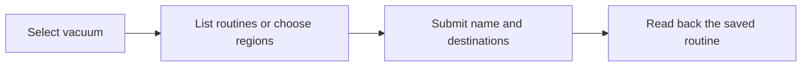

# Saved Cleaning Routines

- Status: Implemented
- Date: 2026-11-24
- Catalog capability ID: saved-cleaning-routines
- Last verified: 2026-11-24
- Owners: ha-roomba-home maintainer
- Scope: List, create, update, and remove a Roomba Home routine for one associated vacuum.
- Related issues/PRs: Interactive map and app feature coverage.
- Required review gates: product, UX, architecture, testing, documentation, and security/operations
- Open decisions blocking readiness: Provider launch semantics for replay, multi-robot, and unsupported routine variants.

## 1. Executive summary

Manage saved Roomba Home routines from Home Assistant actions. Save room or
zone selections with cleaning preferences and confirm each change through an
independent read from Roomba.

## 2. Problem, current behavior, and evidence

Earlier integration actions manage weekly schedules and can start a selected
region. Roomba Home also stores reusable routines in its edition 1 favorites
collection. A disposable one-room routine was created, renamed, updated with
a different suction setting, and removed through that collection. The
provider assigned its own ID.
[API and validation](../docs/api.md#saved-cleaning-routines)

## 3. Actors, surfaces, and terminology

The operator uses the vacuum's Home Assistant actions to manage its saved
routines. A routine is a stored start command. A weekly schedule has a
calendar trigger and may carry an independent copy of a routine.

## 4. Goals, non-goals, and fixed invariants

- ROUTINE-01: List recognized saved routines for the selected robot.
- ROUTINE-02: Create an ordered routine on one current map and validate each profile.
- ROUTINE-03: Rename an existing routine or replace its regions and settings.
- ROUTINE-04: Confirm removal through an independent read.
- Saving, updating, and removing a routine leave the robot's movement state alone.
- Routine launch and multi-robot or replay-specific writes require separate protocol evidence.

## 5. Current versus proposed product journey

Text equivalent: Select a vacuum, list its routines or choose regions, submit
the change, and inspect the result read back from Roomba.

## 6. Functional behavior and state model

List typed one-robot start routines and omit deleted, hidden, or unsupported
records. Default routines are read-only. Creation validates a printable name
and up to 32 ordered, distinct regions. A single exact match is idempotent.
An ambiguous match stops before writing. Updates read the current document
and preserve unmodified provider fields. A replacement uses the active map
revision and invalidates prior time estimates. Removal checks the original
identity in the full provider collection.

## 7. User-facing configuration

Use the existing integration account and select a supported vacuum. Provide a
name and region list for creation, or a listed ID and changed fields for an
update. Each region can supply a mode and compatible preferences. The robot's
next-cleaning preferences supply values for omitted fields.

## 8. Clean Architecture design

The core validates and projects favorite documents. The cloud client owns
signing, edition selection, mutation, and reconciliation. The coordinator
validates current map and profile capabilities under the account I/O lock.
Home Assistant resolves entity permissions and exposes typed actions.

## 9. UI/UX and content contract

The Actions screen distinguishes saved routines from weekly schedules.
List results include an ID, name, region identifiers, and whether the routine
is editable. Show a distinct failure when a save cannot be confirmed.

## 10. Failure, recovery, and cleanup

A read-back follows uncertain transport failures without a second mutation.
Rate-limited calls respect the provider delay. A stale region replacement is
rejected before writing. A rename preserves targets and settings, including
provider fields outside the integration's control.

## 11. Security, permissions, and privacy

Require Home Assistant entity permissions and validate the selected robot's
association before accessing the account collection. Keep raw provider
payloads, names, and map IDs out of diagnostics and published fixtures.

## 12. Observability and operational UX

Return confirmed actions with the provider's routine ID. Log only error
classes. An unconfirmed result directs the operator to list routines again
before retrying.

## 13. Compatibility, migration, rollout, and rollback

Existing integration configuration and weekly schedule identifiers carry
forward. The added actions start with Max 700 evidence and safely reject
unrecognized routine records. Removing the integration leaves saved routines
available to Roomba Home.

## 14. Testing strategy and numeric budget

Exercise signed paths, edition queries, assigned IDs, account scoping, a
name-only update, target replacement, idempotency, and ambiguous writes with
synthetic fixtures. Verify creation, update, and removal against one
disposable routine on the authorized account. Require the existing 100%
statement and branch coverage gate.

## 15. Documentation and discoverability

Link the Actions setup and examples from the README. Keep the evidence for
saved routines and scheduled cleaning independently identifiable.

## 16. Acceptance scenarios

1. List the selected robot's editable routines.
2. Save a one-room routine and confirm its assigned ID.
3. Send the same create request and receive the existing routine.
4. Rename the routine and replace its cleaning settings.
5. Remove only the created routine and confirm existing routines are retained.

## 17. Requirements traceability

| Requirement | Implementation | Verification |
|---|---|---|
| ROUTINE-01 | [Favorite projection](../custom_components/roomba_home/core/routines.py) | Foreign and unsupported routine fixtures |
| ROUTINE-02 and ROUTINE-03 | [Cloud client](../custom_components/roomba_home/core/client.py) | Signed API tests and verified disposable write |
| ROUTINE-04 | [Home Assistant actions](../custom_components/roomba_home/services.py) | Read-back, ambiguity, and action integration tests |

## 18. Implementation sequence

Verify the wire contract, add the pure parser, implement safe client
mutations, and connect the scoped actions. Validate the complete lifecycle
and document its limits. A future dashboard editor may build on these
actions once the edit form and routine launch semantics are verified.

## 19. Definition of Done

- [x] Verify edition-aware list, create, update, and remove API operations.
- [x] Test failures, scoping, and absence of movement in Home Assistant.
- [ ] Verify installed actions against the authorized household account.
- [x] Record the remaining unsupported routine variants.

## 20. References and decisions

[Provider API](../docs/api.md#saved-cleaning-routines) ·
[Usage](../docs/usage.md#saved-cleaning-routines) ·
[Map and zone editor](009-map-zone-editor.md)
